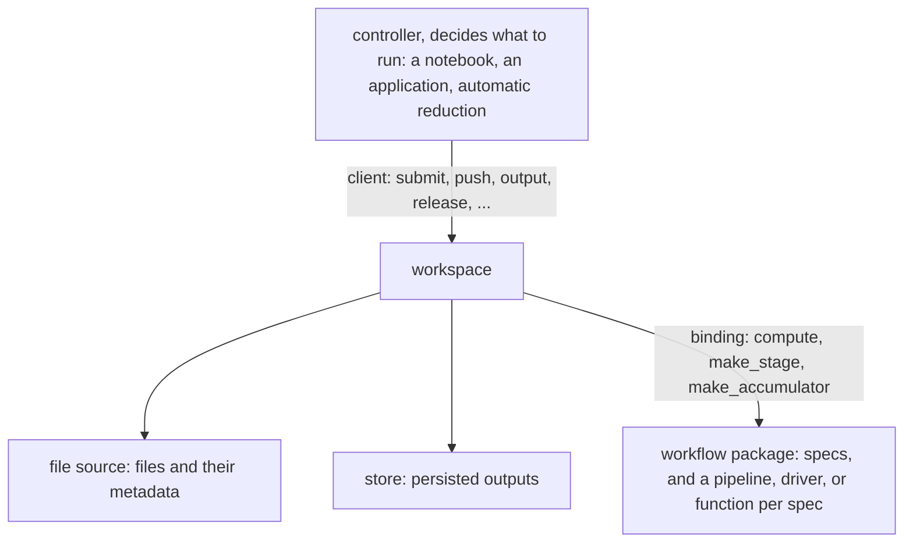

# ESS data-reduction framework

For a developer new to this repository.
After reading you know the components of the framework, the ideas that client code is built from, and where to read further.

| To learn | Read |
|---|---|
| the architecture, as a crash course | [tours/layers.html](tours/layers.html) |
| how to write a workflow, a client, or the framework | [roles/](roles/README.md) |
| how to write a spec | [packages/essspec/docs/params.md](../../packages/essspec/docs/params.md) |
| how to write a binding | [packages/essspec/docs/bindings.md](../../packages/essspec/docs/bindings.md) |
| stages and accumulators | [accumulators.md](accumulators.md) |
| automatic reduction | [automatic-reduction.md](automatic-reduction.md) |
| which process holds what | [deployments.md](deployments.md) |
| how to build an application that reduces many samples | [packages/essbatch/docs/batch.md](../../packages/essbatch/docs/batch.md) |
| what each call of a workspace guarantees and raises | [`ess.apps.protocol`](../../packages/essapps/src/ess/apps/protocol.py) |
| the shapes and shortcuts of the client | the docstrings of `ess.apps.client` |
| how the code is built | the module docstrings |
| why it is so | the [ADRs](adr/index.md), and those of [essspec](../../packages/essspec/docs/developer/adr/) |
| what it must do | [the requirements](../requirements/README.md), [user-stories.md](user-stories.md), [system-stories.md](system-stories.md) |
| how other systems do it | [prior-art/](prior-art/README.md) |
| how to write docs pages, docstrings, comments and messages | [writing.md](writing.md) |

## From a for loop

A notebook without the framework:

```python
curves = {}
for run in (60339, 60340, 60341):
    curves[run] = reduce_iofq(run, can=60338, transmission=transmission, bins=100)
```

The same with the framework:

```python
records = {}
for run in (60339, 60340, 60341):
    records[run] = client.submit(IOFQ, params={'reduction': Reduction(bins=100),
                                               'sample': file(run=run),
                                               'can': file(run=60338),
                                               'transmission': t.ref('transmission')})
client.wait(records)
client.output(records[60339], 'iofq')
```

`IOFQ` is the *spec* of the I(Q) reduction: it names the reduction's parameters and outputs.
`file(run=run)` names the raw data of a run.
`t` is the record of an earlier transmission reduction, and `t.ref('transmission')` passes its output to each reduction.
`client.submit` returns a *record* at once, and the workspace runs the three reductions in the background.

What the framework adds to the plain loop:

- Each call is stored as a record. The same process finds it later, and so does a later process that opens the same folder.
- Output values stay in memory until a client releases them, and every client of the workspace reads them. Persisted values are stored on disk.
- Requests run on worker threads of the workspace's process, one thread by default (`workers=1`). Where they run is the workspace's decision.
- Every output can answer where it came from: which spec, which parameter values, which files.

## Components

An arrow points from a caller to what it calls, and its label names the interface:



The framework is two packages ([ADR 0007](adr/0007-packages-split-by-dependencies.md)).
`ess.spec` holds what a workflow package needs: specs, bindings, and checks for tests.
`ess.apps` holds the client, the workspace, and parts that applications are built from, such as the forms of `ess.apps.panel`.

**Spec.** A workflow package declares a spec, `ess.spec.WorkflowSpec`, for each workflow: a name, a version, and two pydantic models, *params* and *outputs*.
The spec is all that a client, a form, and the workspace know of a workflow.
None of them imports the workflow's code.
A parameter is written inline, as a file, or as a reference to another record's output, as its type allows ([params.md](../../packages/essspec/docs/params.md)).

**Binding.** A *binding* is what the workspace calls to compute a spec's requests.
The workflow author makes it from one of three things, and each serves some of the client's calls:

| The author provides | Plain request | Stage | Accumulator |
|---|---|---|---|
| a sciline pipeline, `PipelineBinding` | yes | yes | no |
| a driver, `DriverBinding` | yes | no | yes |
| a function, `function_binding` | yes | no | no |

The binding receives an instance of the params model and returns an instance of the outputs model.
In the instance, each file is a local path, and each reference is replaced by the data it refers to.
The binding must not modify its input, and must not return an output that shares memory with it.
[bindings.md](../../packages/essspec/docs/bindings.md) shows how to write each.

**Workspace.** The *workspace* of a proposal (an experiment at ESS) runs its requests, and holds its records and output values.
A Mantid workspace, a data object, is an output value here.
The *history* of a workspace is the log of its records.
A workspace and its clients live in one process.
`local` and `open_folder` create a workspace and its first client:

```python
client = local(proposal='p1', files=..., bind=[iofq, ...])   # history and values in memory
client = open_folder(directory, bind=[iofq, ...])            # history and persisted outputs in a folder
```

Both run the workflows bound in the call, which may be code defined in a notebook.
With `local`, the records end with the process.
With `open_folder`, a later process continues from the folder's history and reads its persisted outputs.
One workspace holds a folder at a time.
The workspace decides when and where a request runs, and the caller's code does not depend on it.

**Client.** A *client* is one connection to one workspace.
A client holds no values: every client of a workspace reads, references, and releases the same values.
Every call that starts work returns once the workspace has *logged* it in its history. The work happens later.

**File source.** The workspace finds files and their metadata through its *file source*, given when the workspace is created.
At submission it resolves a name, such as `file(run=60339)`, to the file's *identity*, which the record holds ([ADR 0010](adr/0010-a-file-is-identified-by-its-catalogue-identifier.md)).
A client sees only the files that the workspace's proposal may read:

```python
samples = client.files.list(Selector(role='sample'))
for run in client.files.watch(Selector(scan='17')): ...   # existing ones first, then new ones
```

**Store.** The *store* holds persisted outputs outside the workspace's memory, also after the workspace has closed.
A record names its spec by name, version, and digest.
A record is *of the bound spec* if the workspace runs a spec with the same three, and else *of an unbound spec*, such as an older version.
An output of a record of an unbound spec is read as stored scipp data, and a new request may not reference it ([ADR 0009](adr/0009-a-record-of-another-spec-stays-readable.md)).

**Controller.** The workspace does not decide what to run.
A *controller* is client code that decides over time what to submit, push, and release, such as the cells of a notebook, the callbacks of an application's screen, or the loop of automatic reduction.
A controller calls the workspace only through a client:

```python
for run in client.files.watch(Selector(role='transmission')):
    record = client.submit(TRANSMISSION, params={'run': run, 'empty_beam': file(run=60336)})
    show(client.output(record, 'transmission'))
```

## Requests and records

A *request* is a spec and its params.
Submitting it returns a *record*: the request as the workspace logged it, with every value filled in, defaults included.
A record never changes, only its status: `pending`, then `completed`, `failed`, or `cancelled`.
Running the same request again creates a new record.

```python
result = client.compute(IOFQ, params={...})          # submit, then wait
client.output(result, 'iofq')                        # raises RecordFailed if the record failed
client.output(result, 'iofq', select={'Q': slice(0, 10)})   # copies a part
client.describe(result, 'iofq')                      # {'iofq': ArrayInfo(sizes, unit, coords)}, no data
client.failure(result)                               # why it failed, or None
```

`submit` checks a request before any data is read, and raises a `SubmitError` that names the position of each problem, such as `reduction.bins`.
A failure when the workspace reads the data and calls the binding fails the record ([params.md, When values are validated](../../packages/essspec/docs/params.md#when-values-are-validated)).

`client.resolve` returns a request as its record would hold it, and logs nothing.
So a request is compared with a record's request once resolved:

```python
resolved = client.resolve({'250K': request_250k, '260K': request_260k})
resolved['250K'] == client.latest('iofq', member='250K').request   # the record ran these values
```

**References.** `record.ref(name)` refers to an output of a record.
A reference to a pending record is allowed, so a chain is submitted without waiting.
The workspace runs the request once the record it reads has completed:

```python
centre = client.submit(BEAM_CENTRE, params={'direct_beam': file(run=60330)})   # pending
result = client.submit(IOFQ, params={..., 'beam_centre': centre.ref('centre')})
```

A reference fills only a field that the spec types `Referenced[T]`, and the output must be a `T`.

**Labels and members.** A *label* names a sequence of records, such as all I(Q) reductions of an experiment, and a *member* one part of it, such as one sample.
Both are given at submission, outside the request:

```python
client.submit({'250K': request_250k, '260K': request_260k}, label='iofq')   # keys become members
client.latest('iofq', member='250K')
client.records(label='iofq')                         # oldest first
```

**Templates.** A *template* is a spec with *fixed values* for some parameters and *blanks* for the others.
Stages, accumulators, and batches are built from templates.
A template can be made from any record, such as the final reduction of one sample with its sample left open:

```python
final = client.latest('iofq', member='250K')
beamtime = Template(final.request.spec, params=final.request.params, blanks=('sample',))
```

## How long a value lives

A record is stored with the workspace's history.
An output value lives while the workspace holds it in memory, a pending request reads it, or the store holds it.
The workspace holds a value until a client releases its record, or the workspace closes.
A release by one client applies to every client of the workspace.
Work whose outputs nothing would hold is cancelled.
[`ess.apps.protocol`](../../packages/essapps/src/ess/apps/protocol.py) states the rules.

```python
client.release(centre)              # the workspace drops the centre, for every client
client.submit(IOFQ, params={...}, persist=('iofq',))  # the store holds iofq, the workspace does not
```

## What changed

A client that shows records, or reacts to them, asks which records changed since a position in the workspace's history, and reads only those.
A record changes when it is submitted, by any client of the workspace, and when it finishes.
The reply holds record IDs and no values, each ID once:

```python
cursor = 0                                  # 0 returns every record of the workspace
while True:
    changes = client.changes(after=cursor, timeout=30)  # waits up to 30 s for a change
    cursor = changes.cursor                 # pass it next time
    for record in client.records(ids=changes.records):
        show(record, client.status(record), client.readable(record))
```

A release does not appear in the changes, since the history holds no lifetimes.
So a client that shows outputs asks `client.readable` for the records it shows, and a read can still raise `NotReadable`.
It asks `client.bound(records)` which records are of the bound spec, since only their outputs have the classes of `client.spec(record.spec)`.

## Stages and accumulators

A *stage* holds the part of a computation that depends only on its fixed values, so that tuning a parameter does not load the runs again.
An *accumulator* holds a sum over runs, so that adding a run does not reduce the earlier ones.
A call through a stage, and a freeze of an accumulator, create the record of the equivalent plain request ([accumulators.md](accumulators.md)):

```python
volume = client.accumulator(Template(VOLUME, blanks=('runs',)))
for run in islice(client.files.watch(Selector(scan='17')), 300):
    volume.push(runs=[run])                                 # one more run in the sum
    show(client.output(volume, 'volume', select={'q': 0}))  # the sum so far
total = client.freeze(volume)                               # the final sum, as a record
```

## Automatic reduction

Automatic reduction is Follow on a batch of `ess.batch`.
A step every few seconds adds the new rows of the batch's row source, and reduces the ready rows that have no result ([batch.md, "Follow"](../../packages/essbatch/docs/batch.md#follow), [automatic-reduction.md](automatic-reduction.md)).

## Provenance

```python
provenance = client.provenance(result)
provenance.request, provenance.records(), provenance.files()
```

Provenance lists the record's request, every record that supplied a value by reference, directly or through other records, and the files they used.
It stops at files.
`ess.apps.scicat` publishes an output to SciCat as a derived dataset, whose inputs are the files of its provenance.

## Left to the system

Not visible in the code of notebooks, applications, or workflow packages:

- how history and outputs are stored, moved, and dropped
- how a file source finds the file that a run number or path names
- when and where a request runs, and where a stage or a driver lives
- the format of persisted outputs and the store's layout
- how access across proposals is enforced
