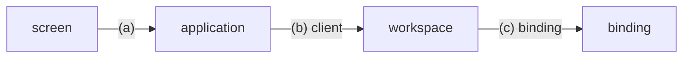
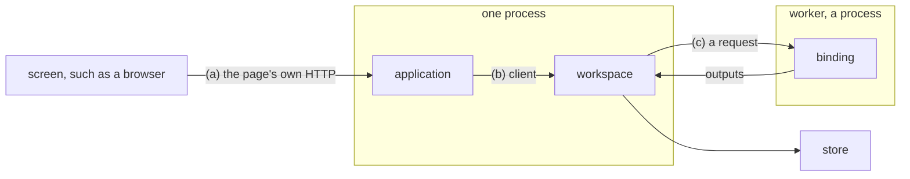

# ADR 0014: A process boundary goes between the workspace and its workers, not between a client and the workspace

- Status: proposed
- Deciders: Simon
- Date: 2026-11-24

## Context

*Application*, *screen*, *client*, *workspace*, *binding*, and *store* are the words of [README.md](../README.md#components).
(a), (b), and (c) are the boundaries of [deployments.md](../deployments.md):



In every deployment of the first release, one Python process holds the application, its client, the workspace, and the bindings, which run on threads.
One process has limits ([README, open question 10](../README.md#open-questions)):

- A workflow shares the interpreter lock, the memory, and a crash with the application.
- A workflow that has started cannot be stopped ([system story D3](../system-stories.md)).
- Work larger than one machine needs a cluster ([system story D2](../system-stories.md)).

So some deployment will need a second process, and it can go to (b) or to (c).
The design so far named (b): a *hosted workspace*, which clients in other processes reach with `connect()` over HTTP ([ADR 0007](0007-packages-split-by-dependencies.md)).

| | A boundary at (b) | A boundary at (c) |
|---|---|---|
| A value | crosses at every read: each plot, each `select=`, each `describe` | crosses once, when the workflow returns |
| Calls that need a form on the wire | the 20 of `WorkspaceProtocol`, some of which wait | run a request, and later the calls of a stage and of an accumulator |
| The model classes of a spec | a client without the spec modules, such as a web frontend that is not Python, needs the spec as plain data and a second builder of forms | both sides import them |
| Keeps workflow code out of the application's process | no: a hosted workspace needs workers too | yes |

An application reads a value many times, as a person moves a slider or opens a page.
Measured on LoKI data, reading a cut of a value held in another process takes about 25 ms, against 0.1 ms in the same process (scipp/essapps#184).

## Decision

**The application, its client, and the workspace stay in one process.**
**Work that must run elsewhere goes to *workers*: processes that import the bindings and compute the requests that the workspace gives them.**
**No client reaches a workspace in another process.**

A worker here is a process.
The `workers=` of a workspace today counts threads.



What crosses (c) for a plain request:

```text
workspace -> worker    the record's ID
                       the spec's name, version, and digest
                       the params, in the JSON form that the record holds
                       the local path of each file
                       each referenced value (Open: how)
worker -> workspace    completed or failed, and the outputs
```

- **The workspace checks and logs, and the worker computes.** The request phase stays in the workspace. The call phase moves to the worker: it validates the params by the params model, with the paths and the referenced data, and calls the binding (`ess.spec.validation`).
- **Both sides import the spec.** A worker has each spec from its binding. When it starts, it tells the workspace the name, version, and digest of each, and the workspace gives it only requests of a spec with the same three. No spec crosses as plain data.
- **A value crosses in the store's format.** scipp data cannot be pickled, and the store has a format (`ess.apps.hdf5`). So every output of a spec that runs in a worker needs a stored form, where today only a persisted output does.
- **An output moves to the workspace once.** The workspace keeps it by the rules of [ADR 0002](0002-a-value-lives-while-something-keeps-it.md), and the application reads it in its own process.
- **Threads stay.** A workspace without workers runs its bindings on threads. A binding defined in a notebook runs only so, since a worker cannot import it. Where a request runs changes nothing that a client sees.

## Alternatives considered

- **The boundary at (b), a hosted workspace.** The table of the Context. It also leaves (c) to be built, for the workers of the service.
- **Both boundaries.** With workers at (c), a boundary at (b) would serve only people in different processes who share one history and its values. A value passes between workspaces as a file ([deployments.md](../deployments.md#one-proposal-several-histories)), and people who use one served application share its process.
- **A pool of processes with pickled arguments**, such as `ProcessPoolExecutor`. scipp data cannot be pickled, and a pool cannot send a call to the worker that holds a stage or a driver.

## Consequences

- Nothing is built by this decision. Measured on LoKI data, worker processes give 1.4 to 1.9 times on plain requests and lose to a stage in the workspace's process (scipp/essapps#184). They are built when a deployment needs their isolation. A process that runs without a person, such as the automatic reduction, is the likely first.
- Of ADR 0007, these are not built: `ess.apps.http.server`, `ess.apps.http.remote` with `connect()`, the `--url` of the command-line tool, and a web frontend that is not Python. What ADR 0007 says of them is replaced by this.
- `SerializedWorkflowSpec` and `WorkflowSpec.serialize()` have no reader left, and are removed ([essspec ADR 0001](../../../packages/essspec/docs/developer/adr/0001-minimal-workflow-spec.md), "Two forms, one-way projection"). This is decided and not done. The request type stays: it validates a request and gives a form the sources of each field.
- A form is built from the model classes only (`ess.apps.fields`). No builder of forms from a JSON schema is needed.
- The digest of [ADR 0009](0009-a-record-of-another-spec-stays-readable.md) gets a second use: it finds a worker whose environment has other models than the workspace's.
- The application's environment needs an instrument's spec modules, and only a worker's needs the workflow package. `ess.instruments.loki` is split so: `specs` needs no workflow package, and `bindings` needs the extra `[loki]`.
- A batch that runs overnight (system story D2) needs the application's process on a machine that stays up, with or without a screen. No client connects to it later: the next day's process opens the same folder.
- The questions that a hosted workspace raised stay for a process that several people use, or that runs without a person: whether they share the values in memory, how the memory is bounded, and when an idle workspace closes (ADR 0002, Open).

## Open

- **How a referenced value reaches a worker.** A value that the workspace keeps only in memory would be written once more for each worker that reads it. If a worker writes every output to a file and the workspace reads it from there, a value moves once, but "kept in memory" and "persisted" (ADR 0002) are then no longer two things.
- **Stages and accumulators.** Their state lives in one worker, so their calls go to that worker, and the rows of one stage run there. A state of hundreds of GB does not move to the workspace: `client.output(acc, select=...)` reads a part from the worker, at the cost measured above.
- **How workers start**: as subprocesses of the workspace or as cluster jobs, and in which environment.
- **Stopping started work.** A worker can be ended, which a thread cannot. Open are whether `cancel` ends it, and what becomes of a stage that the worker holds.
