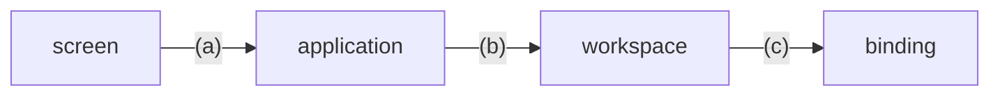
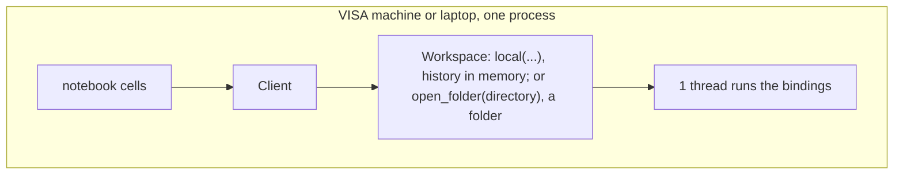
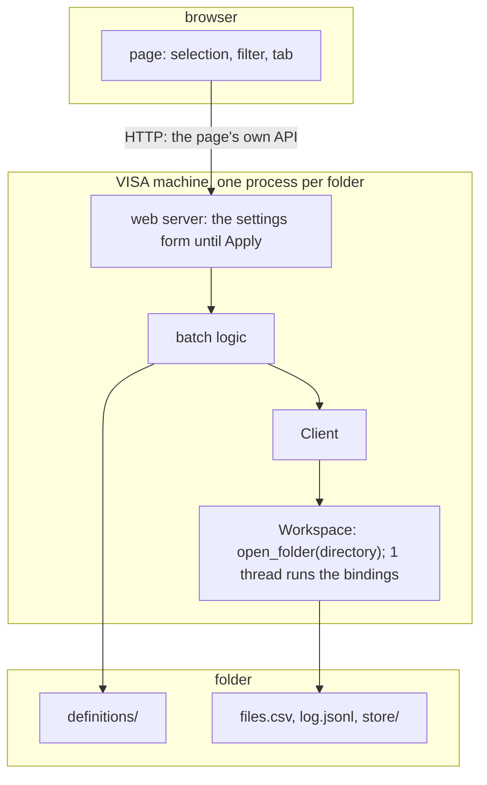
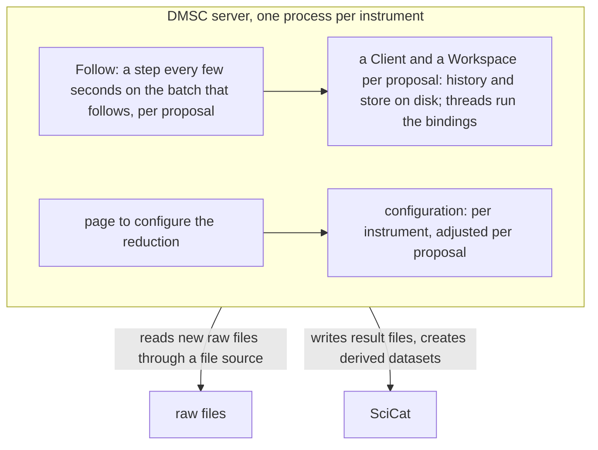
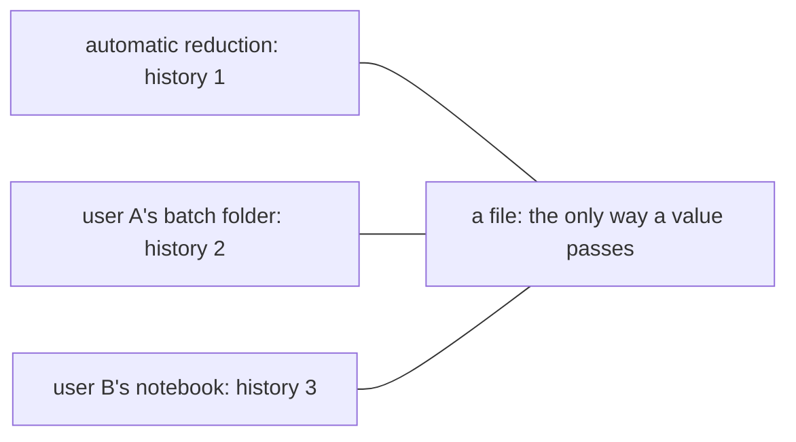
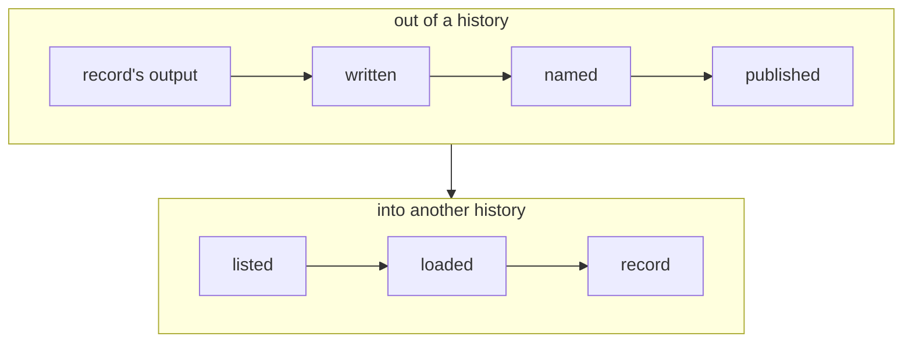

# Deployments: which process holds what

For a developer who places a component or draws a boundary between processes.
After reading you know which process holds the application, the client, the workspace and the bindings in each deployment, and how a value passes between workspaces.

The terms *workspace*, *client*, *controller*, *binding*, and *history* are defined in [README.md](README.md#components).
An *application* is a program that holds a client: a controller, and a *screen* if a person uses it.
In each deployment of the first release, one Python process holds the application, its client, and the workspace:

| Boundary | Interface | Between two processes? |
|---|---|---|
| (a) screen to application | the application's own: HTTP, or the widget library's channel | yes, when a browser draws the screen |
| (b) application to workspace | the client | no |
| (c) workspace to binding | `Binding`, `Driver` | no: threads of one process, one by default |

A screen never calls a workspace.
What a screen shows is computed in Python next to the data, and only the result is sent to the screen.
For example, a plot function returns a figure, and a form is built from the spec's params model.
So the client is an interface for Python code, and the HTTP interface of a page belongs to that page.

## Notebook

An arrow points from a caller to what it calls:

An application of widgets in a notebook is the same case: its controller runs in the notebook's process, and the browser only draws the widgets.

## Technique application with a batch page

An arrow points from a caller to what it calls or writes:

The page holds only what it shows, and every rule is in the Python process.
The command `essbatch` opens the same folder when the application is not running.
Two users of one proposal have two folders.

## Automatic reduction

What the process holds, and what it reads and writes outside:

An instrument has one stream of new files, so it has one automatic reduction.
The process holds a workspace for each proposal that has new files.
It runs with no page open, and users find its results through SciCat.
A scientist who needs a variant of the automatic reduction runs a batch.

## One proposal, several histories

A workspace holds one proposal.
A proposal has several workspaces, each with its own history: one in the automatic reduction, and one for each folder or notebook of a user.

A reference refers to a record of the same history.
So a batch of user A cannot reference the beam centre that the automatic reduction computed, and two users of a proposal do not see each other's records.
A value reaches another history as a file:

| Step | What happens |
|---|---|
| written | a writer turns an output into a file, such as NXcanSAS for a SANS curve |
| named | the file gets a folder and a name |
| published | SciCat gets a derived dataset, with its input datasets and software |
| listed | a file source lists the file with a kind, such as `mask` |
| loaded | a spec reads the file and returns the value as an output |

The inputs that instrument scientists prepare for later proposals, such as masks and calibrations, take the same path.
