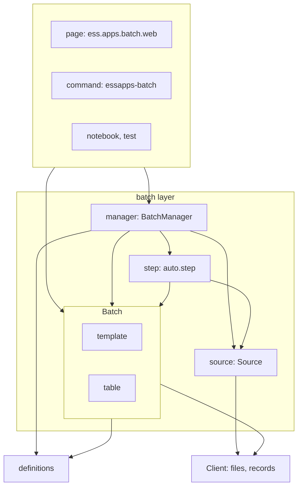
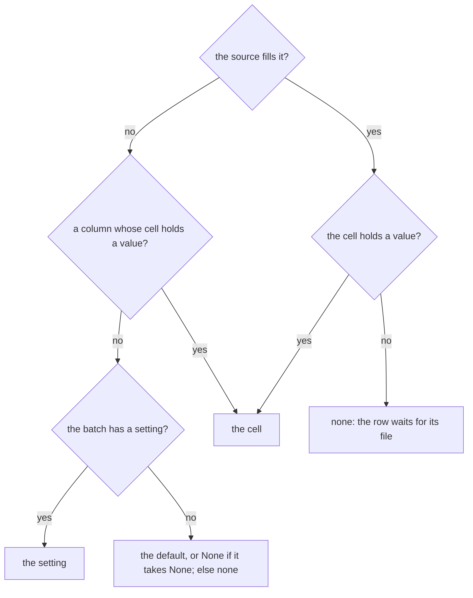
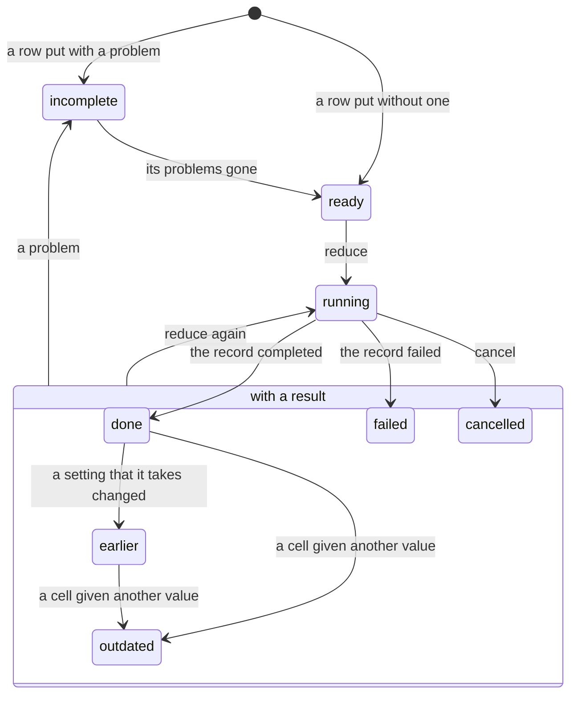
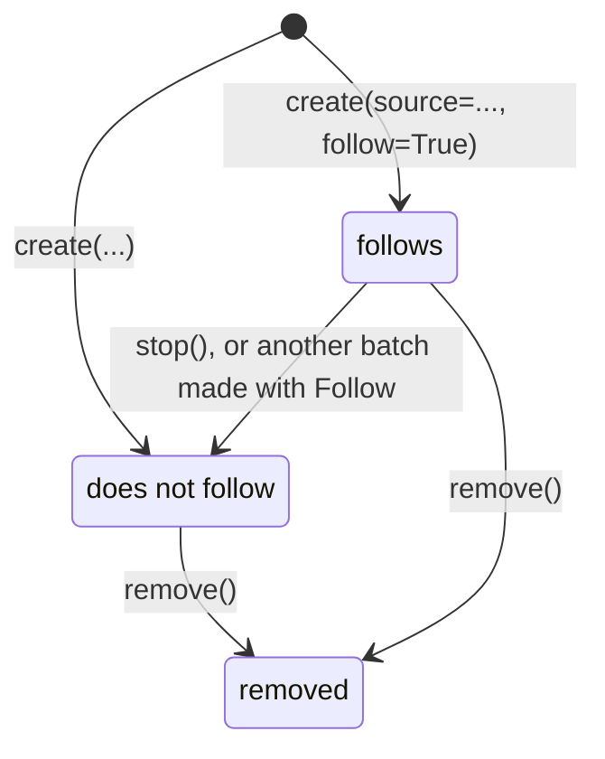
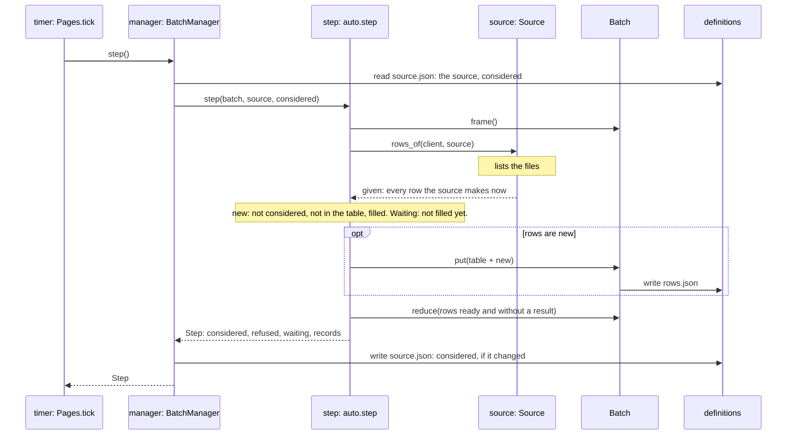

# Batch toolbox for application developers

`ess.apps.batch` reduces one spec for many samples: a table of rows, settings shared by all rows, and the result of each row.
It is built on the client of `ess.apps`; [the client guide](../../../docs/developer/roles/client-authors.ipynb) explains specs, records, labels and stages.
It needs `essapps[files]` (pandas).
The decisions behind it are [ADR 0012](../../../docs/developer/adr/0012-a-batch-is-a-table.md) (a batch is a template and a table) and [ADR 0013](../../../docs/developer/adr/0013-follow-adds-the-rows-not-considered.md) (Follow adds the rows not considered).

## The system on one page

### Picture

Who calls whom; an arrow points from a caller to what it calls:



Not drawn: the page lists the runs, and the manager finds the specs bound, through the client.
Nothing in the batch layer imports the page or the command.
`table` and `state` are functions on plain data, which any part may use.

| Component | Code | Owns |
|---|---|---|
| table | `table.py` | the form of a table: dtypes, cells, cell to request value and back, `rows.json`, table files |
| source | `source.py`: `Source`, `rows_of` | the code of the application that makes rows from the files |
| batch | `reduction.py`: `Batch` | the template and the table of one label: `put`, `state`, `reduce`, `cancel`, and `version`, which moves when the table, the template or a record changes; the only part that submits to the client |
| state | `state.py`: `RowState`, the rules | where each row stands; the rules are functions from the states of rows to keys |
| step | `auto.py`: `step`, `Step` | one step of Follow on one batch: add rows of the source, reduce rows |
| manager | `manager.py`: `BatchManager` | the batches of a workspace: make, list, change, remove; which batch follows; `considered` |
| definitions | `definition.py`: `DefinitionStore`, `FolderDefinitions` | what a workspace keeps besides files and records (table below) |

### Terms

| Term | Definition |
|---|---|
| workspace | a `Client` (specs bound, files, records) and the definitions; one folder |
| label | the name of a batch, and the label of its records |
| batch | a label with a header (title, description), a template and a table |
| template | an `ess.apps.Template`: a spec, the settings but those at the columns, and the blanks, the columns, which each row fills |
| setting | the value of a parameter for the batch: an entry of `batch.settings`; every row takes it at a parameter that is no column, and a row whose cell is empty at a column |
| table | one `pandas.DataFrame`: the key as index, columns, and notes |
| row | one line of the table: a key and a cell in each column and note |
| key | the text that names a row, unique in the table; the member of the row's records |
| column | a column of the table named as a parameter of the spec, a parameter that a row may give itself; the columns are the blanks of the template |
| note | any other column of the table, such as `run` or `name`; shown, never part of a request |
| cell | one value of a row in a column or a note, or empty; plain data such as `'run:60339'`, `2.0`, `['run:1', 'run:2']` |
| value of a parameter for a row | its cell; if the cell is empty or the parameter is no column, the setting; if the batch has none, the default of the parameter; but at a column that the source of the batch fills, the cell only |
| request of a row | the template filled with the value of each column for the row |
| result of a row | the newest record under the label with the row's key as member |
| state of a row | its result, the status of the result, its problems, and where its request differs from that of its result |
| outdated | a result whose request differs from the row's request now, or that is of another spec |
| earlier | a completed result whose request differs from the row's only at settings: at parameters that are no column, or where the row's cell is empty |
| source | code of the application that makes a table from the files (a `Source`) |
| filled, waits | a row of the source is filled once it has a value in each of `Source.fills`; until then it waits |
| considered | the keys of the source that a batch made from it has taken or left out |
| Follow | a step every few seconds on one batch: add the rows of its source that are filled and not considered, then reduce the rows that are ready and have no result; chosen when the batch is made, until it is stopped |

### Rules that always hold

1. **Only `put` changes a table.** A person on the page, the command, `take` and a step each build a table and call `batch.put(table)`. A `put` of an equal table writes nothing.
2. **The columns are the blanks.** `put` makes the columns of the table the blanks of the template. Nothing else says which parameters are columns.
3. **A cell overrides the setting for its row.** The value of a parameter for a row is its cell; if the cell is empty or the parameter is no column, the setting; if the batch has none, the default (diagram in [The request of a row](#the-request-of-a-row)). A setting at a column stays in `batch.settings` and in `settings.json`, and is left out of `batch.template()`, since a template cannot fix a value that each row fills. In a batch made from a source, a column that the source fills takes its value from the cell only: an empty cell there means that the row waits for its file, and the row is incomplete, whatever the settings hold and whatever the default of the parameter is.
4. **A cell is plain data, converted in one place.** `table.as_request` turns cells into request values; `table.cell_of` turns a request value into a cell.
5. **A column has the dtype of its parameter.** A cell of another kind is refused where it enters the table, with a `ValueError` that names the key and the column.
6. **The state is computed, never kept.** It is read from the records each time. Each rule (`ready`, `not_reduced`, `left_to_reduce`, `earlier_settings`, `to_reduce`) is a function from the states to keys.
7. **A step never changes a row that the table has.** It adds rows, and reduces rows that have no result.
8. **Each kept file has one writer** (table below).
9. **A batch is shown without its source and without the files.** A file that is not found is a problem of its row.
10. **The rules are in the batch layer.** A refusal is a `ValueError`. The page and the command show it and copy no rule. The batch layer has no lock and no timer.
11. **Follow is chosen when a batch is made.** A batch follows from `create(..., follow=True)` until `stop()`, its removal, or the making of another batch that follows. A batch that does not follow cannot be made to follow.

### What is kept on disk

| File | Content | Writer |
|---|---|---|
| `definitions/labels/<label>/header.json` | `{"title": ..., "description": ...}` | manager |
| `definitions/labels/<label>/settings.json` | a template file without blanks: the spec, and the settings in `params`, those at the columns too | `Batch` |
| `definitions/labels/<label>/rows.json` | `{"schema": ..., "data": [{"key": "60339", "sample": "run:60339", ...}]}` | `Batch.put` |
| `definitions/labels/<label>/source.json` | `{"source": "sample-runs", "considered": ["60337", ...]}`; only for a batch made from a source | manager |
| `definitions/following.json` | `{"label": ...}` or `{"label": null}` | manager |
| `definitions/corrections.json` | metadata of files set by hand | `CorrectedFiles` |
| `store/`, the log | the records | the workspace |

A label is a batch if and only if `header.json` exists.
`create` writes settings, rows and source, then the header, then `following.json` if the batch follows.
`remove` writes `following.json` first if the batch follows, then deletes the header, then the rest.
Blanks in `settings.json` are not read: the columns of `rows.json` are the blanks.

## One example followed through

An afternoon at LoKI.
The spec `loki-iofq` has, among others, the parameters `sample` and `sample_transmission` (files) and `thickness: float = 1.0`.
The source `sample-runs` (`SAMPLE_RUNS` in "Writing a source") makes one row per sample run and fills `sample` and `sample_transmission`.

**1. A batch is made from the source.** Runs 60337 to 60340 are listed, each with its transmission run.

```python
manager.rows_of('sample-runs')        # what the source makes now
#        run    name      sample     sample_transmission
# key
# 60337  60337  water     run:60337  run:60305
# ...
# 60340  60340  sample A  run:60340  run:60306
label = manager.create('loki-iofq', title='Afternoon', source='sample-runs',
                       choose=lambda given: given[given.run >= 60339], label='afternoon',
                       follow=True)
```

`create` lists the source once and gives `choose` the rows that are filled; `choose` picks some and may add columns.
On disk: `header.json`, `settings.json`, `rows.json` with rows 60339 and 60340, `source.json` with `considered` = 60337 to 60340, and `following.json` with `afternoon`.
Rows 60337 and 60338 are considered and not in the table: they were left out when the batch was made, so Follow never adds them.
A row that waits when the batch is made, such as a sample run whose transmission run is not listed yet, is neither taken nor considered: Follow adds it once it is filled.

**2. A person edits a cell and reduces.**

```python
batch = manager.batch(label)
table = batch.frame()                 # a copy of the table
table.loc['60340', 'sample_transmission'] = 'run:60307'
batch.put(table)
batch.reduce(['60339', '60340'])      # {key: Record}
```

`rows.json` is written again. The records are in the store under the label, with members `60339` and `60340`.

**3. A setting becomes a column.**

```python
batch.settings = {**batch.settings, 'thickness': 1.5}
batch.make_column('thickness')        # empty cells; every row takes 1.5, no row is outdated
table = batch.frame()
table.loc['60340', 'thickness'] = 2.0
batch.put(table)                      # row 60340 is outdated; 60339 still takes 1.5
```

`rows.json` is written with an empty column `thickness`; `settings.json` keeps `thickness: 1.5`.
A row added later, by a step of Follow, by `take` or by hand, takes 1.5 until its cell is set.
`batch.put(table.drop(columns='thickness'))` drops the column, and every row takes 1.5 again.

**4. Follow adds a row once its transmission run is listed.** The page calls `manager.step()` every few seconds.

| | What happens | Table | `considered` |
|---|---|---|---|
| a | sample run 60341 is listed; its transmission run is not | unchanged; `done.waiting == ('60341',)` | unchanged |
| b | transmission run 60342 is listed | 60341 is added and reduced | + 60341 |
| c | a person removes row 60340 | 60339, 60341 | unchanged, so 60340 is not added again |
| d | the transmission of sample 60339 is measured again | unchanged: row 60339 keeps its cell | unchanged |

```python
done = manager.step()        # a Step, or None if no batch follows
done.waiting                 # the keys of the rows that wait
done.refused                 # why rows of this step were refused, by key
done.records                 # the records of the rows reduced, by key
```

In step b, `rows.json` is written first, then `source.json`.

**5. A restart.** The process stops; sample run 60343 and its transmission run arrive meanwhile.

```python
manager = BatchManager(client, sources={'sample-runs': SAMPLE_RUNS}, definitions=definitions)
manager.following            # 'afternoon'
manager.step()               # adds 60343 and reduces it
```

The manager reads the headers and `following.json`.
`manager.batch(label)` reads `settings.json` and `rows.json` and makes the `Batch`.
The results are read from the records, so no row is reduced twice.

**6. The next batch.** In the evening a person wants the runs from 60400 on in a batch of their own.
They make it from the source, with the settings of the afternoon, and with Follow:

```python
label = manager.create('loki-iofq', title='Evening', source='sample-runs',
                       choose=lambda given: given[given.run >= 60400],
                       settings=manager.batch('afternoon').settings, label='evening',
                       follow=True)  # 'afternoon' stops following, and cannot follow again
```

No row moves between batches.
`afternoon` keeps its rows, also those from 60400 on that it added before, until a person removes them.
A batch that follows has no last row: the rows filled between a last row and the making would never be added.
`create` refuses `follow=True` with a `Range` that has a `last` (see [The batches of a workspace](#the-batches-of-a-workspace)).
For a batch of only the rows that arrive from now on, `choose` takes none: `choose=Range(later=True)`.
Every row filled now is then considered, and none is reduced again.

## Writing a source

A source is a function from files to a table, and the columns that it fills:

```python
from ess.apps.batch import FileInfo, Source

def pair_by_sample(files: Sequence[FileInfo]) -> pd.DataFrame:
    samples = [f for f in files if f.metadata.get('role') == 'sample']
    records = [
        {'key': str(f.metadata['run']), 'run': f.metadata['run'],
         'name': f.metadata.get('name'), 'sample': str(f.ref),
         'sample_transmission': partner(f, files)}   # None if none is listed
        for f in samples
    ]
    columns = ['key', 'run', 'name', 'sample', 'sample_transmission']
    return pd.DataFrame.from_records(records, columns=columns).set_index('key')

SAMPLE_RUNS = Source(pair_by_sample, fills=('sample', 'sample_transmission'))
```

- The index is the key, as text. A number as key is refused: write `str(run)`.
- A file is its name, `str(f.ref)`, such as `'run:60339'`.
- `selector` (optional) chooses the files the source is given; raw files if not given.
- `rows_of(client, source)` calls the source on the files listed now. It adds an empty column for each of `fills` that the table lacks, so a batch made on an empty folder still has its columns.
- The page names a row by its note `name` if the table has one, else by its key.
- A source knows no spec. `fits(spec, source)` of `ess.apps.batch.manager` checks that each of `fills` is a parameter of the spec.

A source is plain code on plain data: test it on a list of `FileInfo`.

## Cells and their dtypes

`table.dtypes(spec.params)` gives the dtype of each column:

| The parameter takes | dtype | A cell |
|---|---|---|
| a file, an output, a file or an output; text, a `Literal` or an enum of text, a time, a date | `string` | `'run:60339'` |
| a number | `Float64` | `2.0` |
| a whole number | `Int64` | `3` |
| a truth value | `boolean` | `True` |
| a list, a group, a value or an output, anything else | `object` | `['run:1', 'run:2']` |

`| None` does not change the dtype.
A parameter that takes text or an output is refused, since a cell cannot tell the two apart.

Nothing converts a cell: `'2'` and `True` are not numbers.
One exception: an `Int64` column takes a float that is a whole number, since pandas gives whole numbers with a gap as floats.
A note gets the dtype of `convert_dtypes()`, which must be one of the five.
In the table an empty cell is `pd.NA` (`None` in an `object` column); in `rows.json` and in `to_dict('index')` it is `None`.

`as_request` converts a cell at a parameter that takes:

```python
# a file
'run:60339'      -> FileRef(file='run:60339')
60339            -> FileRef(file='run:60339')        # a whole number is a run
# an output
'r17.centre'     -> OutputRef(record='r17', output='centre')
'r18.slices[2]'  -> OutputRef(record='r18', output='slices', key='2')
# a file or an output: text with a kind ([a-z]+:) is a file, other text an output
# a list of these: each element
# anything else, a file inside a group too: the cell as it is
```

`cell_of` is the inverse: a `FileRef` or an `OutputRef` gives its text, anything else its JSON form.

## The request of a row

The value of a parameter for a row:



A parameter without a value is the problem `empty` of the row: it is incomplete.
"The source fills it" is asked of `batch.fills`, kept with the batch (below); each of them is a column.
In code:

```python
template = Template(spec, params=settings, blanks=columns)  # batch.template(): drops the settings at columns
row = rows[columns].loc[[key]].to_dict('index')[key]       # each cell of its type
cells = as_request(model, {c: v for c, v in row.items() if v is not None})
for c in columns - cells.keys():                           # the empty cells
    if c in fills: continue                                # the row waits for its file
    elif c in settings: cells[c] = settings[c]
    elif has_default(c): cells[c] = default(c)
    elif takes_none(c): cells[c] = None
template.fill(params=cells)                                # a blank left: incomplete
```

`batch.empty()` gives what an empty cell gives, by column, `batch.cells(keys=None)` these cells by key, `batch.settings` all settings, and `batch.template()` a copy of the template, which a stage is opened from.

| A column of | An empty cell gives, with no setting |
|---|---|
| `thickness: float = 1.0` | `1.0` |
| `direct_beam: DirectBeamFile \| None` | `None`: no direct beam |
| `sample: SampleFile` | nothing: the row is incomplete (problem `empty`) |
| `sample_transmission`, which the source fills | nothing, whatever the settings and the default: the row waits (problem `empty`) |

A table has no word for `None`: empty is `None`.

```python
batch.settings = {'thickness': 2.0, 'q': {...}}  # one value per parameter, for the batch
batch.make_column('thickness')                    # rows may give their own; no cell is filled, the setting stays
frame = batch.frame(); frame.loc['60340', 'thickness'] = 1.5; batch.put(frame)
batch.cells(['60339', '60340'])                   # {'60339': {..., 'thickness': 2.0}, '60340': {..., 'thickness': 1.5}}
batch.values('thickness')                         # {'60339': 2.0, '60340': 1.5}: the value each row takes, by its first row
batch.make_setting('thickness')                   # ValueError: the rows take different values
batch.make_setting('thickness', '60340')          # the column goes; the setting is 1.5
```

`make_setting(name, key)` drops the column; every row then takes the value that the row of `key` took.
If that row's cell holds a value, the setting becomes it; if the cell is empty, the row took the setting (or the default), and the settings stay.
Without `key`, every row must take the same value; a batch whose cells are all empty, or that has no rows, keeps its setting.
It writes `settings.json`, if the setting changes, before `rows.json` without the column; a stop between the two leaves the column, whose empty cells take the value chosen.

A batch made from a source keeps the parameters that its source fills, `batch.fills`, in `source.json` with the name of the source.
The manager gives them to the batch when it makes or reads it; it does not look up the source, so the command without `-s` reads them too.
The table keeps a column for each, since a row waits until its cell there is filled.
By the rule above, a setting there is never read; one that the definitions hold is left out when the batch is read, and gone at the next write of the settings.

```python
batch.put(frame.drop(columns='sample_transmission'))   # ValueError: the table keeps the column
batch.make_setting('sample_transmission')              # ValueError, as put
batch.settings = {'sample_transmission': 'run:60305'}  # ValueError: the source of the batch fills sample_transmission
batch.settable(settings)                                # settings without the values at batch.fills
```

Settings taken from elsewhere go through `settable`: those of another batch at `create`, a settings file loaded on the page, those of a row put in the form, and the template of the command.
The settings form of the page has no field for such a column.

## The state of a row and the rules over it

`batch.state(keys=None, *, compare=True)` gives a `RowState` per row:

| Field | Meaning |
|---|---|
| `record`, `status` | the result and its status (`pending`, `completed`, `failed`, `cancelled`), or `None` |
| `problems` | why the row cannot be reduced: an empty cell that gives nothing (table above), a cell the workspace refuses, a referenced record that failed or was cancelled |
| `changed` | the parameters at which the request differs from the request of the result |
| `spec_changed` | the result is of another spec than the one bound |
| `outdated` | `spec_changed`, or `changed` is not empty |
| `earlier` | the row is ready, its result completed, and its request differs from that of the result only at settings: at parameters that are no column, or where the row's cell is empty |
| `text` | what the page, a table written and the command say: `running`, `incomplete`, `ready`, `done`, `earlier`, `outdated`, `failed` or `cancelled` |

A row with `earlier` reads `earlier`: its result is completed, as that of a row that reads `done`, and is plotted and downloaded as one.
So a reader that wants the rows with a completed result reads `status` (the field), not `text`.
`batch.state` raises `SubmitError` if the settings are refused: then no row can run.
`batch.state(compare=False)` resolves nothing: `changed` is `None`, and so is `outdated` unless the result is of another spec.
`batch.shown(keys=None)` gives the states and the reasons the settings are refused.
While the settings are refused, its states are not compared.
The page shows these states.

What moves a row from one word of `text` to another:



A problem is any of `RowState.problems`: a value missing, such as an empty cell of a column that the source fills, a cell that the workspace refuses, or a referenced record that failed.
A problem goes when a cell is filled or changed, or a setting is applied.
A row with a problem reads `incomplete` whatever its word but `running`, also when it has a result, as a `done` row whose source-filled cell is emptied; the arrow from the box stands for these.
A cell emptied counts as a setting: the row reads `earlier` if the setting or default that it then takes differs from what the cell held.

The rules, in `ess.apps.batch`:

| Rule | Keys |
|---|---|
| `ready(states)` | no problems, and not pending |
| `not_reduced(states)` | ready, and without a result: what a step reduces |
| `earlier_settings(states)` | the rows with `earlier` |
| `left_to_reduce(states)` | ready, and without a result, failed, cancelled or outdated; not those of `earlier_settings` |
| `to_reduce(states, which)` | `left_to_reduce` for `'remaining'`, `earlier_settings` for `'earlier'`, `ready` for `'all'` |

A change of settings applies to the rows not reduced yet, also to a row that takes a setting at a column: it reads `earlier`.
A change of a cell applies to its row: it reads `outdated`.
Which cells are empty is read from the table as it is now, so a row whose cell was emptied since it was reduced counts its value as a setting.
A person reduces `left_to_reduce`, or chooses the rows.
The page and the command choose with `to_reduce`.

`batch.reduce(keys)` submits all rows or none, and returns the records by key.
It raises `SubmitError` naming the row and the column.
`batch.settings = {...}` replaces all settings and reduces nothing; a setting at a column is the value of each row whose cell is empty.

## The batches of a workspace

```python
manager = BatchManager(client, sources={'sample-runs': SAMPLE_RUNS},
                       definitions=FolderDefinitions(folder),
                       settings={'loki-iofq': {...}},   # the first settings of a batch, by spec
                       staged=('loki-iofq',))           # the specs that run through a stage
label = manager.create('loki-iofq', title='Water', rows=table)   # label: the time if not given
manager.headers()          # {label: Header(title, description)}
manager.batch(label)       # the one Batch of the label, made at the first call
manager.source(label)      # the name of its source, or None: it cannot follow
manager.change(label, title='Water, second try')
manager.remove(label)      # the definitions go; the records stay
```

`create` with `source=` takes its rows from the source, in one listing:

```python
given = rows_of(client, source)
arrived = given[filled]                  # a value in each of source.fills
table = arrived if choose is None else choose(arrived)
considered = arrived.index               # the rows taken and those left out
```

A range of the rows that arrived, as a person picks it, is a `Range`, open at an end not given:

```python
manager.create('loki-iofq', title='Afternoon', source='sample-runs',
               choose=Range(first='60339'), columns=['thickness'])
manager.marked('sample-runs', Range(first='60339'))
                                         # rows_of, with columns waits and taken
manager.create(..., choose=Range(later=True), follow=True)
                                         # no row now: Follow adds the rows that arrive later
```

`Range` refuses an end that is not a key of the rows that arrived (a row that waits is not one), a first row after the last, and an end with `later=True`.
`create` refuses a `Range` with a `last` and `follow=True`.
`columns` are parameters that are columns of empty cells, besides those of the table.

- `create` refuses a label that has definitions or records, a spec that the workspace does not bind, and rows that `put` refuses.
- With `source=`, `create` keeps `Source.fills` with the batch in `source.json` (`batch.fills`), refuses a table from `choose` without one of their columns, and leaves out the settings there (`batch.settable`). Every other setting stays, at a column too.
- It refuses `rows=` with `source=`, `choose=` or `follow=True` without `source=`, and a key from `choose` that is not in `arrived`.
- `manager.batch(label)` reads `settings.json`, `rows.json` and the fills in `source.json`, binds the spec by name, and passes the definitions, so the `Batch` writes each change.
- Ask for the batch each time: one handed out before `remove` must not be used after.
- A `Batch` made in code, `Batch(client, spec, label=..., settings=..., rows=...)`, is the same class without definitions: it keeps nothing.

## Follow

At most one batch follows: the last one made with `follow=True`, until it is stopped.
The life of a batch; a batch made without Follow and a batch that stopped are in the same state:



```python
manager.create(..., source='sample-runs', follow=True)   # follows; the batch that followed stops
manager.following           # its label, or None
manager.stop()              # none follows; the batch that followed cannot follow again
done = manager.step()       # a Step, or None if none follows
manager.offered(label)      # the rows of the source that the table lacks, with a boolean column `waits`
manager.take(label, keys)   # put these rows as the source gives them now, then consider them
```

A step (`auto.step(batch, source, considered)`), as code:

```python
table = batch.frame()
given = rows_of(batch.client, source)                  # every row the source makes now
new, waiting = added(table, given, batch.fills, considered)
batch.put(pd.concat([table, new]))                     # only the columns and notes of the table
considered |= set(new.index) | (set(given.index) & set(table.index))
candidates = not_reduced(batch.state(compare=False))   # ready as given, no result
batch.reduce(not_reduced(batch.state(candidates)))
```

One step of Follow, from the timer to `considered` kept:



- A row is new if its key is neither considered nor in the table. A key of the source that the table has is considered, so a row added by hand, or by a step cut off before `source.json` is written, stays away once removed.
- A new row is added once each of the batch's `fills` has a value. Until then it waits. The step asks the batch, not the source, which parameters a row waits for, as the state of a row does.
- A row that a person removes stays away: its key is considered. `take` brings it back.
- A row with a result is never reduced by a step, also when it is outdated, failed or cancelled.
- A row whose request is refused does not hold back the others; `done.refused` says why, and the next step tries again.
- A batch of the manager persists what it submits.

A source whose row grows, such as the runs of a sample so far, gives the grown list a new key:

```
after run 2:  si@2      runs=[2]
after run 4:  si@2,4    runs=[2, 4]
after run 3:  si@2,3,4  runs=[2, 3, 4]   # listed after run 4: a new key too
```

Each list is a new row, which a step adds and reduces; the earlier rows keep their results.
The key names the whole list, since a step adds a row only under a key that is not considered.

`step`, `offered` and `take` raise `ValueError` "<label> was not made from a source of rows" for a batch without `source.json`.
`auto.step(batch, source, considered)` runs the same step on a `Batch` made in code, with `considered` in memory: give the next step `done.considered`.
Whoever serves calls `manager.step()` on a timer, such as `every` of `ess.apps.batch.web.api`.

## Table files and the command

A table file (`.csv`, `.tsv`, `.xlsx`) is the table as text, with the key as column `key`:

```
key,sample,thickness,binning,name
60339,run:60339,1.5,"{""bins"":4}",water
60340,run:60340,,,NA
```

- `table.write_table(table, path)` and `table.read_table(path, spec.params)` are the only writer and reader.
- A list or a group is JSON text. Empty is the only missing marker, so the note `NA` is text.
- `read_table` reads columns with their dtypes, and drops `status`, `record` and `failure`.
- A note of a `.csv` or `.tsv` file is text, so `0342` stays `'0342'`. A note of a `.xlsx` file keeps the type of its cells.
- A header that is not exactly a parameter name, such as `Sample`, is read as a note, and `sample` is no column: every row takes its setting, or the row is incomplete if there is none.

The command, with `-b package.module:BINDINGS` before each subcommand:

```
essapps-batch -b ... rows package.module:SOURCE -o runs.csv   # the table a source makes now
essapps-batch -b ... reduce iofq.yaml runs.csv -l water        # makes `water`: iofq.yaml its template, runs.csv its table
essapps-batch -b ... reduce -l water -o done.csv               # reduces every ready row again; writes the table with results
essapps-batch -b ... reduce iofq.yaml done.csv -l water        # iofq.yaml becomes the settings, done.csv the table; reduces
essapps-batch -b ... reduce iofq.yaml -l water2 -s package.module:SOURCES --source sample-runs
                                                               # a batch of the rows that the source has filled
```

The table written has the notes `status` (the words of `RowState.text`), `record` and `failure`.
For a label that exists, the template becomes the settings and the table replaces the table.
A value of the template at a column of the table is the setting that each row with an empty cell takes.
`--remaining` reduces only `left_to_reduce`; `--earlier-settings` adds `earlier_settings` to it.
A row that `--remaining` leaves reads `earlier`, and the command exits with 3.
A label without a batch and with neither a table nor `--source` gets one row, keyed by the label: every parameter is a setting.
The command does no step of Follow.

## Chains

A cell can name an output of another record: `'r17.centre'` at a parameter that takes an output (typed `Referenced[...]` in the spec).
Here `find` is a batch of the spec that finds the beam centre, and `iofq` a batch with the column `beam_centre`:

```python
centres = find.reduce(left_to_reduce(find.state()))   # {key: Record}
table = iofq.frame()
for key, record in centres.items():
    table.loc[key, 'beam_centre'] = str(record.ref('centre'))
iofq.put(table)
```

A cell may name a record that still runs. If that record failed or was cancelled, the row has the problem "the record it reads is failed".

## Where the definitions are kept

`DefinitionStore` is a protocol: `load(key, read)`, `save(key, data)`, `delete(key)`, `labels()`.
A key is a tuple, such as `('labels', label, 'rows')` or `('following',)`.
`FolderDefinitions(folder)` keeps each table of the definitions as a JSON file under `definitions/`, written whole through a temporary file.
`rows.json` holds `data_of(table)`, and `frame_of(data)` reads it back equal, dtypes and floats included; both are in `ess.apps.batch.table`.
A refused write raises `NotKept`.

## The page

`ess.apps.batch.web` serves the manager as a page.
`Pages` holds one lock over the manager; the app calls `Pages.tick`, and so `manager.step()`, on a timer.
`Page` is the presenter of one batch: each action that changes rows builds a table and calls `put`.
The actions are described in [`batch/web/README.md`](../src/ess/apps/batch/web/README.md).
Each action of the page is one call of the batch layer:

| On the page | In code |
|---|---|
| an edit of cells, **+ Add row**, **Remove selected**, **Load table** | `batch.put(table)` |
| **Apply** | `batch.settings = settings` |
| **Reduce** and its ways | `batch.reduce(keys)` |
| **+ New batch** | `manager.create(..., choose=Range(first, last, later), columns=...)` |
| the range's marks | `manager.marked(source, choose)` |
| **+ Add rows from the runs** | `manager.offered(label)`, then `manager.take(label, keys)` |
| "Make this a column" | `batch.make_column(name)` |
| "Make this a setting" | `batch.values(name)`, then `batch.make_setting(name, key)` |
| the grey text of an empty cell | `batch.settings[name]`, else the default of the parameter |
| **Follow** in **+ New batch** | `manager.create(..., follow=True)`; the timer calls `manager.step()` |
| **Stop following** | `manager.stop()` |
| the column **Batches** of the Runs view | `batch.files()` of each batch, joined to the runs by identity |

## Testing an application

- Test the source on a list of `FileInfo`, without a workspace.
- Test the batch on `ess.apps.local()` or a folder workspace with fake workflows (`ess.apps.testing`). They start in milliseconds, and refuse and fail as real ones do.
- Use `FolderDefinitions(tmp_path)`, and make the manager again to test a restart.
- `packages/essapps/tests/batch/toys.py` and `conftest.py` show the pattern.

## What it does not do

- A step never changes a cell or removes a row. A transmission run measured again reaches no earlier row; a person sets the cell.
- A correction of a run changes no batch.
- No range of runs is kept: "from run 60339 on" is the choice of rows when the batch is made.
- No row moves between batches: the next batch is made from the source.
- One batch follows at a time, and a batch that stopped following never follows again. The command does no step.
- The batch layer has no lock and no timer: whoever serves owns both.
