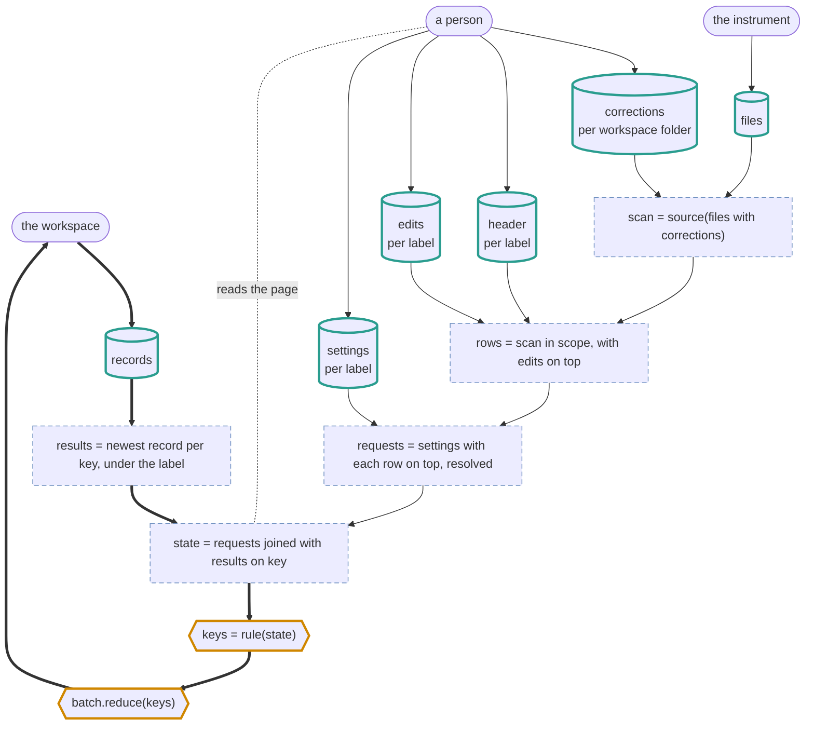
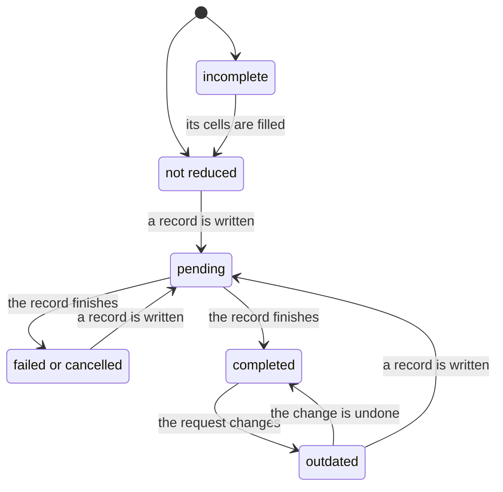

# Batch toolbox for application developers

`ess.apps.batch` is for applications that reduce many samples with one workflow: a table of rows, settings shared by all rows, and the result of each row.
It is built on the client of `ess.apps`. A *spec* declares a workflow's parameters, and a *binding* connects a spec to code. [The client guide](../../../docs/developer/roles/client-authors.ipynb) explains specs, records, labels, and stages.
Your application supplies what depends on the technique: which files make which rows, and optionally how to draw a result.
[The model](#the-model-tables-and-one-cycle) shows a batch as stored tables, derived tables, and one cycle.

## An application

```python
import uvicorn

from ess.apps.batch import BatchManager, Defaults, FileInfo, FolderDefinitions, Row, Source
from ess.apps.batch.auto import Follow
from ess.apps.batch.web import Pages, Shown, create_app
from ess.apps.folder import open_folder

def pair_by_sample(files: Sequence[FileInfo]) -> list[Row]:
    """A row per sample run, with the transmission run of the same sample."""
    partner = {f.metadata.get('sample'): f.ref for f in files
               if f.metadata.get('role') == 'transmission'}
    rows = []
    for f in files:
        if f.metadata.get('role') == 'sample':
            name = f.metadata.get('sample')
            values = {'sample': f.ref}
            if name in partner:
                values['sample_transmission'] = partner[name]
            run = f.metadata['run']
            rows.append(Row(str(run), values, info={'name': str(name)}, index=int(run)))
    return rows

SOURCES = {'sample-runs': Source(pair_by_sample, fills=('sample', 'sample_transmission'),
                                 row_name='name', index_title='Run')}

client = open_folder(folder, BINDINGS)
definitions = FolderDefinitions(folder)
manager = BatchManager(client, sources=SOURCES, definitions=definitions,
                       defaults={IOFQ.name: Defaults(staged=True)})
if not manager.headers():                  # a new folder: one batch to start with
    manager.create(IOFQ.name, title='Sample runs', source='sample-runs')

def draw_iofq(shown: Sequence[Shown]) -> dict:
    """A Plotly figure of the completed results that the page asks to draw."""
    ...

pages = Pages(manager, Follow(manager, definitions), title='I(Q)', draw={IOFQ.name: draw_iofq})
app = create_app(pages)   # a FastAPI app: the page of each batch at /batches/<label>/
uvicorn.run(app, host='localhost', port=8000)
```

`python -m ess.apps.batch.web.demo [DIRECTORY]` serves a complete application on fake files and fake workflows, with its workspace in a folder (see [The app and the command on one folder](#the-app-and-the-command-on-one-folder)).
`ess.instruments.loki.batch` holds the sources and a `Batch` for the real LoKI workflows, and `python -m ess.instruments.loki.web FOLDER` serves them.

The same logic works without the page, in a notebook or a test, with a `Batch` of the manager or one made in code:

```python
from ess.apps.batch import Batch, left_to_reduce, ready

batch = Batch(client, IOFQ, columns=('sample', 'sample_transmission'),
              label='iofq', source=pair_by_sample, staged=True)   # or manager.batch(label)
batch.settings = settings      # one write; nothing is reduced for it
batch.scan()
state = batch.state()           # where each row stands
records = batch.reduce(ready(state))
batch.reduce(left_to_reduce(batch.state(), batch.columns))
batch.cancel()
```

`batch.settings` is a read-only mapping of the parameters that are not columns, as `Form.params` gives them. `Batch(..., settings=...)` gives the settings that a new batch starts with, such as the technique's defaults. Every state and every reduction reads them. Only an assignment of all of them changes them: `batch.settings` is a copy, so `batch.settings['q'] = ...` raises, and a change inside a value changes only the copy.

## The model: tables and one cycle

A batch is a set of tables. Six of them are stored, and each has one writer. All others are derived: they are computed from the stored tables at each read and stored nowhere.

| Stored table | Written by | Holds | One table per |
|---|---|---|---|
| files | the instrument | the files that the file source lists, with their metadata | workspace |
| corrections | `CorrectedFiles` | metadata of a file set by hand | workspace folder |
| header | `BatchManager` | the names of the spec and the source, the columns, the title, the description, the scope | label of a batch of the manager |
| edits | `Batch.rows` | cells set, rows added or removed, by key | label |
| settings | `Batch.settings`; the first by the manager, before any `Batch` of the label exists | the parameters that are not columns | label |
| records | the workspace | a record per submission, with its status | workspace |

```python
# derived at each read
scan     = source(files with corrections)
rows     = scan in scope, with edits on top
requests = settings with each row on top, resolved
results  = newest record per key, under the label
state    = requests joined with results on key
```

A *correction* is a value of a file's metadata set by hand ([When the metadata is wrong or missing](#when-the-metadata-is-wrong-or-missing)). The corrections, header, edits, and settings are the *definition* of a batch, the part that a person makes, through a page, the command, or code. [Where the definition is kept](#where-the-definition-is-kept) says where they are stored and when they are read. A request is *resolved* as a record holds it ([Rules](#rules)). `state` is what `batch.state()` gives and a page shows: each row with its result, its status, and `changed`, the parameters at which the row's request differs from its result's ([Rules](#rules)).

An edit sets only columns. A value at a name that is not a column makes its row `incomplete` (`not a column`). A `Batch` made again on the same stored tables reads the same state.



Cylinders are stored tables and dashed boxes derived ones. The thick arrows are the cycle.

**The cycle** is the only path from the state to a write of a stored table, apart from a person who reads the page and changes the definition. A *rule* is a function from the state to keys, and `batch.reduce` submits those rows. The workspace writes their records, and the results and the state follow from them:

```python
batch.scan()                  # if the trigger scans
state = batch.state()         # with the batch's settings
batch.reduce(rule(state))
```

Every way of reducing a batch is this cycle, with its own rule and its own trigger:

| Trigger | Who | Rule |
|---|---|---|
| **Reduce** on the page | a person | `left_to_reduce(state, batch.columns)` |
| **Reduce them again** on the page | a person | `earlier_settings(state, batch.columns)` |
| **Reduce all**, **Reduce selected** | a person | `ready(state)`, the keys selected |
| **Follow** on the page of a batch: the application's loop, a timer that scans as **Rescan runs** does | the application's process | `arrived(state, at)`, `at` the columns of the source |
| `Automatic.step`, which `run` calls from a timer | a process of its own | `arrived(state, at)` |
| `essapps-batch reduce` | a person or a script | every row of the table; with `--remaining`, `left_to_reduce(state, batch.columns)`, and with `--earlier-settings` too, `earlier_settings(state, batch.columns)` |

So a person and automatic reduction differ in the rule and in the trigger only. [Rules](#rules) defines each rule, and [Automatic reduction](#automatic-reduction) compares the rows they give. A person is a second loop: they read the state on the page and write the definition. In automatic reduction this loop is idle most of the time.

A change of settings is one write of `batch.settings`, and runs no cycle. The rows reduced before keep their results, and `changed` names the setting. `left_to_reduce` and `arrived` leave these rows, and `earlier_settings` gives them. No history of the settings is stored: each record holds the settings it was made with.

**The status of a row** is a function of the row's request and the status of its result, both read from stored tables. The batch stores no status of a row:

```python
def text(row):                                       # RowState.text
    if row.status is PENDING: return 'pending'       # row.status: the status of the result
    if row.problems:          return 'incomplete'    # a cell is empty, not a column, refused, or reads a failed record
    if row.status is None:    return 'not reduced'   # no result
    if row.status in (FAILED, CANCELLED):
        return str(row.status)                       # needs reducing, whether or not the request changed
    if row.outdated:          return 'outdated'      # the request or the spec differs from the result's
    if row.outdated is None:  return 'outdated'      # not compared, as while the settings are refused
    return str(row.status)                           # 'completed'
```

So the diagram has no memory of its own. Each arrow is a write to a stored table by the writer of that table:



| Arrow | Writer | Stored table |
|---|---|---|
| its cells are filled, the request changes, the change is undone | a person, or the instrument | corrections, edits, settings, or files |
| a record is written | the workspace, when the cycle submits the row | records |
| the record finishes | the workspace | records |

A failed or cancelled row reads `failed` or `cancelled` whether or not its request changed, since it needs reducing either way. A row reads `incomplete` from any state but `pending` when a cell is emptied or refused. The diagram leaves out these arrows. The batch page shows `not reduced` as `ready`, `pending` as `running`, and `completed` as `done`. A row of `earlier_settings` reads `outdated`, but the page shows it as `done`, marked "earlier settings", and a table written shows `completed, earlier settings` (`status_texts`).

**Not in this picture:**

- What the names in the header stand for. The names of the spec and of the source are fixed when a batch is made; the version of the spec that the workspace binds, and the function of the source, are code in the technique's package, read at each start ([The batches of a workspace](#the-batches-of-a-workspace)).
- A chain: a second batch whose scan reads the results of the first ([Chains](#chains)).
- Publishing results.

## Terms

- A **column** is a parameter of the spec that differs per row, such as `sample`. The columns are the blanks of a `Template`.
- The **settings** are all other parameters, shared by every row. They are the batch's (`batch.settings`), and the template's values.
- A **row** has a **key**, a value per column, and read-only **info** to show with it. A cell can hold anything a request can: a file, a reference to an output, a number, a list of runs.
- A **source** is your function from files to rows. A **scan** calls it.
- A row's **index** is a value that orders the rows, such as the run number or the start time. The source gives it (`Row(..., index=60339)`); a row added by hand has none.
- The **scope** of a batch is which rows of the scan it holds: a slice of index values, or the keys named ([Rules](#rules)).
- An **edit** is a cell set, a row added, or a row removed, by hand: by a person or by your code.
- A row's **result** is the newest record with the batch's label and the row's key as its member, of any spec and whoever submitted it. So two `Batch` objects with the same label are one batch: give each batch its own label. An application that wants a table per person puts the person in the label.
- A row's **request** is what `reduce` would submit for it now: the settings and its cells. A result is **outdated** if the row's request differs from the result's, or if the result is of another spec than the one bound ([Rules](#rules)).

Choose a key that does not change from one scan to the next, such as the run number. Results and edits are found by key. Put the name of the sample in `info`, under a name that is not a column.

## Rules

**A scan never overrides what was set by hand.** A table holds two layers, what the last scan gave and what was set by hand; a row's cells are the first with the second on top.

```python
t = RowTable().rescan([Row('a', {'x': 1, 'y': 2}), Row('b', {'x': 3})])
t = t.edit('a', {'x': 10}).remove('b')
t = t.rescan([Row('a', {'x': 99, 'y': 98}), Row('b', {'x': 3}), Row('c', {'x': 5})])
# a: x is 10, set by hand, and y is 98, from the scan
# b: stays removed
# c: new
```

A row added by hand stays. An edited row that a scan no longer gives is not shown, and comes back with its edits if a later scan gives it. `reset(key)` forgets a row's edits and that it was removed; `reset(key, column)` forgets the edit of one cell. `EMPTY` clears a cell whatever the scan gives. `edit_each(keys, values)`, `remove_each(keys)` and `reset_each(keys, *columns)` do the same for many rows in one pass over the table, and edit or remove none if a key is not a row; call them rather than the single-row method in a loop. A batch given definitions keeps what was set by hand there, so a batch made again on the label has it on top of its first scan ([Where the definition is kept](#where-the-definition-is-kept)).

**The scope picks rows, never files.** The source sees every file, so a partner measured before the scope, such as the transmission run of a sample, is still found. The scope then picks the rows of the scan that the batch holds:

```python
Scope(start=60339, stop=None)                  # index values; start included, stop excluded, None is open
Scope(keys=frozenset({'60339', '60351'}))      # the rows named
batch.scope = Scope(start=60339, stop=60421)   # the rows change at once, without a scan
```

- A slice compares values. It needs no row at its ends, and a file listed late lands in or out by its value.
- `stop` is excluded, as in a Python slice, so a batch that starts where another stops leaves no gap and shares no row with it.
- `Scope()`, the default, holds every row, also one without an index. A slice with an end holds no row without an index; a scope of keys can name it.
- A row added by hand is in its batch whatever the scope. A batch without a source has only such rows.
- An edit of a row that the scope leaves out is kept, and used again if the scope takes the row back. So is a removal: `removed_in_scope` gives the rows removed that the scope holds, which the page counts and brings back.
- `put` and `add` refuse a row that the scan gives and the scope leaves out, with `SubmitError`: added by hand, it would no longer take its cells from the scan.

The table keeps every row of the scan, so a change of scope needs no new scan. `batch.scope = ...` writes nothing; the manager keeps the scope of a batch in its header ([The batches of a workspace](#the-batches-of-a-workspace)). An assignment of `batch.rows` keeps the scope of the batch. A scope is checked when it is made, so that it reads back from the header as it was written: `keys` are strings, given as any iterable but a string; an end is an `int`, a `float` or a `str`; the ends compare, and `stop` is not below `start` (`start == stop` holds no row). A source gives indices of one type, and a scope takes ends of that type: comparing a number with a text raises `TypeError` when the rows are read.

**A row is ready if it is complete and not running.** Each column with no default has a value, no cell reads a record that failed or was cancelled, and its result is not running. An empty cell of a column with a default takes the default. Whether a value is valid, such as a thickness below zero, is checked at submission, and by `state()` for a value that differs from the row's result (below).

| Function | Gives |
|---|---|
| `ready(states)` | every row that can run now |
| `arrived(states, at)` | ready rows with no result, or whose request differs from their result's at a column of `at`, but those changed by hand ([Automatic reduction](#automatic-reduction)) |
| `earlier_settings(states, columns)` | ready rows whose completed result differs from their request only at settings, not at a column, and of the same spec |
| `left_to_reduce(states, columns)` | ready rows with no result, a failed or cancelled one, or an outdated one, but those of `earlier_settings` |
| `refused_again(states, at, refused)` | of the reasons `refused` by row, those of the rows of `arrived`: why the next step of a loop will be refused again |
| `status_texts(states, columns)` | the status of each row as a table shows it: `completed, earlier settings` for a row of `earlier_settings` |

**A row's state is read from its result.** `state()` compares each row's request, its cells with the settings, with the request of its result, and says where they differ:

```python
s = batch.state()['60339']
s.record         # the result: the newest record under the label with member '60339'
s.changed        # frozenset({'q'}): the parameters whose value differs from the result's
s.spec_changed   # True if s.record is of another spec than the one bound
s.outdated       # True if either holds
s.set_by_hand    # frozenset({'thickness'}): the columns set by hand, all of a row added
s.changed_by_hand  # True if a cell is set by hand, and the row has no result or differs from it there
s.text           # 'outdated'
```

The state is read from the records, so every `Batch` on the label, and the same one after a restart, reads the same, with one limit: a `Batch` keeps how it resolved a file name until its next `scan`. That differs from a new `Batch` only for a file that gained a catalogue identifier since: its names, its old identity among them, now resolve to the identifier. `results()` gives each row with its result but without its request: it resolves nothing, so `changed` is `None`, and a result is `outdated` only if it is of another spec. It is what a page shows while the settings are refused, and what `reduce` checks before it submits.

A record holds its request resolved: files by identity, defaults filled in, values in their JSON form. So `state()` resolves with `client.resolve` what it compares. The settings are resolved once per call, whatever the number of rows, and compared with each result. If they are refused, `state` raises the `SubmitError`, with reasons that name no row: no row can run with them. A cell of a row with a result is compared as given first, and only a cell that differs so is resolved and compared again, so writing a default out, or naming a file by run, does not make a row `changed`. Every cell of a row without a result is resolved, so a file named before it is measured shows before anything is submitted. A value resolved is kept by its column and its value, with the type of the value and of each element of a list or tuple, until the next `scan`; a value that cannot be a dictionary key, such as a dict, is resolved at each call. A cell that `resolve` refuses is not `changed`: its reason is one of the row's `problems`, so the row shows as `incomplete`, with the reason at the cell, and neither `ready` nor `left_to_reduce` gives it. It is asked again at the next call, so a file that arrives later is found.

**Cost of `state()`.** Measured with 30 000 rows of two files each, on an in-memory workspace with a file source that finds a name by one lookup:

| 30 000 rows | first state | later states |
|---|---|---|
| with results, cells as the records hold them | 0.7 s | 0.5–0.9 s |
| with results, every row edited | 2.8 s | 0.5 s |
| with results, files named by run | 6–7 s | 0.7–1.3 s |
| without results | 6–9 s | 0.3–0.7 s |
| 10 chosen rows (`keys`) | 0.6 ms | 0.6 ms |

A first state is paid by a new `Batch` and again after each `scan`, which drops what was kept. Nearly all of it is the workspace validating each value resolved, about 0.1 ms per value. A list cell is kept too: 3 000 rows of a list of one file named by run take 0.4 s at the first state and 17 ms later. `results()` resolves nothing.

A result of another spec stays the row's result. Its request and its outputs are read as stored data ([ADR 0009](../../../docs/developer/adr/0009-a-record-of-another-spec-stays-readable.md)), so the results of two versions of a spec can be compared until the row is reduced again.

**`reduce` is strict and all-or-nothing.** The rows given are submitted in one call. If any is refused, or still running, none is submitted, and the `SubmitError` names the rows refused. `FieldError.entry` is the row's key and `loc[0]` the column. A reason about the settings appears once, with no key. So `reduce(ready(state))` skips incomplete and running rows, while one invalid value refuses the whole call and names the row. The workspace checks values first and references second, so correcting the rows named can bring up more.

**With `staged=True`** the rows go through a stage, and what they share is computed once. It needs a binding that makes stages. A stage is reused while the settings are the same. Whether a column can vary through a stage is the binding's to decide, and a refusal says so; a column that everything depends on saves nothing.

**Settings tried on one row.** A row has no settings of its own. To try settings on one row, set them, and reduce that row only:

```python
batch.settings = trial    # the completed rows are now of earlier_settings
batch.reduce(['60339'])   # only this row is reduced with the trial
# to keep the trial, reduce the others again:
batch.reduce(earlier_settings(batch.state(), batch.columns))
# or, to drop it, set the settings back: the row tried is then of earlier_settings
batch.settings = before
```

The page does the same with **Apply** and **Reduce selected** ([the page's README](../src/ess/apps/batch/web/README.md#settings-and-follow)). If a parameter differs for many rows, make it a column.

## Writing a source

A source takes `FileInfo(ref, metadata)` for each file, and returns `Row`s. It calls nothing but, in a chain, the `state` of another batch ([Chains](#chains)), so test it on plain data:

```python
def test_a_sample_run_pairs_with_its_transmission_run():
    rows = pair_by_sample([info(1, role='sample', sample='w'),
                           info(2, role='transmission', sample='w')])
    assert rows[0].values['sample_transmission'] == ref(2)
```

Give each row its index, such as the run number as a number (`Row(key, values, info, index=int(run))`), so that a batch can hold a slice of the rows ([Rules](#rules)). A row without one, such as of a file without a run number, is held only by a scope without ends or by its key.

Group runs by giving a cell a list of files, in one order at every scan, such as sorted by run: `FileSource.list` promises no order, and a list in another order is another request, which automatic reduction reduces again ([Automatic reduction](#automatic-reduction)). Choose one of several partners by an order too, such as the last by run. Leave a cell out if a partner is missing, so the row shows as incomplete and the rest of the batch can run. A key given twice is refused with the key named, and nothing changes.

Pairing is yours to write. The framework knows no technique. If a source raises, the page shows the error in a message.

## When the metadata is wrong or missing

Wrap the file source, and give the wrapper to the workspace. Forms and sources then all see a file as corrected:

```python
files = CorrectedFiles(FolderFiles('/data', table))
client = local(proposal='p1', files=files, bind=BINDINGS)
files.correct(run, role='sample')       # or exclude=True, if your source reads it
```

The page has a Runs tab, a table of the files, in which a person does this. You choose the fields with a pydantic model, and give the page the wrapper:

```python
class Marks(BaseModel):
    role: Literal['sample', 'transmission'] | None = None

pages = Pages(manager, follow, files=files, marks=Marks, draw={IOFQ.name: draw_iofq})
app = create_app(pages)
```

## Where the definition is kept

The *definition* of a batch is the corrections, the header, the edits, and the settings ([The model](#the-model-tables-and-one-cycle)). Give the batch and the file source the *definitions* of the workspace, and a batch made again, after a restart or in another process, starts with them:

```python
from ess.apps.batch import FolderDefinitions

definitions = FolderDefinitions(directory)                   # the workspace's folder
files = CorrectedFiles(folder_files(directory), definitions=definitions)  # reads the corrections
client = open_folder(directory, BINDINGS, files=files)
batch = Batch(client, IOFQ, columns=..., label='auto/iofq', source=pair_by_sample,
              settings=DEFAULTS, definitions=definitions)    # the settings kept replace DEFAULTS
batch.scan()                                                 # the scan, with the edits kept on top
```

Without definitions, the corrections, the edits and the settings stay in memory. The edits and settings are read when the `Batch` is made, the corrections when the `CorrectedFiles` is made, and nothing reads them again while these live. Each change is written to the definitions before it is made, so a change that they refuse raises `NotKept` (an `OSError`) and changes nothing; the page answers it with a message, and its settings form keeps what it holds, to apply again. A scan writes nothing.

What is written is what is assigned: `batch.rows = ...`, `batch.settings = ...`, `batch.put(...)`, and `files.correct(...)`, `files.correct_each(...)`, `files.reset(...)`. `batch.settings` is a read-only copy, so a change inside it changes nothing, and settings that name a column raise `ValueError`. The methods of `RowTable` return a new table. Its `edits` and a row's `values` are plain dicts, though: a change made in them is not written and is lost at a restart, so never change them in place.

`FolderDefinitions` writes JSON files, which a person can read, in `definitions/` of the folder. A label holds `/`, written as `%2F`, so each label has a folder of its own:

```
definitions/corrections.json                    every file source of the workspace
definitions/labels/auto%2Fiofq/edits.json       what was set by hand on the rows
definitions/labels/auto%2Fiofq/settings.json    a template, which essapps-batch reads
definitions/labels/auto%2Fiofq/header.json      spec, columns, source, title, description, scope; written by the manager
definitions/following.json                      the label of the batch that follows; written by Follow
```

```json
{"added": [{"key": "mine", "values": {"sample": {"@ref": "file", "file": "run:60400"}}, "info": {"name": "mine"}}],
 "edited": {"60339": {"thickness": 2.0}},
 "cleared": {"60339": ["sample_transmission"]},
 "removed": ["60340"]}
```

A file is written to a temporary file next to it, which then replaces it, so a reader never sees half of one; a temporary file left by a write that was cut off is removed when the file is read. A label too long to name a folder, once written so, is refused with `ValueError` when the batch is made. Labels that differ only in case share a folder on a file system that ignores case, such as that of macOS.

The edits hold only what was set by hand, so a cell from the scan follows the files after a restart. A definition kept that no longer fits the code:

- An edit at a column that is gone makes its row `incomplete` (`not a column`). The page offers to remove it.
- Settings of another version of the spec are read as they are. The settings form shows those that fit, and the page names the others with their values above it. `state()` and `reduce` refuse what the spec bound does not take. Nothing is written until a person presses **Apply**, which writes the settings of the form.
- Settings of a spec of another name raise `ValueError` when the batch is made, naming the file and both specs.
- Settings at a column of the batch raise `ValueError` when the batch is made, naming the file and the columns. A `Batch` on the label with fewer columns, such as one of the command, writes such settings.
- A correction of a file no longer listed is kept, and not used.
- A file that is not of the shape described raises `ValueError` naming the file and the entry, when the batch or the `CorrectedFiles` is made.

Two `Batch` objects on one label and one folder each write their whole table of edits at each change. A change made through the other since it was made is lost, and neither sees the other's changes. So a label has one `Batch` in a process: the manager holds one per label ([The batches of a workspace](#the-batches-of-a-workspace)), and the page shows one batch to every browser that opens it.

The files that a person loads and writes ([The UI](#the-ui)) are copies, for other people and other tools. The definitions are the one place that a batch is kept, for an application and for the command ([The app and the command on one folder](#the-app-and-the-command-on-one-folder)).

## The batches of a workspace

A `BatchManager`, *the manager*, makes, lists, changes and removes the batches of a workspace, and holds the one `Batch` of each label. It keeps each batch in the definitions, so a manager made again after a restart lists the same batches and makes the same `Batch` of each. The application registers its sources by name, and what a new batch of a spec gets:

```python
from ess.apps.batch import BatchManager, Defaults, Scope, Source, Words

SOURCES = {'sample-runs': Source(pair_by_sample, fills=('sample', 'sample_transmission'),
                                 words=Words(one='sample run', many='sample runs'),
                                 row_name='name', index_title='Run')}
DEFAULTS = {IOFQ.name: Defaults(settings=SETTINGS, staged=True)}

manager = BatchManager(client, sources=SOURCES, definitions=definitions, defaults=DEFAULTS)
label = manager.create(IOFQ.name, title='Afternoon', source='sample-runs',
                       columns=('sample', 'sample_transmission', 'can'),
                       scope=Scope(start=60339))
manager.headers()      # {'20261118-130204': Header(spec='loki-iofq',
                       #     columns=('sample', 'sample_transmission', 'can'),
                       #     source='sample-runs', title='Afternoon', description='',
                       #     scope=Scope(start=60339))}
counts = manager.counts()   # makes and scans every batch
counts.states          # {label: {key: RowState}} of each batch counted; status_texts(...) names their statuses
counts.failed          # {label: reason} of each batch that could not be made or scanned
counts.outside         # {source: rows that no batch of it shows}
batch = manager.batch(label)   # the Batch, made and scanned at the first call
manager.change(label, title='Afternoon, 2 mm cells')
manager.change(label, scope=Scope(start=60339, stop=60421))   # the series ends
manager.remove(label)
```

What a batch is, and where each part comes from:

| | fixed at making | changed by a person | from code, by name |
|---|---|---|---|
| naming | label | title, description | |
| rows | name of the source | scope, edits | the `Source` |
| computation | name of the spec, columns | settings | the version of the spec bound, `staged`, `draw`, the first settings |

Each part that is kept is in one file of the label, with one writer at a time:

```
header.json     BatchManager      spec, columns, source; title, description; scope
settings.json   Batch.settings    the settings, as a template; its spec and blanks a copy of the header's;
                                  the first written by create
edits.json      Batch.rows        the edits
```

What the manager gives the `Batch` of a label:

| Argument | Comes from |
|---|---|
| `spec` | `bound_spec(client, header.spec)`: the spec of that name that the workspace binds, the highest version if several |
| `source`, `selector` | the `Source` registered under `header.source` |
| `columns` | `header.columns`: those given to `create`, else those that the source fills |
| `settings` | `settings.json`; else `Defaults.settings` of the spec, those that are columns left out |
| `staged` | `Defaults.staged` of the spec |
| `label` | given to `create`, or the time of making, `YYYYMMDD-HHMMSS`, with `-2`, `-3`, ... if that is taken |
| `scope` | `header.scope`: `create(..., scope=...)`, then `change(..., scope=...)` |
| `persist` | always, so the workspace needs a store, as a folder has |
| `definitions` | those of the manager |

- `create` takes the name of a spec. It refuses an empty title, a column that is not a parameter of the spec or is named twice, and columns that lack one that the source fills; then it writes the first settings, `Defaults.settings` of the spec or `create(..., settings=...)`, and the header. The names of the spec and the source, and the columns, are fixed from then on. What the names stand for is read from code at each start: a later `Defaults.staged` applies to every batch, a later `Defaults.settings` only to batches made after it. `batch(label)` refuses a batch whose source now fills a column that the batch lacks.
- `change` changes the title, the description and the scope, and refuses an empty title; a scope is written to the header, then given to the `Batch` of the label if it was made, whose rows change at once.
- A header without `settings.json` is a batch with the default settings of its spec, as registered at each start.
- A label is letters, digits, `_`, `.` and `-`, and starts with neither `.` nor `-` (`check_label`), so that it is one segment of a URL path. `create` refuses a label that has definitions or records.
- `remove` removes the header, the edits and the settings of a batch, and releases its stage. Its records stay, and those running keep running. A `Batch` handed out before must not be used after its removal, so ask the manager for the batch each time.
- A `Batch` made in code without the manager has no header and is not listed.
- `counts` makes every batch not made yet, which scans it, and scans every other batch with a source, so the rows of each batch are those of the files now. It gives the state of each row of each batch, and the rows of each source that no batch of it shows: a row counts as shown if any batch shows it, so a row outside the scope of every batch of its source counts there. A source is called once more only if no batch of it was scanned. A batch that cannot be made or scanned, such as one whose source is no longer registered or raises, gets its reason in `failed`, and its source is left out of `outside`. It costs one scan per batch, so call it when a person asks.
- `words`, `row_name` and `row_info` of a `Source` say what the page of a batch calls a row, which entry of `Row.info` names it, and which other entries it shows. `index_title` is what the page calls the index of a row, such as `'Run'`.

One loop per application, `Follow`, reduces the rows of one batch as its files arrive: each step is a step of an `Automatic` on the batch that follows ([Automatic reduction](#automatic-reduction)), with `at` the columns of its source. It reduces the rows of the scope only, and a slice holds every row whose index is inside it, whenever its file is listed: so widening the scope of the batch that follows makes the next step reduce every row that the scope now holds and that has no result.

```python
from ess.apps.batch.auto import Follow

follow = Follow(manager, definitions, interval=5.0)
follow.on(label)       # this batch follows, and no other; ValueError for a batch without a source
follow.label           # the label of the batch that follows, or None
while True:
    follow.step()      # its records by key; follow.refused says why rows were refused
    time.sleep(follow.interval)
```

`follow.on` and `follow.off` write `following.json`, so a `Follow` made again after a restart resumes. If the batch that follows is removed, the next step turns `Follow` off. `Follow` has no thread, and the manager none either: whoever owns the timer calls `step`. For the pages, `create_app` owns it ([The UI](#the-ui)).

## Chains

A cell may read another record, also one still running, so a row can use a value computed for that row:

```python
centres = find.reduce(left_to_reduce(find.state(), find.columns))
for key, record in centres.items():
    iofq.rows = iofq.rows.edit(key, {'beam_centre': record.ref('centre')})
```

After a centre failed, this reruns only what is left, and points those rows at the new centre. The field must be typed `Referenced[...]` in the spec.

A source that reads the other batch's state makes the same cells at every scan, without an edit for each new row, which automatic reduction needs:

```python
def with_centre(files: Sequence[FileInfo]) -> list[Row]:
    found = {k: s.record for k, s in find.state().items() if s.record}
    return [replace(row, values={**row.values, 'beam_centre': found[row.key].ref('centre')})
            if row.key in found else row
            for row in pair_by_sample(files)]
```

Scan `find` before a batch with this source, so that its rows see the newest centres.

## Automatic reduction

Automatic reduction reduces a batch as its files arrive. Its *loop*, an `Automatic`, needs a batch with a source, which should persist what it submits, since nothing releases its records:

```python
from ess.apps.batch.auto import Automatic, run

batch = Batch(client, IOFQ, columns=('sample', 'sample_transmission'), label='auto/iofq',
              source=pair_by_sample, staged=True, persist=True, settings=settings)
loop = Automatic(batch, at={'sample'})
loop.step()       # scans, and reduces the rows that arrived; their records by key
loop.refused      # why rows of the last step were refused, by key
run([loop])       # steps once a second, until a step raises
```

A step is [the cycle](#the-model-tables-and-one-cycle) with a scan and the rule `arrived`: `batch.reduce(arrived(batch.state(), at))`, with the batch's settings as they are at the step.

`at` is a set of columns, and has no default. A row with no result is reduced whatever `at` is. A row with a result is reduced again only if its request differs from its result's at a column of `at`. Take a source that makes a row per sample, with the lists `sample_runs` and `trans_runs`, and leaves `trans_runs` out until a transmission run arrives. The files arrive as `s1, t1, s1', t1'`, where `s1'` repeats `s1`, and each step finishes before the next file arrives:

| Arrives | `at={'sample_runs', 'trans_runs'}` | `at={'sample_runs'}` | `at=set()` |
|---|---|---|---|
| `s1` | nothing: row 1 is `incomplete` | nothing | nothing |
| `t1` | row 1, `[s1]`, `[t1]` | row 1, `[s1]`, `[t1]` | row 1, `[s1]`, `[t1]` |
| `s1'` | row 1, `[s1, s1']`, `[t1]` | row 1, `[s1, s1']`, `[t1]` | nothing: row 1 reads `outdated` |
| `t1'` | row 1, `[s1, s1']`, `[t1, t1']` | nothing: row 1 reads `outdated` | nothing |

A row that a person changed is the person's to reduce: the loop leaves a row with a cell set by hand ([Rules](#rules)) while it has no result, or while its request differs from its result's at such a cell:

```python
def arrived(state, at):
    return [key for key in ready(state)
            if not state[key].changed_by_hand   # a cell set by hand, not reduced yet
            and (state[key].record is None or state[key].changed & at)]
```

The loop reduces a row for what the files changed, never for what a person changed. Every cell of a row added by hand is set by hand. A row edited at two cells of `at`, such as its sample run and then its transmission run, waits until a person reduces it with both. Once reduced, a cell set by hand equals its result's, so a file that arrives later at another cell of `at` reduces the row again, with the cell set by hand. A correction of a file's metadata ([When the metadata is wrong or missing](#when-the-metadata-is-wrong-or-missing)) reaches the rows through the scan, so the loop reduces for it as for a file that arrives: two corrections that belong together reduce a row twice if a step runs between them.

A cell that a person reverts to the scan's (`reset`) is no longer set by hand, so it follows the files again at once: the next step reduces the row, with its other cells as they are. Nothing distinguishes the row then from one whose file changed. So two reverts of one row, one after the other, can reduce it twice, the first time with the scan's cell next to a cell still set by hand. `reset(key)`, or `reset(key, *columns)`, reverts several cells of a row in one write, and the row is reduced once; on the page, a revert takes one column, and removing and restoring a row reverts all its cells.

So the loop, the page's buttons, and the command differ:

| A row is reduced if it has | no result | a failed or cancelled result | a result, and a setting changed | a result, and the scan changed a cell at `at` | a result, and the scan changed a cell at another column | a cell set by hand, not reduced yet |
|---|---|---|---|---|---|---|
| the page, "Reduce" (`left_to_reduce`) | yes | yes | no | yes | yes | yes |
| the page, "Reduce them again" (`earlier_settings`) | no | no | yes | no | no | no |
| the loop (`arrived`) | yes, but for a row set by hand | no | no | yes | no | no |

On the page, a change of settings applies to rows not reduced yet, and to all only when a person says so. `essapps-batch reduce --remaining` follows the page's "Reduce", and `--earlier-settings` with it adds the rows of "Reduce them again". The command is given its settings at each call, so without `--remaining` it applies them to all.

A failed or cancelled result counts as any other, so a row whose reduction fails is not reduced at every step. A changed setting reduces no row again ([The model](#the-model-tables-and-one-cycle)). A person reduces those rows through the loop's batch, with **Reduce them again** on the page ([one label, one batch](#one-label-one-batch)).

A row whose result is running is not ready, and the loop does not submit it again. At the first step after its record finishes, it is reduced if a file arrived meanwhile at a column of `at`.

`state` compares requests resolved. So a cell that names a file by run, `file(run=60339)`, equals the identity that the record holds, and its row is reduced once. A file that gained a catalogue identifier since its row was reduced resolves to another identity, and its row is reduced again if the cell is at a column of `at`. A list is compared element by element, in order: a list at `at` in another order, or shorter, reduces the row again. So a source gives a list in one order at every scan ([Writing a source](#writing-a-source)).

A result of another spec, such as an older version, stays the row's result ([Rules](#rules)). Its request differs from the row's at each parameter that the other spec lacks, so the loop reduces the row again only if a column of `at` is among them, or a file arrives there.

A row whose key changes from one scan to the next, such as a key made from a sample name that a correction changed, is a new row, and is reduced again under its new key; so choose a key that does not change, such as the run number ([Terms](#terms)).

The page of a batch has a switch "Follow", which makes its batch the one that the application's `Follow` steps ([The UI](#the-ui)). In a chain, step the loop of the batch that is read first: `run([Automatic(find, ...), Automatic(iofq, ...)])`. [automatic-reduction.md](../../../docs/developer/automatic-reduction.md) holds the design, its cost, and what is open.

### One label, one batch

Which rows a step reduces follows from the files, the batch's rows and settings, and the records under its label. The loop keeps nothing else, so a step that raises, in the settings, the source, or a submission, loses nothing. For the rows with no change by hand that is not reduced yet, the loop keeps the results under its label equal to its batch's rows at the columns of `at`:

```python
page = Batch(client, IOFQ, columns=..., label='auto/iofq', source=pair_by_sample)  # a second batch on the label
page.rows = page.rows.edit('60339', {'sample': file(run=60400)})
page.reduce(['60339'])               # a record with run 60400 at `sample`
loop.step()                          # reduces '60339' again with the source's file: the loop's rows win
```

The edit is in another batch, so the loop's row still has the scan's cell. So a label has one batch. A person who wants another file for a row edits the loop's own batch and reduces the row, and the loop leaves the cell set by hand as it is; or the person corrects the file's metadata so that the source gives the row another file ([When the metadata is wrong or missing](#when-the-metadata-is-wrong-or-missing)), which the loop reduces. Two loops never share a label: if their rows differ at `at`, each replaces the other's records at every step. A record under the label that equals the loop's row at `at`, from any submitter, counts as the row's result.

A restart starts from a new scan, with the edits that the batch's definitions kept. So after a restart, a row is not reduced again unless the files changed it at `at`. Without definitions the edits are gone, and a row that was edited at a column of `at` is reduced again with the source's cells. A record that was running when the workspace ended is failed at the restart; the loop does not run a failed row again, and a person retries it.

### Problems and refusals

A row with an empty cell, or a cell that the workspace does not accept when the state is read, such as a thickness below zero or a file named before it is measured, is `incomplete`. The reason is one of the row's `problems`, `arrived` does not give the row, and the loop reduces it once the scan fills the cell or the workspace accepts it. A cell that a person fills is set by hand, so the person reduces that row.

`submit` checks a few things that `state` does not, such as a reference to an output that the workspace no longer keeps, and refuses the rows with a `SubmitError`. The step drops the rows that the error names, submits the others, and `refused` holds the reasons by key until the next step. Such a row is submitted again at every step. A reason that names no row refuses every row of the step. If the settings are refused, no row can run: the step submits nothing, and `refused` holds the reason for every ready row but those without a result that are set by hand, `{'1': 'unknown spec sans-iofq/v1'}`. No row is compared with its result then, so a row with a result counts whether or not a person changed it.

## From files, and from the command line

A batch can be given as two files: a template, and a table with a row for each sample.
The command `essapps-batch` reads them (extra `[files]`):

```yaml
# iofq.yaml: a Template
spec: {name: loki-iofq, version: 1}
blanks: [sample, sample_transmission]
params:
  can: 60393                               # a run
  can_transmission: 60392
  empty_beam: 60392
  direct_beam: /data/direct-beam.h5        # a path; null for none
  masks: {'@latest': masks, output: masks}  # the newest record labelled masks
  beam_centre: {x: -0.029, y: -0.018, z: 4.116}
  wavelength: {start: 1.0, stop: 13.0, num_bins: 200}
  q: {start: 0.01, stop: 0.3, num_bins: 100}
```

```
# runs.csv
sample,sample_transmission,name
60339,60394,water
60250,60394,sds
```

```sh
B="essapps-batch --bind ess.instruments.loki.bindings:BINDINGS"
$B reduce iofq.yaml runs.csv --label water-series -o done.csv
$B export done.csv reduced -o exported.csv
```

```
# exported.csv
sample,sample_transmission,name,status,record,failure,iofq,transmission
60339,60394,water,completed,2e35ce83...,,reduced/60339/iofq.h5,reduced/60339/transmission.h5
60250,60394,sds,failed,bd9864f1...,OSError: ...,,
```

Each step is a command, and a function for a notebook that takes and returns a pandas `DataFrame`:

| Step | Command | Function |
|---|---|---|
| list the files | `files package.module:read --with runs` | `frames.described(pd.DataFrame(scan_folder(folder, read)), runs)` |
| make the table | `rows package.module:source`, or a spreadsheet | `frames.table_of(source(batch.file_infos(client)))` |
| reduce it | `reduce template table --label ...` | `frames.reduce_table(client, template, table, label=...)` |
| write the outputs to files | `export table folder` | `export.export_table(client, table, folder)` |

A table is a `.csv`, `.tsv`, or `.xlsx` file.

In a notebook, the table is a `DataFrame` and the template a `Template`, and no file is needed. [loki-batch.ipynb](../../essinstruments/docs/loki-batch.ipynb) runs every step on LoKI's data:

```python
done = frames.reduce_table(client, template, table, label='water-series')
exported = export_table(client, done, Path('reduced'))
```

A cell that is not text is its value, and `None` or `NaN` is an empty cell, so only a table read from a file is all text. To write `None` itself in a cell, as opposed to leaving it empty, write the text `null`.

**The table.** The first column holds the key of each row; it may also be a blank, as `sample` above. A column named as a blank holds its cells. A column of any other name is info, which comes back as it is; a column named `key`, as `frames.table_of` writes the key, is not info. Two mistakes are refused: a blank that is no column, such as a misspelt header, and a column named as a parameter that is not a blank, whose cells no row would use. An empty cell takes the parameter's default.

**A cell** is read as JSON if it is JSON, so `1.5`, `null`, and `{"x": 0, "y": 1}` are values, and anything else is text. Text that is JSON is written in quotes, such as `"12"` for a sample name at a string parameter; a `.csv` file doubles them, `"""12"""`. At a parameter that is a file field, or a list of them, a whole number names a run, text with a kind, such as `pid:...` or `path:...`, a file as the record holds it, and other text a path, relative to the working directory. A table that the batch writes holds each file as the record does, by its identity: `pid:20.500.12269/<uuid>` for a raw file the catalogue lists, and `path:masks/mask.xml`, relative to the workspace's folder, for any other file in it. A number with a leading zero, such as `0342`, is not JSON, so it is read as a path: write `342`. The same holds for the values of the template's file. A file field inside a group takes the JSON form, `{"@ref": "file", "file": "run:60339"}`. Every file is one that the workspace's file source knows.

**`reduce`** returns the table with three columns, which it replaces if the table has them: `status`, the ID of the `record`, and `failure`, the reason. So its result can be its next table. With `--remaining` it reduces only the rows that `left_to_reduce` gives: those with no result, a failed or cancelled one, or one whose cells changed since, or whose result is of another spec ([Rules](#rules)). A row reduced with earlier settings is left, and reads `completed, earlier settings`: the command then says how many rows it left, and ends with status 3. `--earlier-settings`, only with `--remaining`, reduces those rows too. A row that cannot run is submitted all the same, so that the command refuses it by name. The `status` of a row is `completed`, `failed`, or `cancelled`, or `completed, earlier settings` for a row that `--remaining` left.

Ctrl-C cancels every row that has not completed, those running among them, and the command ends with a `KeyboardInterrupt` once the workflows that were running return. It writes no table; reduce again with `--remaining`.

**`export`** writes the outputs of each completed row to `<folder>/<key>/`, and returns the table with a column for each output that holds the path of its file. It finds the outputs by the `record` column, not by the label. A key must be the name of a folder, so one with `/` is refused.

```
reduced/60339/iofq.h5          what scipp.io.load_hdf5 reads: a DataGroup of the output's fields
reduced/60339/_record.json     the record: every file and value the outputs came from
```

These files are a placeholder (`ess.apps.hdf5` states the format). A format of a technique, such as NXcanSAS, is not written. If the folder is inside the workspace, a later `files` lists what was exported.

**Exit status.** 0: done, and for `reduce`, every row completed. 2: the command or a row was refused, and nothing ran. 3: a row did not complete, or `--remaining` left a row reduced with earlier settings. 1: any other error. Every command but `files` opens the workspace, and needs `--bind`.

**The workspace** of the command is a folder, `--workspace`, the working directory by default (`ess.apps.folder`). It holds one input, which you write, and what the commands keep:

```
files.csv      input: the raw files, masks, and calibrations that a request may name
log.jsonl      history
store/         every output of every row, <record>/<output>.h5
```

`files.csv` is the table of `FolderFiles`, a stand-in for a catalogue: a row per file with its path, relative to the folder, and its metadata as text. A run number in a template or a table is looked up here. A file with a `pid`, which `read_metadata` gives a raw file that carries the catalogue's identifier, is identified by it, and any other file in the folder by its path relative to the folder. So a folder that is moved, with all it holds, keeps its records, its tables, and its results.

```
file,run,kind,role
raw/60339.nxs,60339,raw,sample
masks/mask.xml,,mask,
```

`files` writes it from the files in the folder and, with `--with`, a table that says what each run is:

```sh
essapps-batch files ess.instruments.loki.files:read_metadata --with runs.xlsx -o files.csv
```

```
# runs.xlsx: a row per run, kept by a person
run,role,sample
60339,sample,water
60394,transmission,water
,direct_beam,          <- with a column file: a file that is no run
```

`read_metadata` is a function of the instrument package, from the path of a file to its metadata, or `None` for a file that is not the instrument's (`ess.apps.folder.scan_folder`). The runs come first, by their number, since the order of the rows is the order of measurement. A file that cannot be read is left out, with a warning. Two files of one run are refused. Running `files` again after files gained a `pid` changes their identity: the loop of automatic reduction reduces them again, and earlier records name files the folder no longer knows.

A file says its kind, its run, and perhaps its sample, but not what a run is for. A row source that pairs runs reads the `role`, and a field such as the direct beam requires it. The run table gives it (`frames.described`): a row describes the file of its `run`, or the file at its `file` if it has no run. A run of the table that has no file in the folder is ignored, so the table may cover more than the folder holds. A file that no row describes keeps what it says of itself, and where both have a column, a cell of the run table that is not empty wins. Two rows for one run are refused. Without `--with`, the roles are typed into `files.csv`, so `files` then refuses to write over a table that exists.

The workspace outlives the command, so a template references a record of an earlier command. A template without blanks is one request, and `reduce` without a table submits it:

```sh
$B reduce detector.yaml --label detector      # prints key,status,record,failure
$B reduce masks.yaml --label masks            # detector: {'@latest': detector, output: detector}
$B reduce iofq.yaml runs.csv --label water-series
```

`{'@latest': label, output: name}` is read when the command starts, as the output of the newest record under the label, of `member` if given, whoever submitted it. It is for a template, not for a cell of a table. The record of each row holds the ID that it was read as. A reference by ID is `{'@ref': output, record: ..., output: ...}`.

One command holds the folder at a time. If a command was killed, the next one first finishes the rows that had not started, but fails those of a spec it does not bind with the same version and models. A row that was running fails, since its workflow may have been what ended the process. Reduce again with `--remaining` to submit every row that has not completed, the failed ones included. A command that binds another version of a spec, or the same version with changed models, reads the old results as plain scipp data, and reduces their rows again with `--remaining`, whatever settings the template gives. Nothing removes the files of the store.

## The UI

[The batch page](../src/ess/apps/batch/web/README.md) (`ess.apps.batch.web`) shows each batch in a browser: how to run it, its layers, and its limits.
The settings form holds a change until **Apply** writes it to the batch; **Discard** shows the batch's settings again. Apply is refused while the form misses something, and while the form holds a change a person's reductions with the batch's settings are refused, so that nothing is reduced with settings other than those shown. A change of the settings applies to the rows not reduced yet. A row reduced before is shown as done, marked "earlier settings", and "Reduce" leaves it; **Reduce them again** in the Settings tab reduces those rows, after a confirmation that names how many. The page of a batch with a source offers a switch **Follow**: it makes the batch the one that the application's `Follow` steps, so no other batch follows, and the page of another batch says which one does. A step every few seconds does what **Rescan runs** does and reduces the rows that `arrived` gives, at the columns of the source, with the batch's settings, whatever the form holds. Follow leaves a row that a person changed to the person, who reduces it with **Reduce**: while following, such a row says "Set by hand, so Follow leaves it to you: reduce it." An action reduces nothing that a person did not ask for, and Apply reduces nothing either: the next step reduces the rows without a result with the settings applied. The batch that follows is kept in `following.json`, so a restart resumes.

`create_app(pages)` makes the app: the page of each batch of the manager at `/batches/<label>/`, and `/`, which redirects to the page of the batch that follows, else of the last label. `Pages(manager, follow, ...)` (`ess.apps.batch.web.pages`) holds what the pages share: the title of the application (`title`), how to draw the results of each spec (`draw`, by the name of the spec), the correction of the metadata of runs (`files`, `marks`), `Follow` and its timer, and one lock that every request of every page and each step of Follow take. What a page calls a row and shows of it are the `words`, `row_name` and `row_info` of the batch's `Source`. Every page has a view **Batches**, which lists the batches of the manager, each a link to its page, with its scope, and counts their rows by status when it is opened (`counts`, which scans every batch), with the statuses of the page of each batch. `Page` (`ess.apps.batch.web.page`) holds what the page of one batch shows and does, and its actions return `State`, the whole of what the page shows. The browser renders `State` and sends the actions.

`draw(shown)` gets the completed results of the rows selected, as `Shown` (`key`, `name`, `record`, `outdated`, `color`), and returns a Plotly figure as a dict. `ess.apps.batch.web.plots` draws curves with the page's colours.

## The app and the command on one folder

A person and the command share one workspace folder (`open_folder`), and a label is one batch for both: the command keeps a batch in the folder's definitions as an app does. One process holds the folder at a time, so stop the app before the command runs:

```sh
python -m ess.apps.batch.web.demo ws       # Download as CSV: rows.csv, Download settings: settings.yaml
L=20261118-130204                          # the label of the batch, in the URL of its page
B="essapps-batch -w ws --bind ess.apps.batch.web.demo:BINDINGS"
$B reduce settings.yaml rows.csv --label $L -o done.csv
$B reduce --label $L --remaining           # the batch as the label keeps it
python -m ess.apps.batch.web.demo ws       # the rows show as done
```

`reduce` imports what it is given into the definitions of its label, then reduces the rows of the table: the template becomes the batch's settings, and the table is set by hand as **Load table…** sets it, on the rows that `--source` makes from the files, if given, and on the edits that the label keeps. So what the command was given shows in the app afterwards, and a table older than an edit made in the app sets the cell back, as any import does. Without a template and a table, `reduce` reduces the batch that the label keeps, with the app's edits. `rows`, `files`, and `export` read the files as corrected, and keep no batch. The command finds the results of the app, and the app those of the command, if the outputs are persisted (`Batch(..., persist=True)`).

| Button of the page | Same as |
|---|---|
| **Load table…** | `batch.scan()`, then `batch.put(frames.rows_of(frames.read_table(path), spec.params, batch.columns))`, refused with a row that the source makes and the scope leaves out |
| **Download as CSV**, **as XLSX** | `frames.batch_table(batch, states)`, written with `frames.write_table` |
| **Load settings…**, then **Apply** | `batch.settings = text.checked_settings(batch, text.load_template(path))`, refused if of another spec, another version of it, or with other blanks than the columns; the file fills the settings form, and Apply writes it |
| **Download settings** | `text.write_template(batch.template(), path)`, refused while the settings form holds a change |
| **Download selected**, **Download all** | `export.export_table(client, frames.batch_table(batch, states, keys), folder)`, with the keys of the completed rows, zipped with their table |

`reduce` refuses a table with a row that cannot run, so remove the incomplete rows before writing it. A table loaded is set by hand: each cell that differs from the row shown is an edit, a row the batch removed is brought back, and a row the batch does not show is added, so it stays after **Rescan runs**, and the definitions keep it. A table with a row that the source makes and the scope leaves out is refused, and nothing is set. The `status` of a table written is what the page shows, such as `outdated`, `not reduced`, or `completed, earlier settings` (`status_texts`). `reduce` replaces the result columns, and `export` reads only the `record` column, so both take such a table.

## Interfaces to the framework

| Between | Interface | Why |
|---|---|---|
| your pairing and the batch | a function over plain data | there is no behaviour to abstract |
| `Batch` and the framework | `Client`, the class | one implementation; a fake would have to redo the validation that a table shows |
| `Form` and the framework | `Listing`, a pydantic model of the params, and `Form.held()` | `Form` needs neither `Client` nor `WorkflowSpec` |
| the logic and the page | the methods of `BatchManager`, `Follow`, `Batch` and `RowTable` | `Pages` and `Page` hold what the pages show and do, so a rule is written once |
| `Page` and the browser | `State` and the actions of `Page` | the browser renders `State` and sends actions; `Page` has no HTTP in it |

`ess.apps` and `ess.apps.panel` import nothing from `ess.apps.batch`, and `ess.apps.batch` imports no widget library and nothing of `ess.apps.batch.web`. `ess.apps.batch.web.page`, `ess.apps.batch.web.pages` and `ess.apps.batch.web.models` import neither `fastapi` nor `starlette`; only `ess.apps.batch.web.api` does. A test enforces this.

`ess.apps.batch.web` shows the batches as web pages: a FastAPI server and plain JavaScript. It is experimental and the candidate for a hosted interface.

## Testing an application

| What | How |
|---|---|
| your source | plain data |
| rules of rows and states | plain values; see `packages/essapps/tests/batch/table_test.py` and `state_test.py` |
| submitting, stages, refusals, reruns | `local()` with `ess.apps.testing.FakeFiles` and fake workflows; a fixture starts in milliseconds |
| the page | `Pages` and the `Page` of `pages.page(label)`, or `create_app(pages)` with FastAPI's `TestClient(app, base_url=f'http://testserver/batches/{label}/')`; see `packages/essapps/tests/batch/web_test.py` |

```python
fake = FakeFiles('p1', tmp_path)
fake.measure(1, 1.0, role='sample', sample='water')
binding = StagedFunction(IOFQ, fake_iofq)     # function_binding for no stages
with local(proposal='p1', files=fake, bind=[binding]) as client:
    ...
```

Raise in the fake to make a row fail; hold it back on a `threading.Event` to keep a row pending.

## What it does not do

- Keep a result that is not persisted. A `Batch` finds results by key in its workspace, so `local()` per session starts with none, and a result that is not persisted is gone once its workspace closes.
- Merge two writers of one definition, or lock it. Two `Batch` objects on one label each write their whole table of edits, so a change made through the other since is lost ([Where the definition is kept](#where-the-definition-is-kept)).
- Keep settings of one row apart from the others. A row's request is its cells and the batch's settings, so a parameter that differs between rows is a column.
- Free the values of replaced results. They stay until the workspace closes or they are released, unless the batch persists them (`persist=`).
- Offer preparatory steps with a **Use** button. A `Referenced[...]` setting offers each record in the settings form.
