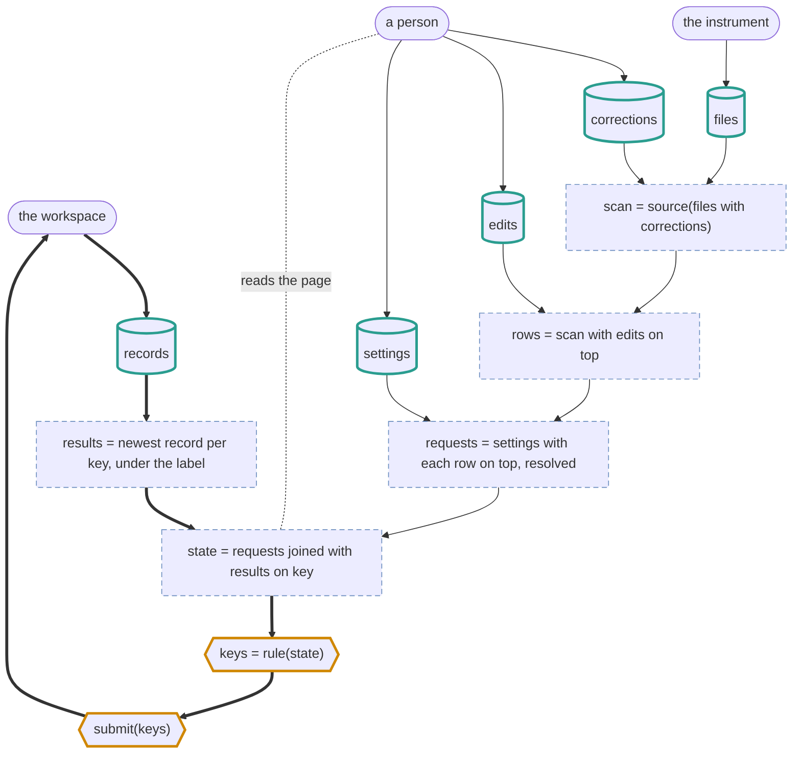
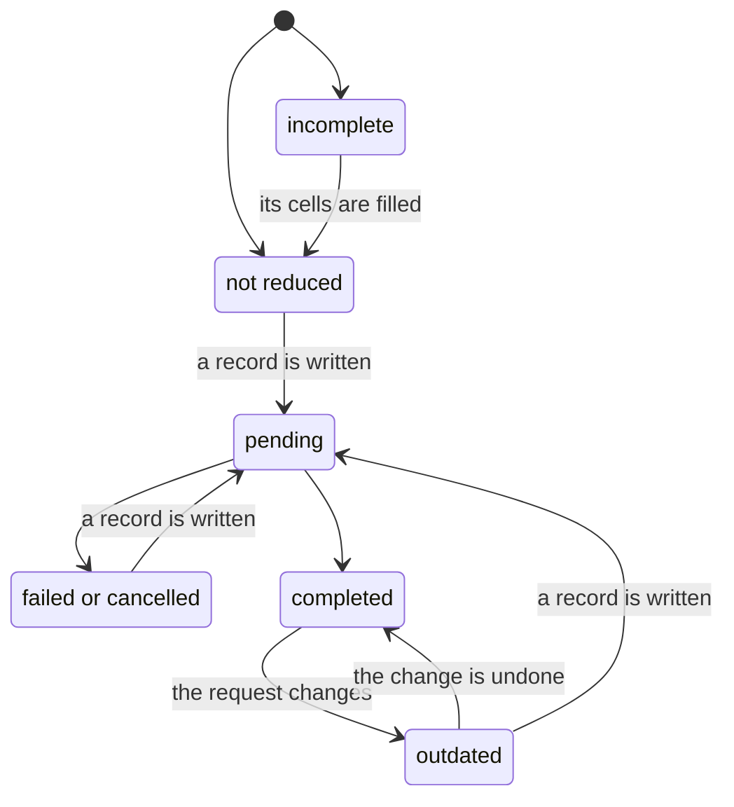

# Batch toolbox for application developers

`ess.apps.batch` is for applications that reduce many samples with one workflow: a table of rows, settings shared by all rows, and the result of each row.
It is built on the client of `ess.apps`. A *spec* declares a workflow's parameters, and a *binding* connects a spec to code. [The client guide](../../../docs/developer/roles/client-authors.ipynb) explains specs, records, labels, and stages.
Your application supplies what depends on the technique: which files make which rows, and optionally how to draw a result.
[The model](#the-model-tables-and-one-cycle) shows a batch as stored tables, derived tables, and one cycle.

## An application

```python
from ess.apps import local
from ess.apps.batch import Batch, FileInfo, Row
from ess.apps.batch.panel import BatchView
from ess.apps.panel import App

def pair_by_sample(files: Sequence[FileInfo]) -> list[Row]:
    """A row per sample run, with the transmission run of the same sample."""
    partner = {f.metadata.get('sample'): f.ref for f in files
               if f.metadata.get('role') == 'transmission'}
    rows = []
    for f in files:
        if f.metadata.get('role') == 'sample':
            name = f.metadata.get('sample')
            values = {'sample': f.ref}
            if name in partner:
                values['sample_transmission'] = partner[name]
            rows.append(Row(str(f.metadata['run']), values, info={'name': str(name)}))
    return rows

client = local(proposal='p1', files=files, bind=BINDINGS)
batch = Batch(client, IOFQ, columns=('sample', 'sample_transmission'),
              label='iofq', source=pair_by_sample, staged=True)
view = BatchView(batch, info=('name',), draw=draw_iofq)
view.scan()
App(client, plots=PLOTS, tabs={'I(Q)': view}).panel().servable()
```

`python -m ess.apps.batch.panel.demo [DIRECTORY]` serves a complete application on fake files and fake workflows, with its workspace in a folder (see [The app and the command on one folder](#the-app-and-the-command-on-one-folder)).
`ess.instruments.loki.batch` holds a source and a `Batch` for the real LoKI workflows, without a view.

The same logic works without widgets, in a notebook or a test:

```python
from ess.apps.batch import ready, remaining

batch.scan()
state = batch.state(settings)   # where each row stands
records = batch.reduce(settings, ready(state))
batch.reduce(settings, remaining(batch.state(settings)))
batch.cancel()
```

`settings` is a dict of the parameters that are not columns, as `Form.params` gives it.

## The model: tables and one cycle

A batch is a set of tables. Five of them are stored, and each has one writer. All others are derived: they are computed from the stored tables at each read and stored nowhere.

```python
# stored, each with one writer
files         # the instrument, as the file source lists them. Only grows.
corrections   # a person: metadata of a file, set by hand
edits         # a person: cells set, rows added or removed, by key
settings      # a person: the parameters that are not columns
records       # the workspace. Only grows.

# derived at each read
scan     = source(files with corrections)
rows     = scan with edits on top
requests = settings with each row on top, resolved
results  = newest record per key, under the label
state    = requests joined with results on key
```

A *correction* is a value of a file's metadata set by a person ([When the metadata is wrong or missing](#when-the-metadata-is-wrong-or-missing)). The corrections, edits, and settings are the *definition* of a batch, the part a person makes. The definition is written at each change and read when the application starts. The records are in the workspace. Nothing else is stored, so a restart loses nothing.

An edit may also set a parameter that is not a column, for one row:

```python
edits = {'60339': {'sample_transmission': file(run=60340),   # replaces the cell of the scan
                   'q': {'num_bins': 50}}}                   # replaces the setting q, for this row
```

Both lines say how the row differs from what the scan and the settings give, and both are kept with the other edits. If a parameter differs for many rows, make it a column.

`state` is what the page shows: each row with its result, its status, and `changed`, the set of parameters at which the row's request differs from its result's request ([Rules](#rules)).



Cylinders are stored tables and dashed boxes derived ones. The thick arrows are the cycle.

**The cycle** is the only program that reads the state and causes a stored table to be written: `keys = rule(state)`, then `submit(keys)`. The workspace writes the records, and the results and the state follow from them. A *rule* is a function from the state to keys. Two rules cover a person and the timer:

```python
remaining(state)    # ready rows with no result, a failed or cancelled one, or an outdated one

def arrived(state, at: set[str]) -> list[str]:
    """Ready rows with no result, or whose request differs from their result's at `at`."""
    return [key for key in ready(state)
            if state[key].record is None or state[key].changed & at]
```

Two buttons of the page drive the cycle. **Rescan** calls `batch.scan()`, which reads the files and extends the tables. **Reduce** calls `batch.reduce(settings, keys)`. Automatic reduction is a timer that presses the same two buttons:

```python
def step(batch, settings, at):
    batch.scan()
    state = batch.state(settings)
    return batch.reduce(settings, arrived(state, at))
```

| | Rule | Started by |
|---|---|---|
| a person | `remaining(state)`, or the rows chosen | a click on **Reduce** |
| automatic reduction | `arrived(state, at)` | a timer |

A person is the second loop. They read the state on the page and write corrections, edits, and settings. In automatic reduction this loop is idle most of the time ([Automatic reduction](#automatic-reduction)).

**`at`** is a set of columns that the technique names. It has no default, since it says which changes of a row the timer follows. Take sample and transmission runs that are repeated until the statistics suffice. The source makes a row per sample, with the lists `sample_runs` and `trans_runs`, and leaves `trans_runs` out until a transmission run arrives. A list grows when a repeated run, `s1'` or `t1'`, arrives:

| `at` | A list grows (`s1'` or `t1'`) | A direct-beam run arrives later, paired with all rows | Meaning |
|---|---|---|---|
| `set()` | the row reads `outdated` | the rows read `outdated` | nothing is reduced again without a person |
| `{'sample_runs', 'trans_runs'}` | reduced again | the rows read `outdated` | the columns that carry a row's own data |
| all columns | reduced again | all rows reduced again | the table always wins |

With `at={'sample_runs', 'trans_runs'}`, the files arriving as `s1, t1, s1', t1', s2, t2`, and a step after each that finishes before the next file arrives:

| Arrives | Row | Reduced with |
|---|---|---|
| `s1` | 1 | not reduced: `trans_runs` is empty, so the row is `incomplete` |
| `t1` | 1 | `sample_runs=[s1]`, `trans_runs=[t1]` |
| `s1'` | 1 | `sample_runs=[s1, s1']`, `trans_runs=[t1]` |
| `t1'` | 1 | `sample_runs=[s1, s1']`, `trans_runs=[t1, t1']` |
| `s2` | 2 | not reduced: `incomplete` |
| `t2` | 2 | `sample_runs=[s2]`, `trans_runs=[t2]` |

A row that is pending when a file arrives is not ready. It is reduced at the first step after its record finishes. A failed row reads `outdated` once its request changes. The timer reduces it again only for a change at a column of `at`, such as a file that arrives. Otherwise a person retries it.

**A changed setting** is one write of the settings, `write(settings)` below:

```python
write(settings)                                            # "apply to new": no cycle

write(settings)                                            # "apply to all": the same write,
batch.reduce(settings, remaining(batch.state(settings)))   # then one cycle
```

"Apply to new" runs no cycle. The rows reduced before read `outdated`, with the setting in `changed`, and `arrived` does not pick them, since a setting is not in `at`. "Apply to all" runs the cycle once with a person's rule. No list of settings over time is stored: each record holds the settings it was made with.

**The status of a row** is a function of two stored things: the row's request, which follows from the files and the definition, and the status of its newest record, which the workspace stores. The batch stores no status of a row. A stored one would be a copy that every writer has to keep right, from every process.

```python
def text(row):                                       # RowState.text
    if row.status is PENDING: return 'pending'       # row.status: the status of the newest record
    if row.problems:          return 'incomplete'    # a cell is empty, refused, or reads a failed record
    if row.status is None:    return 'not reduced'   # no record
    if row.outdated:          return 'outdated'      # the request differs from the record's
    return str(row.status)                           # 'completed', 'failed', 'cancelled'
```

So the diagram has no memory of its own. Each arrow is a write to a stored table by the writer of that table:



| Arrow | Writer | Stored table |
|---|---|---|
| its cells are filled, the request changes, the change is undone | a person, or the instrument | corrections, edits, settings, or files |
| a record is written | the workspace | records |
| from pending, without a label: the record finishes | the workspace | records |

The workspace writes a record when the cycle submits the row. `arrived` submits a row that is `not reduced`, or `outdated` at a column of `at`. `remaining` submits also a failed or cancelled row, and every `outdated` one. A row with a problem reads `incomplete` whatever its record says, unless the record is pending.

**Not in this picture:**

- The fixed part of a batch: the spec, the columns, and the source. It is code in the technique's package.
- A chain: a second batch whose scan reads the results of the first ([Chains](#chains)).
- Publishing results.

## Terms

- A **column** is a parameter of the spec that differs per row, such as `sample`. The columns are the blanks of a `Template`.
- The **settings** are all other parameters, shared by every row. They are the template's values.
- A **row** has a **key**, a value per column, and read-only **info** to show with it. A cell can hold anything a request can: a file, a reference to an output, a number, a list of runs.
- A **source** is your function from files to rows. A **scan** calls it.
- An **edit** is a cell set by hand, by a person or by your code.
- A row's **result** is the newest record with the batch's label and the row's key as its member, of any spec and whoever submitted it. So two `Batch` objects with the same label are one batch: give each batch its own label. An application that wants a table per person puts the person in the label.
- A row's **request** is what `reduce` would submit for it now: the settings and its cells. A result is **outdated** if the row's request differs from the result's, or if the result is of another spec than the one bound ([Rules](#rules)).

Choose a key that does not change from one scan to the next, such as the run number. Results and edits are found by key. Put the name of the sample in `info`, under a name that is not a column.

## Rules

**A scan never overrides what was set by hand.** A table holds two layers, what the last scan gave and what was set by hand; a row's cells are the first with the second on top.

```python
t = RowTable().rescan([Row('a', {'x': 1, 'y': 2}), Row('b', {'x': 3})])
t = t.edit('a', {'x': 10}).remove('b')
t = t.rescan([Row('a', {'x': 99, 'y': 98}), Row('b', {'x': 3}), Row('c', {'x': 5})])
# a: x is 10, set by hand, and y is 98, from the scan
# b: stays removed
# c: new
```

A row added by hand stays. An edited row that a scan no longer gives is not shown, and comes back with its edits if a later scan gives it. `reset(key)` forgets a row's edits and that it was removed; `reset(key, column)` forgets the edit of one cell. `EMPTY` clears a cell whatever the scan gives. None of this is stored: a new session starts from a new scan.

**A row is ready if it is complete and not running.** Each column with no default has a value, no cell reads a record that failed or was cancelled, and its result is not running. An empty cell of a column with a default takes the default. Whether a value is valid, such as a thickness below zero, is checked at submission, and by `state(settings)` for a value that differs from the row's result (below).

| Function | Gives |
|---|---|
| `ready(states)` | every row that can run now |
| `remaining(states)` | ready rows with no result, a failed or cancelled one, or an outdated one |
| `summary(states)` | the number of rows in each state |

**A row's state is read from its result.** `state(settings)` compares each row's request with the request of its result, and says where they differ:

```python
s = batch.state(settings)['60339']
s.record         # the result: the newest record under the label with member '60339'
s.changed        # frozenset({'q'}): the parameters whose value differs from the result's
s.spec_changed   # True if s.record is of another spec than the one bound
s.outdated       # True if either holds; for a tweak, if a column changed (below)
s.text           # 'outdated'
```

The state is read from the records, so every `Batch` on the label, and the same one after a restart, reads the same, with one limit: a `Batch` keeps how it resolved a file name until its next `scan`. That differs from a new `Batch` only for a file that gained a catalogue identifier since: its names, its old identity among them, now resolve to the identifier. `changed` is worked out only when `state` is given the settings; `state()` alone leaves it empty, resolves nothing, and is what `reduce` reads.

A record holds its request resolved: files by identity, defaults filled in, values in their JSON form. So `state(settings)` resolves with `client.resolve` what it compares. The settings are resolved once per call, whatever the number of rows, and compared with each result. If they are refused, `state` raises the `SubmitError`, with reasons that name no row: no row can run with them. A cell of a row with a result is compared as given first, and only a cell that differs so is resolved and compared again, so writing a default out, or naming a file by run, does not make a row `changed`. Every cell of a row without a result is resolved, so a file named before it is measured shows before anything is submitted. A value resolved is kept by its column and its value, with the type of the value and of each element of a list or tuple, until the next `scan`; a value that cannot be a dictionary key, such as a dict, is resolved at each call. A cell that `resolve` refuses is not `changed`: its reason is one of the row's `problems`, so the row shows as `incomplete`, with the reason at the cell, and neither `ready` nor `remaining` gives it. It is asked again at the next call, so a file that arrives later is found.

**Cost of `state(settings)`.** Measured with 30 000 rows of two files each, on an in-memory workspace with a file source that finds a name by one lookup:

| 30 000 rows | first state | later states |
|---|---|---|
| with results, cells as the records hold them | 0.7 s | 0.5–0.9 s |
| with results, every row edited | 2.8 s | 0.5 s |
| with results, files named by run | 6–7 s | 0.7–1.3 s |
| without results | 6–9 s | 0.3–0.7 s |
| 10 chosen rows (`keys`) | 0.6 ms | 0.6 ms |

A first state is paid by a new `Batch` and again after each `scan`, which drops what was kept. Nearly all of it is the workspace validating each value resolved, about 0.1 ms per value. A list cell is kept too: 3 000 rows of a list of one file named by run take 0.4 s at the first state and 17 ms later. `state()` without settings resolves nothing.

A result of another spec stays the row's result. Its request and its outputs are read as stored data ([ADR 0009](../../../docs/developer/adr/0009-a-record-of-another-spec-stays-readable.md)), so the results of two versions of a spec can be compared until the row is reduced again.

**`reduce` is strict and all-or-nothing.** The rows given are submitted in one call. If any is refused, or still running, none is submitted, and the `SubmitError` names the rows refused. `FieldError.entry` is the row's key and `loc[0]` the column. A reason about the settings appears once, with no key. So `reduce(settings, ready(state))` skips incomplete and running rows, while one invalid value refuses the whole call and names the row. The workspace checks values first and references second, so correcting the rows named can bring up more.

**With `staged=True`** the rows go through a stage, and what they share is computed once. It needs a binding that makes stages. A stage is reused while the settings are the same. Whether a column can vary through a stage is the binding's to decide, and a refusal says so; a column that everything depends on saves nothing.

**One row with other settings.** `tweak(key, params)` submits one request with all of its parameters, which becomes the row's result, and its state is `tweaked`; a newer record of the row ends that. While it is the row's result, `changed` names every parameter at which the row's request differs from the tweak's, as for any row, but the row is `outdated` only if one of them is a column. So a tweak that sets a column to another value than the row's cell reads `outdated` at once. Only the `Batch` that made the tweak knows it: after a restart, or on another `Batch` on the label, the tweak's result is read as any other, and the row reads `outdated` where the tweak differs from the settings. `tweak_params(state, settings)` gives the params that a form for a tweak starts from: the row's cells, and the other parameters of its result, or the settings if it has none or one of another spec, whose parameters are not this spec's. If a parameter differs for many rows, make it a column.

## Writing a source

A source takes `FileInfo(ref, metadata)` for each file, and returns `Row`s. It calls nothing but, in a chain, the `state` of another batch ([Chains](#chains)), so test it on plain data:

```python
def test_a_sample_run_pairs_with_its_transmission_run():
    rows = pair_by_sample([info(1, role='sample', sample='w'),
                           info(2, role='transmission', sample='w')])
    assert rows[0].values['sample_transmission'] == ref(2)
```

Group runs by giving a cell a list of files. Leave a cell out if a partner is missing, so the row shows as incomplete and the rest of the batch can run. A key given twice is refused with the key named, and nothing changes.

Pairing is yours to write. The framework knows no technique. If a source raises, the view shows the error in its message.

## When the metadata is wrong or missing

Wrap the file source, and give the wrapper to the workspace. Forms and sources then all see a file as corrected:

```python
files = CorrectedFiles(FolderFiles('/data', table))
client = local(proposal='p1', files=files, bind=BINDINGS)
files.correct(run, role='sample')       # or exclude=True, if your source reads it
```

`RunSheet` is a table of the files in which a person does this. You choose the fields with a pydantic model:

```python
class Marks(BaseModel):
    role: Literal['sample', 'transmission'] | None = None

sheet = RunSheet(files, client, Marks, then=view.scan)
App(client, tabs={'I(Q)': view, 'Runs': sheet})
```

## Chains

A cell may read another record, also one still running, so a row can use a value computed for that row:

```python
centres = find.reduce(settings, remaining(find.state()))
for key, record in centres.items():
    iofq.rows = iofq.rows.edit(key, {'beam_centre': record.ref('centre')})
```

After a centre failed, this reruns only what is left, and points those rows at the new centre. The field must be typed `Referenced[...]` in the spec.

An edit is lost when the session ends. A source that reads the other batch's state makes the same cells at every scan, which automatic reduction needs:

```python
def with_centre(files: Sequence[FileInfo]) -> list[Row]:
    found = {k: s.record for k, s in find.state().items() if s.record}
    return [replace(row, values={**row.values, 'beam_centre': found[row.key].ref('centre')})
            if row.key in found else row
            for row in pair_by_sample(files)]
```

Scan `find` before a batch with this source, so that its rows see the newest centres.

## Automatic reduction

Automatic reduction reduces a batch as its files arrive. Its *loop*, an `Automatic`, needs a batch with a source, which should persist what it submits, since nothing releases its records:

```python
from ess.apps.batch.auto import Automatic, run

batch = Batch(client, IOFQ, columns=('sample', 'sample_transmission'), label='auto/iofq',
              source=pair_by_sample, staged=True, persist=True)
loop = Automatic(batch, at='sample', settings=lambda: settings)
loop.step()       # scans, and reduces the rows with a new file at `sample`; their records by key
loop.refused      # why each such row did not run, by key: {'60339': '60339: sample_transmission: empty'}
run([loop])       # steps once a second, until a step raises
```

`at` is the *trigger column*, of a file or a list of files, each as `FileInfo.ref` gives it. A cell there that names a file another way, such as `file(run=1)`, which the workspace resolves, would never count as held, and its row would be reduced at every step. So each file of a cell at `at` must be one of the files of the scan, those the source got. A row with any other file there is refused before it is submitted, as `refused` says: `{'60339': '60339: sample: run:60339 is not a file of the scan. ...'}`. `settings` is called at each step, so a change applies to the rows not reduced yet.

**A row runs if its cell at `at` holds a file that no record under the label, with the row's key, holds at `at`.** Any record counts: failed, cancelled, of any spec, and of any submitter. So automatic reduction differs from a person's reduce:

| A row runs if | no result | failed or cancelled | a setting or another cell changed | a new file at the trigger column | a result of another spec |
|---|---|---|---|---|---|
| the page, "reduce remaining" | yes | yes | yes (outdated) | yes | yes (outdated) |
| `essapps-batch reduce --remaining` | yes | yes | yes | yes | yes |
| the loop | yes | no | no | yes | no |

Which rows are reduced is defined by the records under the label and by nothing else. So a loop on a batch with a new label reduces from the first file, and a person's record under the loop's label counts as a row reduced: give the loop a label of its own. A row whose key changes from one scan to the next, such as a key made from a sample name that a correction changed, is a new row, and is reduced again under its new key; so choose a key that does not change, such as the run number ([Terms](#terms)).

A row that cannot run, such as one without its transmission run, or whose request is refused, does not hold back the others, and `refused` says why. A reason that names no row, about the settings, refuses every row. A row that waits is tried again when its cells change, a row still running when its record finishes, and a refused row also when its records or the settings change.

The loop reads the records from the proposal's changes, from the start when it is made, so a restart needs nothing on disk and reduces no row again. A step that raises, in the settings, the source, or a submission, loses nothing: the next step tries again.

In a chain, step the loop of the batch that is read first: `run([Automatic(find, ...), Automatic(iofq, ...)])`. [automatic-reduction.md](../../../docs/developer/automatic-reduction.md) holds the design, its cost, and what is open.

## From files, and from the command line

A batch can be given as two files: a template, and a table with a row for each sample.
The command `essapps-batch` reads them (extra `[files]`):

```yaml
# iofq.yaml: a Template
spec: {name: loki-iofq, version: 1}
blanks: [sample, sample_transmission]
params:
  can: 60393                               # a run
  can_transmission: 60392
  empty_beam: 60392
  direct_beam: /data/direct-beam.h5        # a path; null for none
  masks: {'@latest': masks, output: masks}  # the newest record labelled masks
  beam_centre: {x: -0.029, y: -0.018, z: 4.116}
  wavelength: {start: 1.0, stop: 13.0, num_bins: 200}
  q: {start: 0.01, stop: 0.3, num_bins: 100}
```

```
# runs.csv
sample,sample_transmission,name
60339,60394,water
60250,60394,sds
```

```sh
B="essapps-batch --bind ess.instruments.loki.bindings:BINDINGS"
$B reduce iofq.yaml runs.csv --label water-series -o done.csv
$B export done.csv reduced -o exported.csv
```

```
# exported.csv
sample,sample_transmission,name,status,record,failure,iofq,transmission
60339,60394,water,completed,2e35ce83...,,reduced/60339/iofq.h5,reduced/60339/transmission.h5
60250,60394,sds,failed,bd9864f1...,OSError: ...,,
```

Each step is a command, and a function for a notebook that takes and returns a pandas `DataFrame`:

| Step | Command | Function |
|---|---|---|
| list the files | `files package.module:read --with runs` | `frames.described(pd.DataFrame(scan_folder(folder, read)), runs)` |
| make the table | `rows package.module:source`, or a spreadsheet | `frames.table_of(source(batch.file_infos(client)))` |
| reduce it | `reduce template table --label ...` | `frames.reduce_table(client, template, table, label=...)` |
| write the outputs to files | `export table folder` | `export.export_table(client, table, folder)` |

A table is a `.csv`, `.tsv`, or `.xlsx` file.

In a notebook, the table is a `DataFrame` and the template a `Template`, and no file is needed. [loki-batch.ipynb](../../essinstruments/docs/loki-batch.ipynb) runs every step on LoKI's data:

```python
done = frames.reduce_table(client, template, table, label='water-series')
exported = export_table(client, done, Path('reduced'))
```

A cell that is not text is its value, and `None` or `NaN` is an empty cell, so only a table read from a file is all text. To write `None` itself in a cell, as opposed to leaving it empty, write the text `null`.

**The table.** The first column holds the key of each row; it may also be a blank, as `sample` above. A column named as a blank holds its cells. A column of any other name is info, which comes back as it is; a column named `key`, as `frames.table_of` writes the key, is not info. Two mistakes are refused: a blank that is no column, such as a misspelt header, and a column named as a parameter that is not a blank, whose cells no row would use. An empty cell takes the parameter's default.

**A cell** is read as JSON if it is JSON, so `1.5`, `null`, and `{"x": 0, "y": 1}` are values, and anything else is text. Text that is JSON is written in quotes, such as `"12"` for a sample name at a string parameter; a `.csv` file doubles them, `"""12"""`. At a parameter that is a file field, or a list of them, a whole number names a run, text with a kind, such as `pid:...` or `path:...`, a file as the record holds it, and other text a path, relative to the working directory. A table that the batch writes holds each file as the record does, by its identity: `pid:20.500.12269/<uuid>` for a raw file the catalogue lists, and `path:masks/mask.xml`, relative to the workspace's folder, for any other file in it. A number with a leading zero, such as `0342`, is not JSON, so it is read as a path: write `342`. The same holds for the values of the template's file. A file field inside a group takes the JSON form, `{"@ref": "file", "file": "run:60339"}`. Every file is one that the workspace's file source knows.

**`reduce`** returns the table with three columns, which it replaces if the table has them: `status`, the ID of the `record`, and `failure`, the reason. So its result can be its next table. With `--remaining` it reduces only the rows that `remaining` gives: those with no result, a failed or cancelled one, or an outdated one, whose cells or settings changed since, or whose result is of another spec ([Rules](#rules)). A row that cannot run is submitted all the same, so that the command refuses it by name. The `status` of a row is `completed`, `failed`, or `cancelled`.

Ctrl-C cancels every row that has not completed, those running among them, and the command ends with a `KeyboardInterrupt` once the workflows that were running return. It writes no table; reduce again with `--remaining`.

**`export`** writes the outputs of each completed row to `<folder>/<key>/`, and returns the table with a column for each output that holds the path of its file. It finds the outputs by the `record` column, not by the label. A key must be the name of a folder, so one with `/` is refused.

```
reduced/60339/iofq.h5          what scipp.io.load_hdf5 reads: a DataGroup of the output's fields
reduced/60339/_record.json     the record: every file and value the outputs came from
```

These files are a placeholder (`ess.apps.hdf5` states the format). A format of a technique, such as NXcanSAS, is not written. If the folder is inside the workspace, a later `files` lists what was exported.

**Exit status.** 0: done, and for `reduce`, every row completed. 2: the command or a row was refused, and nothing ran. 3: a row did not complete. 1: any other error. Every command but `files` opens the workspace, and needs `--bind`.

**The workspace** of the command is a folder, `--workspace`, the working directory by default (`ess.apps.folder`). It holds one input, which you write, and what the commands keep:

```
files.csv      input: the raw files, masks, and calibrations that a request may name
log.jsonl      history
store/         every output of every row, <record>/<output>.h5
```

`files.csv` is the table of `FolderFiles`, a stand-in for a catalogue: a row per file with its path, relative to the folder, and its metadata as text. A run number in a template or a table is looked up here. A file with a `pid`, which `read_metadata` gives a raw file that carries the catalogue's identifier, is identified by it, and any other file in the folder by its path relative to the folder. So a folder that is moved, with all it holds, keeps its records, its tables, and its results.

```
file,run,kind,role
raw/60339.nxs,60339,raw,sample
masks/mask.xml,,mask,
```

`files` writes it from the files in the folder and, with `--with`, a table that says what each run is:

```sh
essapps-batch files ess.instruments.loki.files:read_metadata --with runs.xlsx -o files.csv
```

```
# runs.xlsx: a row per run, kept by a person
run,role,sample
60339,sample,water
60394,transmission,water
,direct_beam,          <- with a column file: a file that is no run
```

`read_metadata` is a function of the instrument package, from the path of a file to its metadata, or `None` for a file that is not the instrument's (`ess.apps.folder.scan_folder`). The runs come first, by their number, since the order of the rows is the order of measurement. A file that cannot be read is left out, with a warning. Two files of one run are refused. Running `files` again after files gained a `pid` changes their identity: the loop of automatic reduction reduces them again, and earlier records name files the folder no longer knows.

A file says its kind, its run, and perhaps its sample, but not what a run is for. A row source that pairs runs reads the `role`, and a field such as the direct beam requires it. The run table gives it (`frames.described`): a row describes the file of its `run`, or the file at its `file` if it has no run. A run of the table that has no file in the folder is ignored, so the table may cover more than the folder holds. A file that no row describes keeps what it says of itself, and where both have a column, a cell of the run table that is not empty wins. Two rows for one run are refused. Without `--with`, the roles are typed into `files.csv`, so `files` then refuses to write over a table that exists.

The workspace outlives the command, so a template references a record of an earlier command. A template without blanks is one request, and `reduce` without a table submits it:

```sh
$B reduce detector.yaml --label detector      # prints key,status,record,failure
$B reduce masks.yaml --label masks            # detector: {'@latest': detector, output: detector}
$B reduce iofq.yaml runs.csv --label water-series
```

`{'@latest': label, output: name}` is read when the command starts, as the output of the newest record under the label, of `member` if given, whoever submitted it. It is for a template, not for a cell of a table. The record of each row holds the ID that it was read as. A reference by ID is `{'@ref': output, record: ..., output: ...}`.

One command holds the folder at a time. If a command was killed, the next one first finishes the rows that had not started, but fails those of a spec it does not bind with the same version and models. A row that was running fails, since its workflow may have been what ended the process. Reduce again with `--remaining` to submit every row that has not completed, the failed ones included. A command that binds another version of a spec, or the same version with changed models, reads the old results as plain scipp data, and reduces their rows again with `--remaining`. Nothing removes the files of the store.

## The UI

`BatchView` is a tab for `App`:

- the settings form, the table of rows with a filter by state, and a count of each state;
- buttons to scan, reduce all, reduce remaining, reduce selected, cancel, and show the settings of a selected result;
- details of a selected row, with the reason it failed;
- an editor: select rows, change cells, and **Update selected** writes only the changed cells, to all of them. A cell with something missing is not written and is named. To write a value that equals its default to several rows, choose the column in **Write**;
- **Bring back removed rows**;
- a form for a tweak of one row;
- a path, and buttons that load and save the files of the command: **Load rows** and **Save rows** (a table), **Load settings** and **Save settings** (a template), and **Export selected** (a folder).

## The app and the command on one folder

A `BatchView` reads and writes the files of `essapps-batch`, so a person and the command share one workspace folder (`open_folder`). One process holds the folder at a time, so stop the app before the command runs:

```sh
python -m ess.apps.batch.panel.demo ws     # Save rows: rows.csv, Save settings: settings.yaml
B="essapps-batch -w ws --bind ess.apps.batch.panel.demo:BINDINGS"
$B reduce settings.yaml rows.csv --label demo -o done.csv
python -m ess.apps.batch.panel.demo ws     # the rows show as completed
```

The command finds the results of the app, and the app those of the command, if both use the batch's label, and the outputs are persisted (`Batch(..., persist=True)`).

| Button | Same as |
|---|---|
| **Load rows** | `batch.rows = batch.rows.rescan(frames.rows_of(frames.read_table(path), spec.params, batch.columns))` |
| **Save rows** | `frames.batch_table(batch, states)`, written with `frames.write_table` |
| **Load settings** | `text.settings_of(batch, text.load_template(path))`, refused if of another spec, another version of it, or with other blanks than the columns |
| **Save settings** | `text.write_template(batch.template(settings), path)` |
| **Export selected** | `export.export_table(client, frames.batch_table(batch, states, keys), folder)`, with the keys of the completed rows selected |

`reduce` refuses a table with a row that cannot run, so remove the incomplete rows before saving. A table loaded takes the place of a scan, so the edits stay on top, and **Scan files** gives the rows of the files again. The `status` of a saved table is what the view shows, such as `outdated` or `not reduced`. `reduce` replaces the result columns, and `export` reads only the `record` column, so both take such a table. A relative path is relative to the working directory of the app.

`draw(records)` gets the completed results of the rows selected, by key, and returns a Panel object.

Any object with `refresh(listing)` and `panel()` can be a tab (`ess.apps.panel.Tab`).

## Interfaces to the framework

| Between | Interface | Why |
|---|---|---|
| your pairing and the batch | a function over plain data | there is no behaviour to abstract |
| `Batch` and the framework | `Client`, the class | one implementation; a fake would have to redo the validation that a table shows |
| `Form` and the framework | `Listing`, a pydantic model of the params, and `Form.held()` | `Form` needs neither `Client` nor `WorkflowSpec` |
| a tab and `App` | the `Tab` protocol | applications write their own |
| the logic and the widgets | the methods of `Batch` and `RowTable` | the view only places widgets and connects events |

`ess.apps` and `ess.apps.panel` import nothing from `ess.apps.batch`, and `ess.apps.batch` imports no widget library. `ess.apps.batch.panel` holds the widgets. A test enforces this.

`ess.apps.batch.web` shows the same batch as a web page without Panel: a FastAPI server and plain JavaScript. It is experimental and the candidate for a hosted interface. Its module docstring describes how to run it and its limits.

## Testing an application

| What | How |
|---|---|
| your source | plain data |
| rules of rows and states | plain values; see `packages/essapps/tests/batch/table_test.py` and `state_test.py` |
| submitting, stages, refusals, reruns | `local()` with `ess.apps.testing.FakeFiles` and fake workflows; a fixture starts in milliseconds |
| a view | call its methods and read its widgets, without a browser |

```python
fake = FakeFiles('p1', tmp_path)
fake.measure(1, 1.0, role='sample', sample='water')
binding = StagedFunction(IOFQ, fake_iofq)     # function_binding for no stages
with local(proposal='p1', files=fake, bind=[binding]) as client:
    ...
```

Raise in the fake to make a row fail; hold it back on a `threading.Event` to keep a row pending.

## What it does not do

- Keep the table across sessions, but in a file that a person saves and loads. A new `Batch` scans again. It finds results by key in its workspace, so `local()` per session starts with none, and a result that is not persisted is gone once its workspace closes.
- Keep a tweak across sessions. After a restart a tweaked row reads `outdated` where the tweak differs from the settings, and "reduce remaining" reduces it again with the settings.
- Free the values of replaced results. They stay until the workspace closes or they are released, unless the batch persists them (`persist=`).
- Offer preparatory steps with a **Use** button. A `Referenced[...]` setting offers each record in the settings form.
