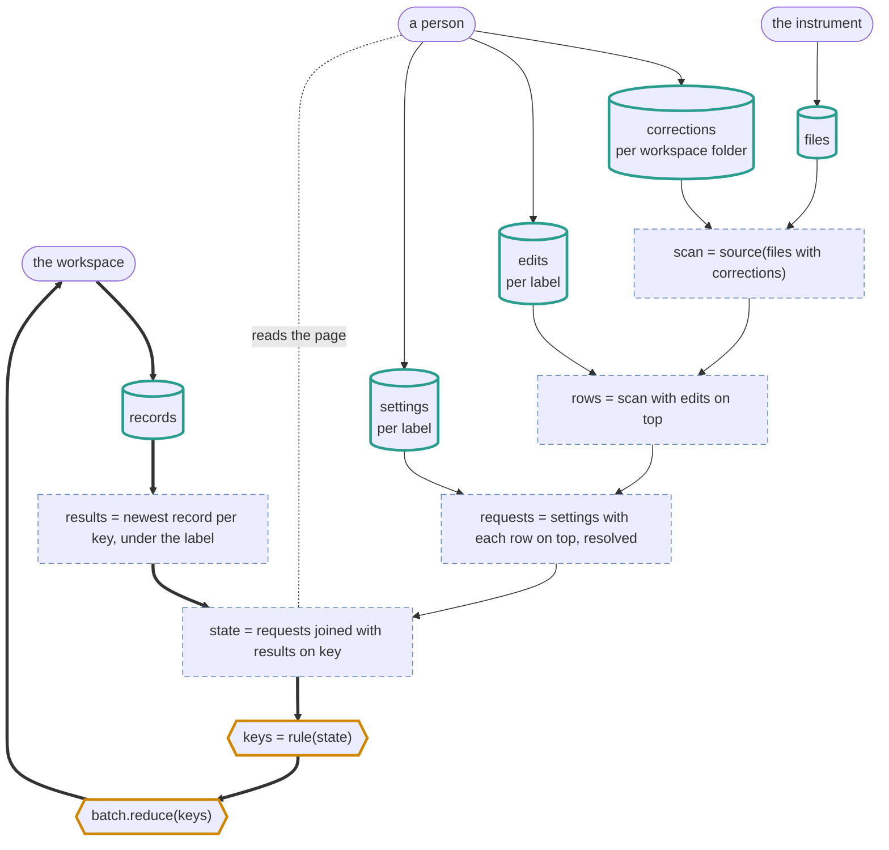
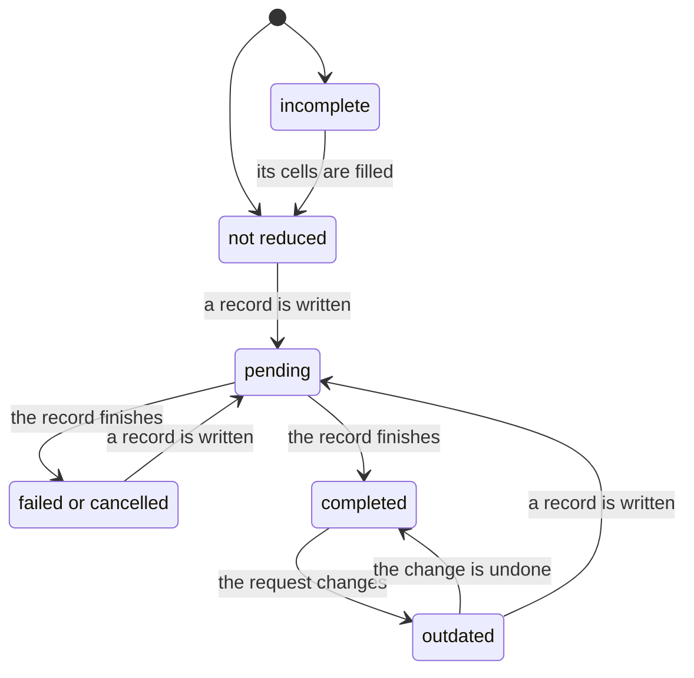

# Batch toolbox for application developers

`ess.apps.batch` is for applications that reduce many samples with one workflow: a table of rows, settings shared by all rows, and the result of each row.
It is built on the client of `ess.apps`. A *spec* declares a workflow's parameters, and a *binding* connects a spec to code. [The client guide](../../../docs/developer/roles/client-authors.ipynb) explains specs, records, labels, and stages.
Your application supplies what depends on the technique: which files make which rows, and optionally how to draw a result.
[The model](#the-model-tables-and-one-cycle) shows a batch as stored tables, derived tables, and one cycle.

## An application

```python
from ess.apps import local
from ess.apps.batch import Batch, FileInfo, Row
from ess.apps.batch.panel import BatchView
from ess.apps.panel import App

def pair_by_sample(files: Sequence[FileInfo]) -> list[Row]:
    """A row per sample run, with the transmission run of the same sample."""
    partner = {f.metadata.get('sample'): f.ref for f in files
               if f.metadata.get('role') == 'transmission'}
    rows = []
    for f in files:
        if f.metadata.get('role') == 'sample':
            name = f.metadata.get('sample')
            values = {'sample': f.ref}
            if name in partner:
                values['sample_transmission'] = partner[name]
            rows.append(Row(str(f.metadata['run']), values, info={'name': str(name)}))
    return rows

client = local(proposal='p1', files=files, bind=BINDINGS)
batch = Batch(client, IOFQ, columns=('sample', 'sample_transmission'),
              label='iofq', source=pair_by_sample, staged=True)
view = BatchView(batch, info=('name',), draw=draw_iofq)
view.scan()
App(client, plots=PLOTS, tabs={'I(Q)': view}).panel().servable()
```

`python -m ess.apps.batch.panel.demo [DIRECTORY]` serves a complete application on fake files and fake workflows, with its workspace in a folder (see [The app and the command on one folder](#the-app-and-the-command-on-one-folder)).
`ess.instruments.loki.batch` holds a source and a `Batch` for the real LoKI workflows, without a view.

The same logic works without widgets, in a notebook or a test:

```python
from ess.apps.batch import ready, remaining

batch.settings = settings      # one write; nothing is reduced for it
batch.scan()
state = batch.state()           # where each row stands
records = batch.reduce(ready(state))
batch.reduce(remaining(batch.state()))
batch.cancel()
```

`batch.settings` is a read-only mapping of the parameters that are not columns, as `Form.params` gives them. `Batch(..., settings=...)` gives the settings that a new batch starts with, such as the technique's defaults. Every state and every reduction reads them. Only an assignment of all of them changes them: `batch.settings` is a copy, so `batch.settings['q'] = ...` raises, and a change inside a value changes only the copy.

## The model: tables and one cycle

A batch is a set of tables. Five of them are stored, and each has one writer. All others are derived: they are computed from the stored tables at each read and stored nowhere.

| Stored table | Written by | Holds | One table per |
|---|---|---|---|
| files | the instrument | the files that the file source lists, with their metadata | workspace |
| corrections | `CorrectedFiles` | metadata of a file set by hand | workspace folder |
| edits | `Batch.rows` | cells set, rows added or removed, by key | label |
| settings | `Batch.settings` | the parameters that are not columns | label |
| records | the workspace | a record per submission, with its status | workspace |

```python
# derived at each read
scan     = source(files with corrections)
rows     = scan with edits on top
requests = settings with each row on top, resolved
results  = newest record per key, under the label
state    = requests joined with results on key
```

A *correction* is a value of a file's metadata set by hand ([When the metadata is wrong or missing](#when-the-metadata-is-wrong-or-missing)). The corrections, edits, and settings are the *definition* of a batch, the part that a person makes, through a page, the command, or code. [Where the definition is kept](#where-the-definition-is-kept) says where they are stored and when they are read. A request is *resolved* as a record holds it ([Rules](#rules)). `state` is what `batch.state()` gives and a page shows: each row with its result, its status, and `changed`, the parameters at which the row's request differs from its result's ([Rules](#rules)).

An edit sets only columns. A value at a name that is not a column makes its row `incomplete` (`not a column`). A row reduced with settings of its own is a *tweak* ([Rules](#rules)). Which results are tweaks is kept in memory by the `Batch` that made them (`RowState.tweaked`), not in the edits. Apart from that, a `Batch` made again on the same stored tables reads the same state.



Cylinders are stored tables and dashed boxes derived ones. The thick arrows are the cycle.

**The cycle** is the only path from the state to a write of a stored table, apart from a person who reads the page and changes the definition. A *rule* is a function from the state to keys, and `batch.reduce` submits those rows. The workspace writes their records, and the results and the state follow from them:

```python
batch.scan()                  # if the trigger scans
state = batch.state()         # with the batch's settings
batch.reduce(rule(state))
```

Every way of reducing a batch is this cycle, with its own rule and its own trigger:

| Trigger | Who | Rule |
|---|---|---|
| **Reduce** on the page, **Reduce remaining** in `BatchView` | a person | `left_to_reduce(state, batch.columns)` |
| **Apply to all** on the page, **Apply settings to all** in `BatchView` | a person | `earlier_settings(state, batch.columns)` |
| **Reduce all**, **Reduce selected** | a person | `ready(state)`, the keys selected |
| **Follow** on the page: a timer that scans as **Rescan runs** does, and each action of a person | the page's process | `arrived(state, at)` |
| `Automatic.step`, which `run` calls from a timer | a process of its own | `arrived(state, at)` |
| `essapps-batch reduce` | a person or a script | every row of the table, or `remaining(state)` with `--remaining` |

So a person and automatic reduction differ in the rule and in the trigger only. [Rules](#rules) defines each rule, and [Automatic reduction](#automatic-reduction) compares the rows they give. A person is a second loop: they read the state on the page and write the definition. In automatic reduction this loop is idle most of the time.

A change of settings is one write of `batch.settings`, and runs no cycle. The rows reduced before keep their results, and `changed` names the setting. `left_to_reduce` and `arrived` leave these rows, and `earlier_settings` gives them. No history of the settings is stored: each record holds the settings it was made with.

**The status of a row** is a function of the row's request and the status of its result, both read from stored tables. The batch stores no status of a row:

```python
def text(row):                                       # RowState.text
    if row.status is PENDING: return 'pending'       # row.status: the status of the result
    if row.problems:          return 'incomplete'    # a cell is empty, not a column, refused, or reads a failed record
    if row.status is None:    return 'not reduced'   # no result
    if row.outdated:          return 'outdated'      # the request or the spec differs from the result's
    if row.outdated is None and row.status is COMPLETED and not row.tweaked:
        return 'outdated'                            # not compared, as while the settings are refused
    return str(row.status)                           # 'completed', 'failed', 'cancelled'
```

So the diagram has no memory of its own. Each arrow is a write to a stored table by the writer of that table:



| Arrow | Writer | Stored table |
|---|---|---|
| its cells are filled, the request changes, the change is undone | a person, or the instrument | corrections, edits, settings, or files |
| a record is written | the workspace, when the cycle submits the row | records |
| the record finishes | the workspace | records |

A failed or cancelled row reads `outdated` when its request changes, as a completed one does, and goes back when the change is undone. A row reads `incomplete` from any state but `pending` when a cell is emptied or refused. The diagram leaves out these arrows. The pages show some states in other words. The batch page shows `not reduced` as `ready`, `pending` as `running`, and `completed` as `done`. A row of `earlier_settings` reads `outdated`, but the batch page shows it as `done`, marked "earlier settings", and `BatchView` and a table written show `completed, earlier settings` (`status_texts`). The batch page shows a failed or cancelled row as `failed` or `cancelled` whether or not its request changed.

**Not in this picture:**

- The fixed part of a batch: the spec, the columns, and the source. It is code in the technique's package.
- A chain: a second batch whose scan reads the results of the first ([Chains](#chains)).
- Publishing results.

## Terms

- A **column** is a parameter of the spec that differs per row, such as `sample`. The columns are the blanks of a `Template`.
- The **settings** are all other parameters, shared by every row. They are the batch's (`batch.settings`), and the template's values.
- A **row** has a **key**, a value per column, and read-only **info** to show with it. A cell can hold anything a request can: a file, a reference to an output, a number, a list of runs.
- A **source** is your function from files to rows. A **scan** calls it.
- An **edit** is a cell set, a row added, or a row removed, by hand: by a person or by your code.
- A row's **result** is the newest record with the batch's label and the row's key as its member, of any spec and whoever submitted it. So two `Batch` objects with the same label are one batch: give each batch its own label. An application that wants a table per person puts the person in the label.
- A row's **request** is what `reduce` would submit for it now: the settings and its cells. A result is **outdated** if the row's request differs from the result's, or if the result is of another spec than the one bound ([Rules](#rules)).

Choose a key that does not change from one scan to the next, such as the run number. Results and edits are found by key. Put the name of the sample in `info`, under a name that is not a column.

## Rules

**A scan never overrides what was set by hand.** A table holds two layers, what the last scan gave and what was set by hand; a row's cells are the first with the second on top.

```python
t = RowTable().rescan([Row('a', {'x': 1, 'y': 2}), Row('b', {'x': 3})])
t = t.edit('a', {'x': 10}).remove('b')
t = t.rescan([Row('a', {'x': 99, 'y': 98}), Row('b', {'x': 3}), Row('c', {'x': 5})])
# a: x is 10, set by hand, and y is 98, from the scan
# b: stays removed
# c: new
```

A row added by hand stays. An edited row that a scan no longer gives is not shown, and comes back with its edits if a later scan gives it. `reset(key)` forgets a row's edits and that it was removed; `reset(key, column)` forgets the edit of one cell. `EMPTY` clears a cell whatever the scan gives. A batch given definitions keeps what was set by hand there, so a batch made again on the label has it on top of its first scan ([Where the definition is kept](#where-the-definition-is-kept)).

**A row is ready if it is complete and not running.** Each column with no default has a value, no cell reads a record that failed or was cancelled, and its result is not running. An empty cell of a column with a default takes the default. Whether a value is valid, such as a thickness below zero, is checked at submission, and by `state()` for a value that differs from the row's result (below).

| Function | Gives |
|---|---|
| `ready(states)` | every row that can run now |
| `remaining(states)` | ready rows with no result, a failed or cancelled one, or an outdated one |
| `arrived(states, at)` | ready rows with no result, or whose request differs from their result's at a column of `at` ([Automatic reduction](#automatic-reduction)) |
| `earlier_settings(states, columns)` | ready rows whose completed result differs from their request only at settings, not at a column, and of the same spec; no tweak |
| `left_to_reduce(states, columns)` | the rows of `remaining` but those of `earlier_settings` |
| `refused_again(states, at, refused)` | of the reasons `refused` by row, those of the rows of `arrived`: why the next step of a loop will be refused again |
| `status_texts(states, columns)` | the status of each row as a table shows it: `completed, earlier settings` for a row of `earlier_settings` |
| `summary(states)` | the number of rows in each state |

**A row's state is read from its result.** `state()` compares each row's request, its cells with the settings, with the request of its result, and says where they differ:

```python
s = batch.state()['60339']
s.record         # the result: the newest record under the label with member '60339'
s.changed        # frozenset({'q'}): the parameters whose value differs from the result's
s.spec_changed   # True if s.record is of another spec than the one bound
s.outdated       # True if either holds; for a tweak, if a column changed (below)
s.text           # 'outdated'
```

The state is read from the records, so every `Batch` on the label, and the same one after a restart, reads the same, with two limits. A `Batch` knows its own tweaks only (below). A `Batch` keeps how it resolved a file name until its next `scan`. That differs from a new `Batch` only for a file that gained a catalogue identifier since: its names, its old identity among them, now resolve to the identifier. `results()` gives each row with its result but without its request: it resolves nothing, so `changed` is empty, and a result is `outdated` only if it is of another spec. It is what a page shows while the settings are refused, and what `reduce` checks before it submits.

A record holds its request resolved: files by identity, defaults filled in, values in their JSON form. So `state()` resolves with `client.resolve` what it compares. The settings are resolved once per call, whatever the number of rows, and compared with each result. If they are refused, `state` raises the `SubmitError`, with reasons that name no row: no row can run with them. A cell of a row with a result is compared as given first, and only a cell that differs so is resolved and compared again, so writing a default out, or naming a file by run, does not make a row `changed`. Every cell of a row without a result is resolved, so a file named before it is measured shows before anything is submitted. A value resolved is kept by its column and its value, with the type of the value and of each element of a list or tuple, until the next `scan`; a value that cannot be a dictionary key, such as a dict, is resolved at each call. A cell that `resolve` refuses is not `changed`: its reason is one of the row's `problems`, so the row shows as `incomplete`, with the reason at the cell, and neither `ready` nor `remaining` gives it. It is asked again at the next call, so a file that arrives later is found.

**Cost of `state()`.** Measured with 30 000 rows of two files each, on an in-memory workspace with a file source that finds a name by one lookup:

| 30 000 rows | first state | later states |
|---|---|---|
| with results, cells as the records hold them | 0.7 s | 0.5–0.9 s |
| with results, every row edited | 2.8 s | 0.5 s |
| with results, files named by run | 6–7 s | 0.7–1.3 s |
| without results | 6–9 s | 0.3–0.7 s |
| 10 chosen rows (`keys`) | 0.6 ms | 0.6 ms |

A first state is paid by a new `Batch` and again after each `scan`, which drops what was kept. Nearly all of it is the workspace validating each value resolved, about 0.1 ms per value. A list cell is kept too: 3 000 rows of a list of one file named by run take 0.4 s at the first state and 17 ms later. `results()` resolves nothing.

A result of another spec stays the row's result. Its request and its outputs are read as stored data ([ADR 0009](../../../docs/developer/adr/0009-a-record-of-another-spec-stays-readable.md)), so the results of two versions of a spec can be compared until the row is reduced again.

**`reduce` is strict and all-or-nothing.** The rows given are submitted in one call. If any is refused, or still running, none is submitted, and the `SubmitError` names the rows refused. `FieldError.entry` is the row's key and `loc[0]` the column. A reason about the settings appears once, with no key. So `reduce(ready(state))` skips incomplete and running rows, while one invalid value refuses the whole call and names the row. The workspace checks values first and references second, so correcting the rows named can bring up more.

**With `staged=True`** the rows go through a stage, and what they share is computed once. It needs a binding that makes stages. A stage is reused while the settings are the same. Whether a column can vary through a stage is the binding's to decide, and a refusal says so; a column that everything depends on saves nothing.

**One row with other settings.** `tweak(key, params)` submits one request with all of its parameters, which becomes the row's result, and its state is `tweaked`; a newer record of the row ends that. While it is the row's result, `changed` names every parameter at which the row's request differs from the tweak's, as for any row, but the row is `outdated` only if one of them is a column. So a tweak that sets a column to another value than the row's cell reads `outdated` at once. Only the `Batch` that made the tweak knows it: after a restart, or on another `Batch` on the label, the tweak's result is read as any other, and the row reads `outdated` where the tweak differs from the settings. `tweak_params(state)` gives the params that a form for a tweak starts from: the row's cells, and the other parameters of its result, or the settings if it has none or one of another spec, whose parameters are not this spec's. If a parameter differs for many rows, make it a column.

## Writing a source

A source takes `FileInfo(ref, metadata)` for each file, and returns `Row`s. It calls nothing but, in a chain, the `state` of another batch ([Chains](#chains)), so test it on plain data:

```python
def test_a_sample_run_pairs_with_its_transmission_run():
    rows = pair_by_sample([info(1, role='sample', sample='w'),
                           info(2, role='transmission', sample='w')])
    assert rows[0].values['sample_transmission'] == ref(2)
```

Group runs by giving a cell a list of files, in one order at every scan, such as sorted by run: `FileSource.list` promises no order, and a list in another order is another request, which automatic reduction reduces again ([Automatic reduction](#automatic-reduction)). Choose one of several partners by an order too, such as the last by run. Leave a cell out if a partner is missing, so the row shows as incomplete and the rest of the batch can run. A key given twice is refused with the key named, and nothing changes.

Pairing is yours to write. The framework knows no technique. If a source raises, the view shows the error in its message.

## When the metadata is wrong or missing

Wrap the file source, and give the wrapper to the workspace. Forms and sources then all see a file as corrected:

```python
files = CorrectedFiles(FolderFiles('/data', table))
client = local(proposal='p1', files=files, bind=BINDINGS)
files.correct(run, role='sample')       # or exclude=True, if your source reads it
```

`RunSheet` is a table of the files in which a person does this. You choose the fields with a pydantic model:

```python
class Marks(BaseModel):
    role: Literal['sample', 'transmission'] | None = None

sheet = RunSheet(files, client, Marks, then=view.scan)
App(client, tabs={'I(Q)': view, 'Runs': sheet})
```

## Where the definition is kept

The *definition* of a batch is the corrections, the edits, and the settings ([The model](#the-model-tables-and-one-cycle)). Give the batch and the file source the *definitions* of the workspace, and a batch made again, after a restart or in another process, starts with them:

```python
from ess.apps.batch import FolderDefinitions

definitions = FolderDefinitions(directory)                   # the workspace's folder
files = CorrectedFiles(folder_files(directory), definitions=definitions)  # reads the corrections
client = open_folder(directory, BINDINGS, files=files)
batch = Batch(client, IOFQ, columns=..., label='auto/iofq', source=pair_by_sample,
              settings=DEFAULTS, definitions=definitions)    # the settings kept replace DEFAULTS
batch.scan()                                                 # the scan, with the edits kept on top
```

Without definitions, all three stay in memory. The edits and settings are read when the `Batch` is made, the corrections when the `CorrectedFiles` is made, and nothing reads them again while these live. Each change is written to the definitions before it is made, so a change that they refuse raises `NotKept` (an `OSError`) and changes nothing; the page answers it with a message, and its settings form shows the batch's settings again. A scan writes nothing.

What is written is what is assigned: `batch.rows = ...`, `batch.settings = ...`, `batch.put(...)`, and `files.correct(...)`, `files.correct_each(...)`, `files.reset(...)`. `batch.settings` is a read-only copy, so a change inside it changes nothing, and settings that name a column raise `ValueError`. The methods of `RowTable` return a new table. Its `edits` and a row's `values` are plain dicts, though: a change made in them is not written and is lost at a restart, so never change them in place.

`FolderDefinitions` writes JSON files, which a person can read, in `definitions/` of the folder. A label holds `/`, written as `%2F`, so each label has a folder of its own:

```
definitions/corrections.json                    every file source of the workspace
definitions/labels/auto%2Fiofq/edits.json       what was set by hand on the rows
definitions/labels/auto%2Fiofq/settings.json    a template, which essapps-batch reads
```

```json
{"added": [{"key": "mine", "values": {"sample": {"@ref": "file", "file": "run:60400"}}, "info": {"name": "mine"}}],
 "edited": {"60339": {"thickness": 2.0}},
 "cleared": {"60339": ["sample_transmission"]},
 "removed": ["60340"]}
```

A file is written to a temporary file next to it, which then replaces it, so a reader never sees half of one; a temporary file left by a write that was cut off is removed when the file is read. A label too long to name a folder, once written so, is refused with `ValueError` when the batch is made. Labels that differ only in case share a folder on a file system that ignores case, such as that of macOS.

The edits hold only what was set by hand, so a cell from the scan follows the files after a restart. A definition kept that no longer fits the code:

- An edit at a column that is gone makes its row `incomplete` (`not a column`). The page offers to remove it.
- Settings of another version of the spec are read as they are. The settings form shows those that fit, and names the others with their values. `state()` and `reduce` refuse what the spec bound does not take. Nothing is written until a person changes a setting, which writes the settings of the form.
- Settings of a spec of another name raise `ValueError` when the batch is made, naming the file and both specs.
- A correction of a file no longer listed is kept, and not used.
- A file that is not of the shape described raises `ValueError` naming the file and the entry, when the batch or the `CorrectedFiles` is made.

Two `Batch` objects on one label and one folder each write their whole table of edits at each change. A change made through the other since it was made is lost, and neither sees the other's changes. A label has one `Batch` in a process: the Panel demo shows one batch in every session.

The files that a person loads and writes ([The UI](#the-ui)) are copies, for other people and other tools. The definitions are the one place that a batch is kept, for an application and for the command ([The app and the command on one folder](#the-app-and-the-command-on-one-folder)).

## Chains

A cell may read another record, also one still running, so a row can use a value computed for that row:

```python
centres = find.reduce(remaining(find.state()))
for key, record in centres.items():
    iofq.rows = iofq.rows.edit(key, {'beam_centre': record.ref('centre')})
```

After a centre failed, this reruns only what is left, and points those rows at the new centre. The field must be typed `Referenced[...]` in the spec.

A source that reads the other batch's state makes the same cells at every scan, without an edit for each new row, which automatic reduction needs:

```python
def with_centre(files: Sequence[FileInfo]) -> list[Row]:
    found = {k: s.record for k, s in find.state().items() if s.record}
    return [replace(row, values={**row.values, 'beam_centre': found[row.key].ref('centre')})
            if row.key in found else row
            for row in pair_by_sample(files)]
```

Scan `find` before a batch with this source, so that its rows see the newest centres.

## Automatic reduction

Automatic reduction reduces a batch as its files arrive. Its *loop*, an `Automatic`, needs a batch with a source, which should persist what it submits, since nothing releases its records:

```python
from ess.apps.batch.auto import Automatic, run

batch = Batch(client, IOFQ, columns=('sample', 'sample_transmission'), label='auto/iofq',
              source=pair_by_sample, staged=True, persist=True, settings=settings)
loop = Automatic(batch, at={'sample'})
loop.step()       # scans, and reduces the rows that arrived; their records by key
loop.refused      # why rows of the last step were refused, by key
run([loop])       # steps once a second, until a step raises
```

A step is [the cycle](#the-model-tables-and-one-cycle) with a scan and the rule `arrived`: `batch.reduce(arrived(batch.state(), at))`, with the batch's settings as they are at the step.

`at` is a set of columns, and has no default. A row with no result is reduced whatever `at` is. A row with a result is reduced again only if its request differs from its result's at a column of `at`. Take a source that makes a row per sample, with the lists `sample_runs` and `trans_runs`, and leaves `trans_runs` out until a transmission run arrives. The files arrive as `s1, t1, s1', t1'`, where `s1'` repeats `s1`, and each step finishes before the next file arrives:

| Arrives | `at={'sample_runs', 'trans_runs'}` | `at={'sample_runs'}` | `at=set()` |
|---|---|---|---|
| `s1` | nothing: row 1 is `incomplete` | nothing | nothing |
| `t1` | row 1, `[s1]`, `[t1]` | row 1, `[s1]`, `[t1]` | row 1, `[s1]`, `[t1]` |
| `s1'` | row 1, `[s1, s1']`, `[t1]` | row 1, `[s1, s1']`, `[t1]` | nothing: row 1 reads `outdated` |
| `t1'` | row 1, `[s1, s1']`, `[t1, t1']` | nothing: row 1 reads `outdated` | nothing |

So the loop, the page's buttons, and the command differ:

| A row is reduced if it has | no result | a failed or cancelled result | a result, and a setting changed | a result, and a cell changed at `at` | a result, and a cell changed at another column |
|---|---|---|---|---|---|
| the page, "Reduce", and `BatchView`, "Reduce remaining" (`left_to_reduce`) | yes | yes | no | yes | yes |
| the page, "Apply to all", and `BatchView`, "Apply settings to all" (`earlier_settings`) | no | no | yes, but for a tweak | no | no |
| `essapps-batch reduce --remaining` (`remaining`) | yes | yes | yes, but for a tweak | yes | yes |
| the loop (`arrived`) | yes | no | no | yes | no |

On the page, a change of settings applies to rows not reduced yet, and to all only when a person says so. The command is given its settings at each call, so it applies them to all.

A tweak is `outdated` only where a column changed ([Rules](#rules)), so neither the page nor the command reduces a tweaked row whose settings changed. A failed or cancelled result counts as any other, so a row whose reduction fails is not reduced at every step. A changed setting reduces no row again ([The model](#the-model-tables-and-one-cycle)). A person reduces those rows through the loop's batch, with **Apply to all** on the page ([one label, one batch](#one-label-one-batch)).

A row whose result is running is not ready, and the loop does not submit it again. At the first step after its record finishes, it is reduced if a file arrived meanwhile at a column of `at`.

`state` compares requests resolved. So a cell that names a file by run, `file(run=60339)`, equals the identity that the record holds, and its row is reduced once. A file that gained a catalogue identifier since its row was reduced resolves to another identity, and its row is reduced again if the cell is at a column of `at`. A list is compared element by element, in order: a list at `at` in another order, or shorter, reduces the row again. So a source gives a list in one order at every scan ([Writing a source](#writing-a-source)).

A result of another spec, such as an older version, stays the row's result ([Rules](#rules)). Its request differs from the row's at each parameter that the other spec lacks, so the loop reduces the row again only if a column of `at` is among them, or a file arrives there.

A row whose key changes from one scan to the next, such as a key made from a sample name that a correction changed, is a new row, and is reduced again under its new key; so choose a key that does not change, such as the run number ([Terms](#terms)).

The batch page holds a loop of its own: its switch "Follow" steps it on the page's batch ([The UI](#the-ui)). In a chain, step the loop of the batch that is read first: `run([Automatic(find, ...), Automatic(iofq, ...)])`. [automatic-reduction.md](../../../docs/developer/automatic-reduction.md) holds the design, its cost, and what is open.

### One label, one batch

Which rows a step reduces follows from the files, the batch's rows and settings, and the records under its label. The loop keeps nothing else, so a step that raises, in the settings, the source, or a submission, loses nothing. The loop keeps the results under its label equal to its batch's rows at the columns of `at`:

```python
page = Batch(client, IOFQ, columns=..., label='auto/iofq', source=pair_by_sample)  # a second batch on the label
page.rows = page.rows.edit('60339', {'sample': file(run=60400)})
page.reduce(['60339'])               # a record with run 60400 at `sample`
loop.step()                          # reduces '60339' again with the source's file: the loop's rows win
```

So a label has one batch. A person who wants another file for a row edits the loop's own batch, or corrects the file's metadata so that the source gives the row another file ([When the metadata is wrong or missing](#when-the-metadata-is-wrong-or-missing)). Two loops never share a label: if their rows differ at `at`, each replaces the other's records at every step. A record under the label that equals the loop's row at `at`, from any submitter, counts as the row's result.

A restart starts from a new scan, with the edits that the batch's definitions kept. So after a restart, a row is not reduced again unless the files changed it at `at`. Without definitions the edits are gone, and a row that was edited at a column of `at` is reduced again with the source's cells. A record that was running when the workspace ended is failed at the restart; the loop does not run a failed row again, and a person retries it.

### Problems and refusals

A row with an empty cell, or a cell that the workspace does not accept when the state is read, such as a thickness below zero or a file named before it is measured, is `incomplete`. The reason is one of the row's `problems`, `arrived` does not give the row, and the loop reduces it once the cell is filled or accepted.

`submit` checks a few things that `state` does not, such as a reference to an output that the workspace no longer keeps, and refuses the rows with a `SubmitError`. The step drops the rows that the error names, submits the others, and `refused` holds the reasons by key until the next step. Such a row is submitted again at every step. A reason that names no row refuses every row of the step. If the settings are refused, no row can run: the step submits nothing, and `refused` holds the reason for every ready row, `{'1': 'unknown spec sans-iofq/v1'}`.

## From files, and from the command line

A batch can be given as two files: a template, and a table with a row for each sample.
The command `essapps-batch` reads them (extra `[files]`):

```yaml
# iofq.yaml: a Template
spec: {name: loki-iofq, version: 1}
blanks: [sample, sample_transmission]
params:
  can: 60393                               # a run
  can_transmission: 60392
  empty_beam: 60392
  direct_beam: /data/direct-beam.h5        # a path; null for none
  masks: {'@latest': masks, output: masks}  # the newest record labelled masks
  beam_centre: {x: -0.029, y: -0.018, z: 4.116}
  wavelength: {start: 1.0, stop: 13.0, num_bins: 200}
  q: {start: 0.01, stop: 0.3, num_bins: 100}
```

```
# runs.csv
sample,sample_transmission,name
60339,60394,water
60250,60394,sds
```

```sh
B="essapps-batch --bind ess.instruments.loki.bindings:BINDINGS"
$B reduce iofq.yaml runs.csv --label water-series -o done.csv
$B export done.csv reduced -o exported.csv
```

```
# exported.csv
sample,sample_transmission,name,status,record,failure,iofq,transmission
60339,60394,water,completed,2e35ce83...,,reduced/60339/iofq.h5,reduced/60339/transmission.h5
60250,60394,sds,failed,bd9864f1...,OSError: ...,,
```

Each step is a command, and a function for a notebook that takes and returns a pandas `DataFrame`:

| Step | Command | Function |
|---|---|---|
| list the files | `files package.module:read --with runs` | `frames.described(pd.DataFrame(scan_folder(folder, read)), runs)` |
| make the table | `rows package.module:source`, or a spreadsheet | `frames.table_of(source(batch.file_infos(client)))` |
| reduce it | `reduce template table --label ...` | `frames.reduce_table(client, template, table, label=...)` |
| write the outputs to files | `export table folder` | `export.export_table(client, table, folder)` |

A table is a `.csv`, `.tsv`, or `.xlsx` file.

In a notebook, the table is a `DataFrame` and the template a `Template`, and no file is needed. [loki-batch.ipynb](../../essinstruments/docs/loki-batch.ipynb) runs every step on LoKI's data:

```python
done = frames.reduce_table(client, template, table, label='water-series')
exported = export_table(client, done, Path('reduced'))
```

A cell that is not text is its value, and `None` or `NaN` is an empty cell, so only a table read from a file is all text. To write `None` itself in a cell, as opposed to leaving it empty, write the text `null`.

**The table.** The first column holds the key of each row; it may also be a blank, as `sample` above. A column named as a blank holds its cells. A column of any other name is info, which comes back as it is; a column named `key`, as `frames.table_of` writes the key, is not info. Two mistakes are refused: a blank that is no column, such as a misspelt header, and a column named as a parameter that is not a blank, whose cells no row would use. An empty cell takes the parameter's default.

**A cell** is read as JSON if it is JSON, so `1.5`, `null`, and `{"x": 0, "y": 1}` are values, and anything else is text. Text that is JSON is written in quotes, such as `"12"` for a sample name at a string parameter; a `.csv` file doubles them, `"""12"""`. At a parameter that is a file field, or a list of them, a whole number names a run, text with a kind, such as `pid:...` or `path:...`, a file as the record holds it, and other text a path, relative to the working directory. A table that the batch writes holds each file as the record does, by its identity: `pid:20.500.12269/<uuid>` for a raw file the catalogue lists, and `path:masks/mask.xml`, relative to the workspace's folder, for any other file in it. A number with a leading zero, such as `0342`, is not JSON, so it is read as a path: write `342`. The same holds for the values of the template's file. A file field inside a group takes the JSON form, `{"@ref": "file", "file": "run:60339"}`. Every file is one that the workspace's file source knows.

**`reduce`** returns the table with three columns, which it replaces if the table has them: `status`, the ID of the `record`, and `failure`, the reason. So its result can be its next table. With `--remaining` it reduces only the rows that `remaining` gives: those with no result, a failed or cancelled one, or an outdated one, whose cells or settings changed since, or whose result is of another spec ([Rules](#rules)). A row that cannot run is submitted all the same, so that the command refuses it by name. The `status` of a row is `completed`, `failed`, or `cancelled`.

Ctrl-C cancels every row that has not completed, those running among them, and the command ends with a `KeyboardInterrupt` once the workflows that were running return. It writes no table; reduce again with `--remaining`.

**`export`** writes the outputs of each completed row to `<folder>/<key>/`, and returns the table with a column for each output that holds the path of its file. It finds the outputs by the `record` column, not by the label. A key must be the name of a folder, so one with `/` is refused.

```
reduced/60339/iofq.h5          what scipp.io.load_hdf5 reads: a DataGroup of the output's fields
reduced/60339/_record.json     the record: every file and value the outputs came from
```

These files are a placeholder (`ess.apps.hdf5` states the format). A format of a technique, such as NXcanSAS, is not written. If the folder is inside the workspace, a later `files` lists what was exported.

**Exit status.** 0: done, and for `reduce`, every row completed. 2: the command or a row was refused, and nothing ran. 3: a row did not complete. 1: any other error. Every command but `files` opens the workspace, and needs `--bind`.

**The workspace** of the command is a folder, `--workspace`, the working directory by default (`ess.apps.folder`). It holds one input, which you write, and what the commands keep:

```
files.csv      input: the raw files, masks, and calibrations that a request may name
log.jsonl      history
store/         every output of every row, <record>/<output>.h5
```

`files.csv` is the table of `FolderFiles`, a stand-in for a catalogue: a row per file with its path, relative to the folder, and its metadata as text. A run number in a template or a table is looked up here. A file with a `pid`, which `read_metadata` gives a raw file that carries the catalogue's identifier, is identified by it, and any other file in the folder by its path relative to the folder. So a folder that is moved, with all it holds, keeps its records, its tables, and its results.

```
file,run,kind,role
raw/60339.nxs,60339,raw,sample
masks/mask.xml,,mask,
```

`files` writes it from the files in the folder and, with `--with`, a table that says what each run is:

```sh
essapps-batch files ess.instruments.loki.files:read_metadata --with runs.xlsx -o files.csv
```

```
# runs.xlsx: a row per run, kept by a person
run,role,sample
60339,sample,water
60394,transmission,water
,direct_beam,          <- with a column file: a file that is no run
```

`read_metadata` is a function of the instrument package, from the path of a file to its metadata, or `None` for a file that is not the instrument's (`ess.apps.folder.scan_folder`). The runs come first, by their number, since the order of the rows is the order of measurement. A file that cannot be read is left out, with a warning. Two files of one run are refused. Running `files` again after files gained a `pid` changes their identity: the loop of automatic reduction reduces them again, and earlier records name files the folder no longer knows.

A file says its kind, its run, and perhaps its sample, but not what a run is for. A row source that pairs runs reads the `role`, and a field such as the direct beam requires it. The run table gives it (`frames.described`): a row describes the file of its `run`, or the file at its `file` if it has no run. A run of the table that has no file in the folder is ignored, so the table may cover more than the folder holds. A file that no row describes keeps what it says of itself, and where both have a column, a cell of the run table that is not empty wins. Two rows for one run are refused. Without `--with`, the roles are typed into `files.csv`, so `files` then refuses to write over a table that exists.

The workspace outlives the command, so a template references a record of an earlier command. A template without blanks is one request, and `reduce` without a table submits it:

```sh
$B reduce detector.yaml --label detector      # prints key,status,record,failure
$B reduce masks.yaml --label masks            # detector: {'@latest': detector, output: detector}
$B reduce iofq.yaml runs.csv --label water-series
```

`{'@latest': label, output: name}` is read when the command starts, as the output of the newest record under the label, of `member` if given, whoever submitted it. It is for a template, not for a cell of a table. The record of each row holds the ID that it was read as. A reference by ID is `{'@ref': output, record: ..., output: ...}`.

One command holds the folder at a time. If a command was killed, the next one first finishes the rows that had not started, but fails those of a spec it does not bind with the same version and models. A row that was running fails, since its workflow may have been what ended the process. Reduce again with `--remaining` to submit every row that has not completed, the failed ones included. A command that binds another version of a spec, or the same version with changed models, reads the old results as plain scipp data, and reduces their rows again with `--remaining`. Nothing removes the files of the store.

## The UI

[The batch page](../src/ess/apps/batch/web/README.md) (`ess.apps.batch.web`) shows a batch in a browser: how to run it, its layers, and its limits.
A change of its settings applies to the rows not reduced yet. A row reduced before is shown as done, marked "earlier settings", and "Reduce" leaves it; **Apply to all** in the settings reduces those rows again, after a confirmation that names how many. Given the columns `at`, the page offers a switch **Follow**: a step every few seconds does what **Rescan runs** does and reduces the rows that `arrived` gives, in the page's own process and batch. It reduces by the rule of **Reduce**, so nothing while the settings form misses something, and each action of a person is followed at once by a step's reduction. Whether the page follows belongs to its process, not to the definition: a restart starts with `--follow` or without.

`BatchView` is a tab for `App`:

- the settings form, which writes the batch's settings at each change that leaves nothing missing, the table of rows with a filter by state, and a count of each state;
- buttons to scan, reduce all, reduce remaining, reduce selected, cancel, and show the settings of a selected result. As on the web page, a change of settings applies to the rows not reduced yet: **Reduce remaining** leaves the rows reduced with earlier settings (`left_to_reduce`), which the table marks so, and **Apply settings to all** reduces them again (`earlier_settings`);
- details of a selected row, with the reason it failed;
- an editor: select rows, change cells, and **Update selected** writes only the changed cells, to all of them. A cell with something missing is not written and is named. To write a value that equals its default to several rows, choose the column in **Write**;
- **Bring back removed rows**;
- a form for a tweak of one row;
- a path, and buttons that read and write the files of the command: **Load rows** and **Write rows** (a table), **Load settings** and **Write settings** (a template), and **Export selected** (a folder of outputs). The page's **Download** of a table or of the settings is what **Write** is here.

## The app and the command on one folder

A person and the command share one workspace folder (`open_folder`), and a label is one batch for both: the command keeps a batch in the folder's definitions as an app does. One process holds the folder at a time, so stop the app before the command runs:

```sh
python -m ess.apps.batch.panel.demo ws     # Write rows: rows.csv, Write settings: settings.yaml
B="essapps-batch -w ws --bind ess.apps.batch.panel.demo:BINDINGS"
$B reduce settings.yaml rows.csv --label demo -o done.csv
$B reduce --label demo --remaining           # the batch as the label keeps it
python -m ess.apps.batch.panel.demo ws     # the rows show as completed
```

`reduce` imports what it is given into the definitions of its label, then reduces the rows of the table: the template becomes the batch's settings, and the table is set by hand as **Load rows** sets it, on the rows that `--source` makes from the files, if given, and on the edits that the label keeps. So what the command was given shows in the app afterwards, and a table older than an edit made in the app sets the cell back, as any import does. Without a template and a table, `reduce` reduces the batch that the label keeps, with the app's edits. `rows`, `files`, and `export` read the files as corrected, and keep no batch. The command finds the results of the app, and the app those of the command, if the outputs are persisted (`Batch(..., persist=True)`).

| Button | Same as |
|---|---|
| **Load rows** | `batch.scan()`, then `batch.put(frames.rows_of(frames.read_table(path), spec.params, batch.columns))` |
| **Write rows** | `frames.batch_table(batch, states)`, written with `frames.write_table` |
| **Load settings** | `batch.settings = text.settings_of(batch, text.load_template(path))`, refused if of another spec, another version of it, or with other blanks than the columns |
| **Write settings** | `text.write_template(batch.template(), path)` |
| **Export selected** | `export.export_table(client, frames.batch_table(batch, states, keys), folder)`, with the keys of the completed rows selected |

`reduce` refuses a table with a row that cannot run, so remove the incomplete rows before writing it. A table loaded is set by hand: each cell that differs from the row shown is an edit, a row the batch removed is brought back, and a row the batch does not show is added, so it stays after **Scan files**, and the definitions keep it. The `status` of a table written is what the view shows, such as `outdated`, `not reduced`, or `completed, earlier settings` (`status_texts`); the downloads of the web page write the same. `reduce` replaces the result columns, and `export` reads only the `record` column, so both take such a table. A relative path is relative to the working directory of the app.

`draw(records)` gets the completed results of the rows selected, by key, and returns a Panel object.

Any object with `refresh(listing)` and `panel()` can be a tab (`ess.apps.panel.Tab`).

## Interfaces to the framework

| Between | Interface | Why |
|---|---|---|
| your pairing and the batch | a function over plain data | there is no behaviour to abstract |
| `Batch` and the framework | `Client`, the class | one implementation; a fake would have to redo the validation that a table shows |
| `Form` and the framework | `Listing`, a pydantic model of the params, and `Form.held()` | `Form` needs neither `Client` nor `WorkflowSpec` |
| a tab and `App` | the `Tab` protocol | applications write their own |
| the logic and the widgets | the methods of `Batch` and `RowTable` | the view only places widgets and connects events |

`ess.apps` and `ess.apps.panel` import nothing from `ess.apps.batch`, and `ess.apps.batch` imports no widget library. `ess.apps.batch.panel` holds the widgets. A test enforces this.

`ess.apps.batch.web` shows the same batch as a web page without Panel: a FastAPI server and plain JavaScript. It is experimental and the candidate for a hosted interface.

## Testing an application

| What | How |
|---|---|
| your source | plain data |
| rules of rows and states | plain values; see `packages/essapps/tests/batch/table_test.py` and `state_test.py` |
| submitting, stages, refusals, reruns | `local()` with `ess.apps.testing.FakeFiles` and fake workflows; a fixture starts in milliseconds |
| a view | call its methods and read its widgets, without a browser |

```python
fake = FakeFiles('p1', tmp_path)
fake.measure(1, 1.0, role='sample', sample='water')
binding = StagedFunction(IOFQ, fake_iofq)     # function_binding for no stages
with local(proposal='p1', files=fake, bind=[binding]) as client:
    ...
```

Raise in the fake to make a row fail; hold it back on a `threading.Event` to keep a row pending.

## What it does not do

- Keep a result that is not persisted. A `Batch` finds results by key in its workspace, so `local()` per session starts with none, and a result that is not persisted is gone once its workspace closes.
- Merge two writers of one definition, or lock it. Two `Batch` objects on one label each write their whole table of edits, so a change made through the other since is lost ([Where the definition is kept](#where-the-definition-is-kept)).
- Keep a tweak across sessions. After a restart a tweak is read as a result reduced with the settings: where it differs from them only at settings, the web page marks it "earlier settings", and its **Apply to all** or the command reduces it again.
- Free the values of replaced results. They stay until the workspace closes or they are released, unless the batch persists them (`persist=`).
- Offer preparatory steps with a **Use** button. A `Referenced[...]` setting offers each record in the settings form.
