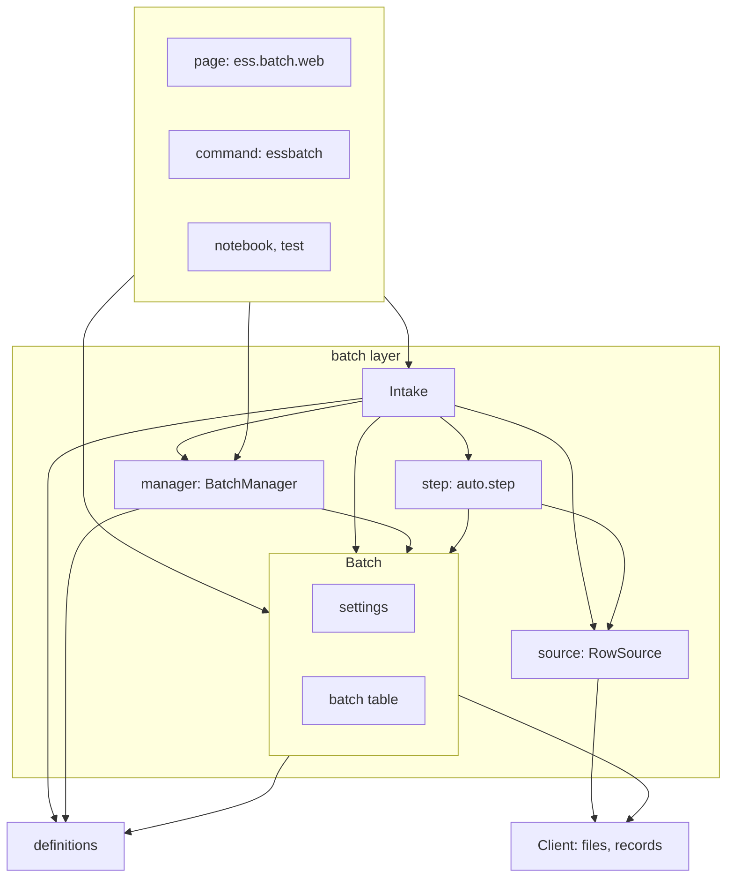
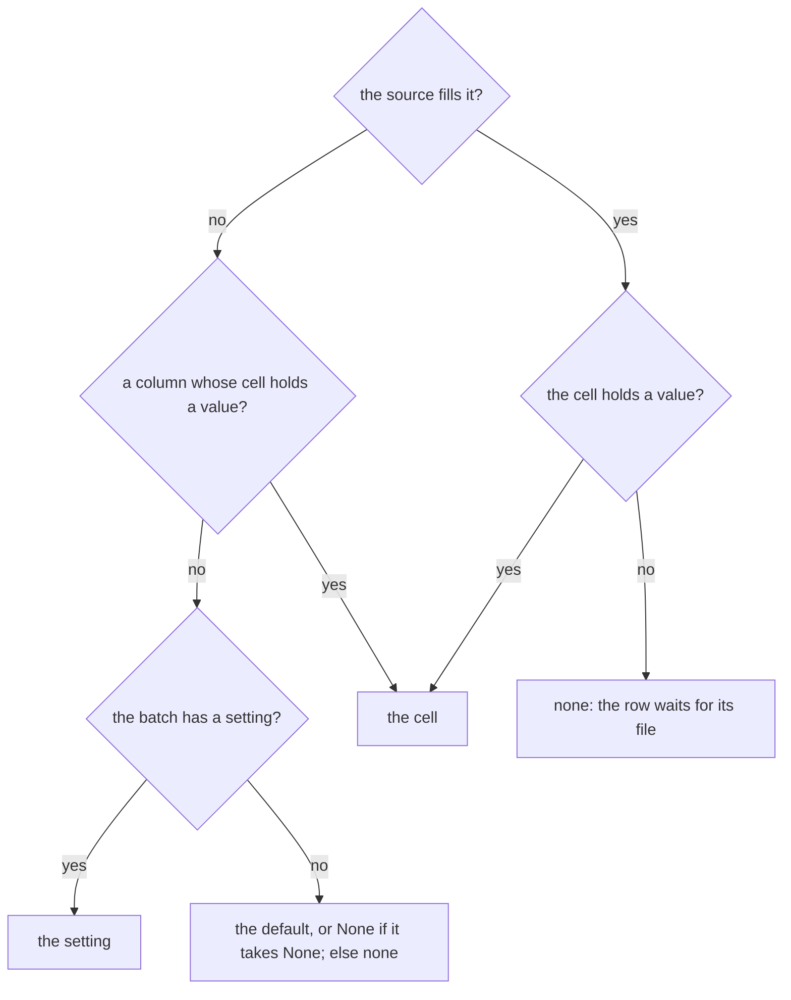
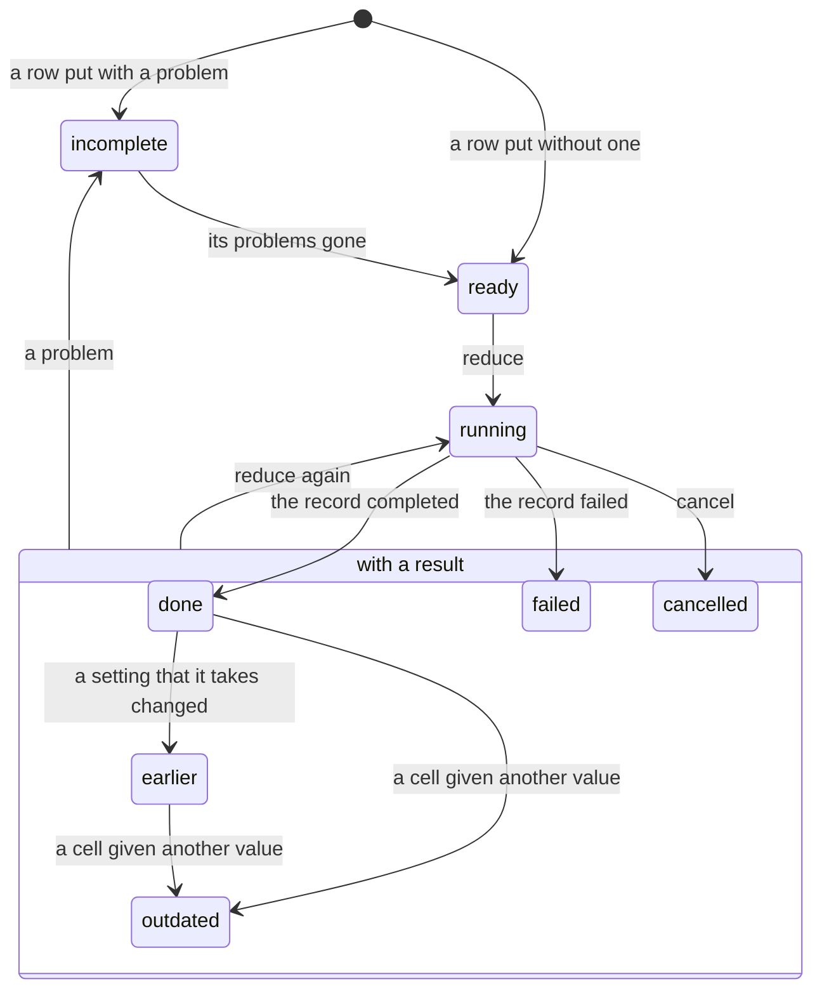
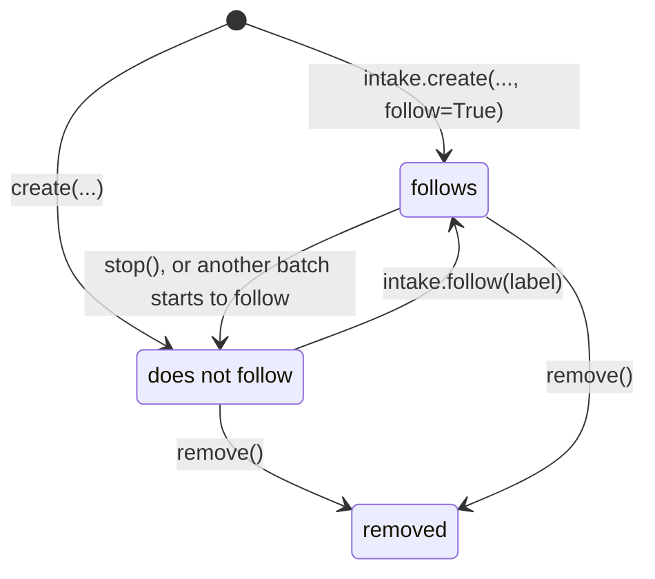
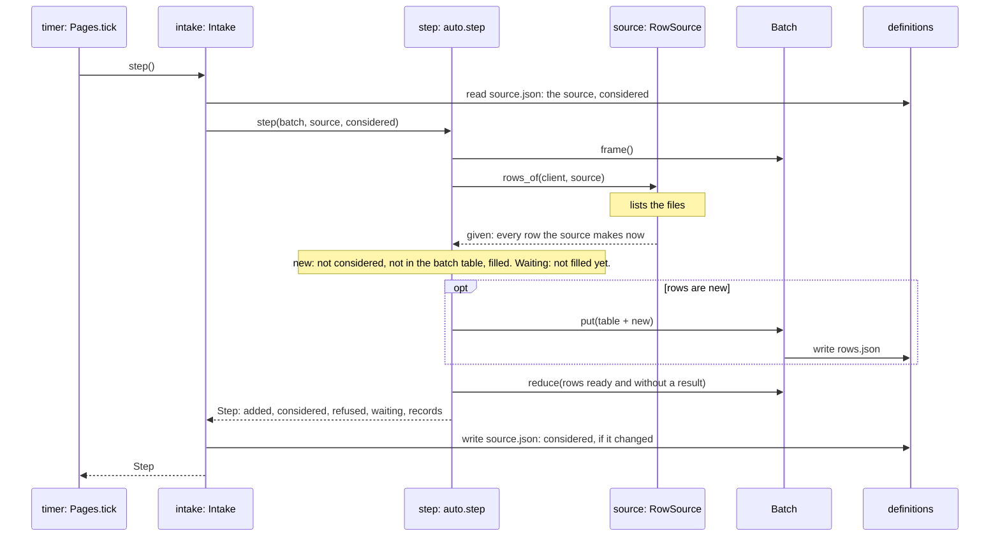

# Batch toolbox for application developers

`ess.batch` reduces one spec for many samples: a table of rows, settings shared by all rows, and the result of each row.
It is built on the client of `ess.apps`; [the client guide](../../../docs/developer/roles/client-authors.ipynb) explains specs, records, labels and stages.
Publishing results to SciCat (`ess.batch.publish`) needs the extra `essbatch[scicat]` (scitacean).
The decisions behind it are [ADR 0012](../../../docs/developer/adr/0012-a-batch-is-a-table.md) (a batch is a template and a table) and [ADR 0013](../../../docs/developer/adr/0013-follow-adds-the-rows-not-considered.md) (Follow adds the rows not considered).

## The system on one page

### Picture

Who calls whom; an arrow points from a caller to what it calls:



Not drawn: the page lists the runs, and the manager finds the specs bound, through the client.
Nothing in the batch layer imports the page or the command.
`table` and `state` are functions on plain data, which any part may use.

| Component | Code | Owns |
|---|---|---|
| table | `table.py` | the form of a batch table: dtypes, cells, cell to request value and back, `rows.json`, table files |
| row source | `source.py`: `RowSource`, `rows_of` | the code of the application that makes rows from the files |
| batch | `reduction.py`: `Batch` | the settings and the batch table of one label: `put`, `state`, `reduce`, `cancel`, and `version`, which moves when the batch table or the settings change; the only part that submits to the client |
| state | `state.py`: `RowState`, the rules | where each row stands; the rules are functions from the states of rows to keys |
| step | `auto.py`: `step`, `Step` | one step of Follow on one batch: add rows of the source, reduce rows |
| manager | `manager.py`: `BatchManager` | the batches of a workspace: make one from a batch table, list, change, remove; it knows no row source |
| `Intake` | `intake.py`: `Intake` | rows of a row source into a batch: make a batch from a source, offer and take its rows; which batch follows, and its step; `considered` |
| definitions | `definition.py`: `DefinitionStore`, `FolderDefinitions` | what a workspace keeps besides files and records (table below) |
| writing | `writing.py`: `Writing` | how the results of a batch are written: the form of a batch (a format, outputs, and what a person says of them, `ess.apps.writers.About`), and the writers of each spec (`ess.apps.writers.Writer`); the download of the page, `export -l` and publishing write by it |
| publisher | `publish.py`: `Publisher` | the results of a batch into SciCat, one derived dataset per row (`ess.apps.scicat`) with the files that `Writing` writes: which results may be published, and what was published |

### Terms

| Term | Definition |
|---|---|
| workspace | a [workspace](../../../docs/developer/README.md) with the definitions of its batches (below), in one folder |
| batch | one spec reduced for many samples: a header (title, description), a template (`ess.apps.Template`: the spec and the settings, kept as `settings.json`) and a batch table |
| label | the name of a batch, unique in a workspace: its folder in the definitions, the label of its records, its address on the page and for the command; `batch.label` |
| setting | the value of a parameter for the batch: one item of `batch.settings`, by the name of the parameter |
| batch table | the rows of a batch, one per reduction: one `pandas.DataFrame` (below) |
| result of a row | the newest record under the label with the row's key as member |
| row source | code of the application that makes rows from the files (a `RowSource`) |
| filled, waits | a row of a source is filled once it has a value in each parameter that the source fills (`RowSource.fills`, kept as `batch.fills`); until then it waits |
| considered | the keys of its source that a batch has taken, left out when it was made, or had in its batch table at a step (`source.json`) |
| Follow, the batch that follows | Follow is a step every few seconds on the batch that follows (`intake.following`): add the rows of its source that are filled and not considered, then reduce the rows that are ready and have no result |

The value and the request of a row are defined in [The request of a row](#the-request-of-a-row); its state, `outdated` and `earlier` in [The state of a row](#the-state-of-a-row-and-the-rules-over-it).

`manager.create` and `intake.create` return the `Batch`, and `manager.batch(label)` gives it again.
Every other method that names a batch takes its label.

The batch table of the example below, as `batch.frame()` gives it:

```python
#        run    name      sample     sample_transmission  thickness
# key
# 60339  60339  water     run:60339  run:60305            <NA>
# 60340  60340  sample A  run:60340  run:60307            2.0
```

| Part | What it is |
|---|---|
| the index, `key` | text that names the row, unique in the batch table; the member of the row's records |
| a parameter column | a column named as a parameter of the spec (`sample`, `sample_transmission`, `thickness`), with the dtype of that parameter: there a row may give its own value. `batch.parameter_columns` names them |
| a note column | any other column (`run`, `name`); shown, never part of a request |
| a cell | plain data, such as `'run:60339'`, `2.0`, `['run:1', 'run:2']`, or empty |

A batch table holds what goes into the reductions only.
The results are records, joined to the rows by key where they are shown or exported.

Other tables are always named with what they are of:

| Table | What it is |
|---|---|
| the files table | `files.csv` of a folder: one line per file with its metadata, such as run, kind, role and sample |
| the rows of a source | a frame of the form of a batch table, which the source makes from the files and a batch takes rows from; it knows no spec, so each of its columns is a note column until a batch takes the row |
| a table file | a batch table as `.csv`, `.tsv` or `.xlsx`, to edit elsewhere and load again |

### Errors

The batch layer refuses what is asked with `ValueError`, a label that no batch has with `KeyError`, and a write that the definitions refuse with `NotKept`.

### What is kept on disk

| File | Content | Writer |
|---|---|---|
| `definitions/labels/<label>/header.json` | `{"title": ..., "description": ...}` | manager |
| `definitions/labels/<label>/settings.json` | a template: the spec; the settings in `params`, also those of a parameter that has a column; `batch.fills` as its `blanks` | `Batch` |
| `definitions/labels/<label>/rows.json` | the batch table: `{"schema": ..., "data": [{"key": "60339", "sample": "run:60339", ...}]}` | `Batch.put` |
| `definitions/labels/<label>/source.json` | `{"source": "sample-runs", "considered": ["60337", ...], "follows": true}`; only for a batch made from a source | `Intake` |
| `definitions/labels/<label>/form.json` | `{"format": "nxcansas", "outputs": ["iofq"], "name": "{title} {name}", ...}`; only for a batch whose form is set (`ess.batch.writing`) | `Writing` |
| `definitions/labels/<label>/publish.json` | `{"published": [{"key": "60339", "record": ..., "pid": ...}]}`; only for a batch published from (`ess.batch.publish`) | `Publisher` |
| `definitions/corrections.json` | metadata of files set by hand | `CorrectedFiles` |
| `definitions/format.json` | `{"format": 1}`: the format of the files above | `FolderDefinitions`, before its first write |
| `store/`, the log | the records | the workspace |

A label is a batch if and only if `header.json` exists.
`manager.create` writes rows and settings, then the header.
`intake.create` then, if the batch follows, writes `"follows": false` to the `source.json` of the batch that followed, then writes the `source.json` of the batch; if the definitions refuse a write, it removes the batch again.
`intake.follow(label)` writes `"follows": false` to the `source.json` of the batch that followed, then `"follows": true` to that of `label`; a process that stops in between leaves no batch that follows.
So a batch of `intake.create` is not always made as asked or not at all: a process that stops between the header and the batch's `source.json` leaves a batch made without a source, which neither offers rows nor follows, and no batch that follows.
`manager.remove` deletes the header, then every other file of the label, `source.json` too.
So whether a batch follows goes with its label: a batch made again with the label does not follow unless made so.
Each file has one writer.

`FolderDefinitions` refuses, with a `ValueError` that says "make a new folder", a folder with labels and no `format.json`, or another format.
What the files mean changes with the format, such as where the fills of a batch are kept, and a folder read with the wrong meaning would reduce rows with wrong values; no folder is migrated.

`rows.json` has the shape that pandas writes with `to_json(orient='table')`: a schema with the dtype of each column, and one record per row.
The records are written and read as Python values and not by `to_json` and `read_json`, which round floats: `0.1 + 0.2` comes back as `0.3`.
A table file is written and read by pandas (`to_csv`, `read_csv`, `to_excel`, `read_excel`).
`settings.json` has the form of a template file of the client.
Its `blanks` are the parameters that the row source of the batch fills (`batch.fills`): a template gives a blank no value, and each row must fill it.
Which parameters have a column is said by the batch table; they are the blanks of `batch.template()`.
A `source.json` is refused when read unless its fields are `source`, `considered` and `follows`.

## One example followed through

An afternoon at LoKI.
The spec `loki-iofq` has, among others, the parameters `sample` and `sample_transmission` (files) and `thickness: float = 1.0`.
The row source `sample-runs` (`SAMPLE_RUNS` in "Writing a row source") makes one row per sample run and fills `sample` and `sample_transmission`.

**1. A batch is made from the source.** Runs 60337 to 60340 are listed, each with its transmission run.

```python
intake = Intake(manager, sources={'sample-runs': SAMPLE_RUNS})
intake.rows_of('sample-runs')         # what the source makes now
#        run    name      sample     sample_transmission
# key
# 60337  60337  water     run:60337  run:60305
# ...
# 60340  60340  sample A  run:60340  run:60306
batch = intake.create('loki-iofq', title='Afternoon', source='sample-runs',
                      choose=Range(first='60339'), label='afternoon',
                      follow=True)
```

`intake.create` lists the source once and gives `choose` the rows that are filled; a `Range` picks those from 60339 on. In code, `choose` may be any function that picks rows and adds columns.
On disk: `header.json`, `settings.json`, `rows.json` with rows 60339 and 60340, and `source.json` with `considered` = 60337 to 60340 and `"follows": true`.
Rows 60337 and 60338 are considered and not in the batch table: they were left out when the batch was made, so Follow never adds them.
A row that waits when the batch is made, such as a sample run whose transmission run is not listed yet, is neither taken nor considered: Follow adds it once it is filled.

**2. A person edits a cell and reduces.**

```python
table = batch.frame()                 # a copy of the batch table; later: manager.batch('afternoon')
table.loc['60340', 'sample_transmission'] = 'run:60307'
batch.put(table)
batch.reduce(['60339', '60340'])      # {key: Record}
```

`rows.json` is written again. The records are in the store under the label, with members `60339` and `60340`.

**3. A setting becomes a column.**

```python
batch.settings = {**batch.settings, 'thickness': 1.5}
batch.make_column('thickness')        # empty cells; every row takes 1.5, no request changes
table = batch.frame()
table.loc['60340', 'thickness'] = 2.0
batch.put(table)                      # row 60340 is outdated; 60339 still takes 1.5
```

Rows 60339 and 60340, reduced in step 2 with the default 1.0, read `earlier` from the setting on, and `make_column` changes no state. At the `put`, row 60340 reads `outdated`, since its cell 2.0 differs from its result; row 60339 stays `earlier`.
`rows.json` is written with an empty column `thickness`; `settings.json` keeps `thickness: 1.5`.
A row added later, by a step of Follow, by `take` or by hand, takes 1.5 until its cell is set.
`batch.put(table.drop(columns='thickness'))` drops the column, and every row takes 1.5 again.

**4. Follow adds a row once its transmission run is listed.** The page calls `intake.step()` every few seconds.

| | What happens | Batch table | `considered` |
|---|---|---|---|
| a | sample run 60341 is listed; its transmission run is not | unchanged; `done.waiting == ('60341',)` | unchanged |
| b | transmission run 60342 is listed | 60341 is added and reduced | + 60341 |
| c | a person removes row 60340 | 60339, 60341 | unchanged, so 60340 is not added again |
| d | the transmission of sample 60339 is measured again | unchanged: row 60339 keeps its cell | unchanged |

```python
done = intake.step()         # a Step, or None if no batch follows
done.waiting                 # the keys of the rows that wait
done.refused                 # why rows of this step were refused, by key
done.records                 # the records of the rows reduced, by key
```

In step b, `rows.json` is written first, then `source.json`.

**5. A restart.** The process stops; sample run 60343 and its transmission run arrive meanwhile.

```python
manager = BatchManager(client, definitions=definitions)
intake = Intake(manager, sources={'sample-runs': SAMPLE_RUNS})
intake.following             # 'afternoon'
intake.step()                # adds 60343 and reduces it
```

The manager reads the headers; the `Intake` finds the batch that follows in their `source.json`.
`manager.batch('afternoon')` reads `settings.json` and `rows.json` and makes the `Batch`.
The results are read from the records, so no row is reduced twice.

**6. The next batch.** In the evening a person wants the runs from 60400 on in a batch of their own.
They make it from the source, with the settings of the afternoon, and with Follow:

```python
evening = intake.create('loki-iofq', title='Evening', source='sample-runs',
                        choose=Range(first='60400'),
                        settings=manager.batch('afternoon').settings, label='evening',
                        follow=True)  # 'afternoon' stops following
```

No row moves between batches.
`afternoon` keeps its rows, also those from 60400 on that it added before, until a person removes them.
`intake.follow('afternoon')` would let it follow again, in place of `evening`: its next step would add every filled row it has not considered, also those that `evening` took.
A batch that follows has no last row: the rows filled between a last row and the making would never be added.
`intake.create` refuses `follow=True` with a `Range` that has a `last` (see [From a row source](#from-a-row-source)); a function as `choose` may pick any rows, and the filled rows it leaves out are considered.
For a batch of only the rows that arrive from now on, `choose` takes none: `choose=Range(later=True)`.
Every row filled now is then considered, and none is reduced again.

## Writing a row source

A row source is a function from files to rows, and the columns that it fills:

```python
from ess.batch import FileInfo, RowSource

def pair_by_sample(files: Sequence[FileInfo]) -> pd.DataFrame:
    samples = [f for f in files if f.metadata.get('role') == 'sample']
    records = [
        {'key': str(f.metadata['run']), 'run': f.metadata['run'],
         'name': f.metadata.get('name'), 'sample': str(f.ref),
         'sample_transmission': partner(f, files)}   # None if none is listed
        for f in samples
    ]
    columns = ['key', 'run', 'name', 'sample', 'sample_transmission']
    return pd.DataFrame.from_records(records, columns=columns).set_index('key')

SAMPLE_RUNS = RowSource(pair_by_sample, fills=('sample', 'sample_transmission'))
```

- The index is the key, as text. A number as key is refused: write `str(run)`.
- A file is its name, `str(f.ref)`, such as `'run:60339'`.
- `selector` (optional) chooses the files the source is given; raw files if not given.
- `description` (optional) says, for a person, what a row is and how the source pairs the files, such as which transmission run a sample run gets when several fit. `essbatch sources` prints it: a person cannot read the code to check a pairing.
- `rows_of(client, source)` calls the source on the files listed now. It adds an empty column for each of `fills` that its rows lack, so a batch made on an empty folder still has its columns.
- The page names a row by its note column `name` if the batch table has one, else by its key.
- A source knows no spec. `fits(spec, source)` of `ess.batch.intake` checks that each of `fills` is a parameter of the spec; `intake.create` refuses a spec that does not fit.

A source is plain code on plain data: test it on a list of `FileInfo`.

## Cells and their dtypes

`table.dtypes(spec.params)` gives the dtype of each parameter column:

| The parameter takes | dtype | A cell |
|---|---|---|
| a file, an output, a file or an output; text, a `Literal` or an enum of text, a time, a date | `string` | `'run:60339'` |
| a number | `Float64` | `2.0` |
| a whole number | `Int64` | `3` |
| a truth value | `boolean` | `True` |
| a list, a group, a value or an output, anything else | `object` | `['run:1', 'run:2']` |

`| None` does not change the dtype.
A parameter that takes text or an output is refused, since a cell cannot tell the two apart.

Nothing converts a cell: `'2'` and `True` are not numbers.
A cell of another kind than its column is refused where it enters the batch table, with a `ValueError` that names the key and the column.
So is text at a parameter that takes an output, which names no output (`RECORD.OUTPUT`) and no file: the message says how a cell names an output.
One exception: an `Int64` column takes a float that is a whole number, since pandas gives whole numbers with a gap as floats.
A note column gets the dtype of `convert_dtypes()`, which must be one of the five.
In a batch table an empty cell is `pd.NA` (`None` in an `object` column); in `rows.json` and in `to_dict('index')` it is `None`.

`as_request` converts a cell at a parameter that takes:

```python
# a file
'run:60339'      -> FileRef(file='run:60339')
60339            -> FileRef(file='run:60339')        # a whole number is a run
# an output
'r17.centre'     -> OutputRef(record='r17', output='centre')
'r18.slices[2]'  -> OutputRef(record='r18', output='slices', key='2')
# a file or an output: text with a kind ([a-z]+:) is a file, other text an output
# a list of these: each element
# anything else, a file inside a group too: the cell as it is
```

`cell_of` is the inverse: a `FileRef` or an `OutputRef` gives its text, anything else its JSON form.
No other code converts between a cell and a value of a request.

## The request of a row

The value of a parameter for a row:



As a function:

```python
def value(batch, key, p):                 # the value of parameter p for the row `key`
    table = batch.frame()
    if p in table.columns and not empty(table.loc[key, p]):
        return table.loc[key, p]          # the row gives its own
    if p in batch.fills:
        return MISSING                    # the row waits for its file
    if p in batch.settings:
        return batch.settings[p]          # the setting
    return default(p)                     # of the spec; None if p takes None; else MISSING
```

The request of a row is the spec with `value(batch, key, p)` for each parameter `p`.
In the batch table of [Terms](#terms) with `batch.settings == {'thickness': 1.5, ...}`, row 60339 is reduced with thickness 1.5 and row 60340 with 2.0.
A parameter without a value (`MISSING`) is the problem `empty` of the row: it is incomplete, and is not reduced.
"The source fills it" is asked of `batch.fills`, kept with the batch (below); each of them is a parameter column.
A row taken by hand before its transmission run is listed has an empty cell there. Without the second branch, it would be reduced with the transmission run of another sample, from the settings.
In code:

```python
template = Template(spec, params=settings, blanks=columns)  # batch.template(): drops the settings at columns
row = rows[columns].loc[[key]].to_dict('index')[key]       # each cell of its type
cells = as_request(model, {c: v for c, v in row.items() if v is not None})
for c in columns - cells.keys():                           # the empty cells
    if c in fills: continue                                # the row waits for its file
    elif c in settings: cells[c] = settings[c]
    elif has_default(c): cells[c] = default(c)
    elif takes_none(c): cells[c] = None
template.fill(params=cells)                                # a blank left: incomplete
```

`batch.empty()` gives what an empty cell gives, by column, `batch.cells(keys=None)` these cells by key, `batch.settings` all settings, and `batch.template()` a copy of the template, which a stage is opened from.
The template is worked out from the settings and the batch table; the batch keeps neither it nor its blanks.

| A column of | An empty cell gives, with no setting |
|---|---|
| `thickness: float = 1.0` | `1.0` |
| `direct_beam: DirectBeamFile \| None` | `None`: no direct beam |
| `sample: SampleFile` | nothing: the row is incomplete (problem `empty`) |
| `sample_transmission`, which the source fills | nothing, whatever the settings and the default: the row waits (problem `empty`) |

A table has no word for `None`: empty is `None`.

```python
batch.settings = {'thickness': 2.0, 'q': {...}}  # one setting per parameter
batch.make_column('thickness')                    # rows may give their own; no cell is filled, the setting stays
frame = batch.frame(); frame.loc['60340', 'thickness'] = 1.5; batch.put(frame)
batch.cells(['60339', '60340'])                   # {'60339': {..., 'thickness': 2.0}, '60340': {..., 'thickness': 1.5}}
batch.values('thickness')                         # {'60339': 2.0, '60340': 1.5}: the value each row takes, by its first row
batch.make_setting('thickness')                   # ValueError: the rows take different values
batch.make_setting('thickness', '60340')          # the column goes; the setting is 1.5
```

`make_setting(name, key)` drops the column; every row then takes the value that the row of `key` took.
If that row's cell holds a value, the setting becomes it; if the cell is empty, the row took the setting (or the default), and the settings stay.
Without `key`, every row must take the same value; a batch whose cells are all empty, or that has no rows, keeps its setting.
It writes `settings.json`, if the setting changes, before `rows.json` without the column; a stop between the two leaves the column, whose empty cells take the value chosen.

A batch made from a row source keeps the parameters that its source fills, `batch.fills`, as the `blanks` of `settings.json`.
The manager gives them to the batch when it makes or reads it; it does not look up the source, so the command without `-s` reads them too.
The batch table keeps a column for each, since a row waits until its cell there is filled.
By the rule above, a setting there is never read; one that the definitions hold is left out when the batch is read, and gone at the next write of the settings.

```python
batch.put(frame.drop(columns='sample_transmission'))   # ValueError: the table keeps the column
batch.make_setting('sample_transmission')              # ValueError, as put
batch.settings = {'sample_transmission': 'run:60305'}  # ValueError: the source of the batch fills sample_transmission
batch.settable(settings)                                # settings without the values at batch.fills
```

Settings taken from elsewhere go through `settable`: those of another batch at `create`, a settings file loaded on the page, those of a row put in the form, and the template of the command.
The settings form of the page has no field for such a column.

## The state of a row and the rules over it

`batch.state(keys=None, *, compare=True)` gives a `RowState` per row, read from the records at each call; no state is kept in the definitions:

| Field | Meaning |
|---|---|
| `record`, `status` | the result and its status (`pending`, `completed`, `failed`, `cancelled`), or `None` |
| `problems` | why the row cannot be reduced: an empty cell that gives nothing (table above), a cell the workspace refuses, a referenced record that failed or was cancelled |
| `changed` | the parameters at which the request differs from the request of the result |
| `spec_changed` | the result is of another spec than the one bound |
| `outdated` | `spec_changed`, or `changed` is not empty |
| `earlier` | the row is ready, its result completed, and its request differs from that of the result only at settings: at parameters that are no column, or where the row's cell is empty |
| `text` | what the page, a table file written and the command say: `running`, `incomplete`, `ready`, `done`, `earlier`, `outdated`, `failed` or `cancelled` |

A row with `earlier` reads `earlier`: its result is completed, as that of a row that reads `done`, and is plotted and downloaded as one.
So a reader that wants the rows with a completed result reads `status` (the field), not `text`.
`batch.state` raises `SubmitError` if the settings are refused: then no row can run.
`batch.state(compare=False)` resolves nothing: `changed` is `None`, and so is `outdated` unless the result is of another spec.
`batch.shown(keys=None)` gives the states and the reasons the settings are refused.
While the settings are refused, its states are not compared.
The page shows these states.

What moves a row from one word of `text` to another:



A problem is any of `RowState.problems`: a value missing, such as an empty cell of a column that the row source fills, a cell that the workspace refuses, or a referenced record that failed.
The workspace refuses a cell that names a file that the file source does not know, or cannot read now: it raised `OSError`, as when a mount is gone or a catalogue timed out.
Only the rows that name that file have the problem, and the reason names the file.
A refusal is not kept, so the next state resolves the cell again, and the problem goes once the file is known and can be read.
A row with a result whose cell names the file as its record holds it resolves nothing, so it keeps reading `done`.
A problem goes when a cell is filled or changed, or a setting is applied.
A row with a problem reads `incomplete` whatever its word but `running`, also when it has a result, as a `done` row whose source-filled cell is emptied; the arrow from the box stands for these.
A cell emptied counts as a setting: the row reads `earlier` if the setting or default that it then takes differs from what the cell held.

The rules, in `ess.batch`, are functions from the states to keys:

| Rule | Keys |
|---|---|
| `ready(states)` | no problems, and not pending |
| `not_reduced(states)` | ready, and without a result: what a step reduces |
| `earlier_settings(states)` | the rows with `earlier` |
| `left_to_reduce(states)` | ready, and without a result, failed, cancelled or outdated; not those of `earlier_settings` |
| `to_reduce(states, which)` | `left_to_reduce` for `'remaining'`, `earlier_settings` for `'earlier'`, `ready` for `'all'` |
| `publishable(states)` | `done` or `earlier`: the rows whose result may be published |

A change of settings applies to the rows not reduced yet, also to a row that takes a setting at a column: it reads `earlier`.
A change of a cell applies to its row: it reads `outdated`.
Which cells are empty is read from the batch table as it is now, so a row whose cell was emptied since it was reduced counts its value as a setting.
A person reduces `left_to_reduce`, or chooses the rows.
The page and the command choose with `to_reduce`.

`batch.reduce(keys)` submits all rows or none, and returns the records by key.
It raises `SubmitError` naming the row and the column.
`batch.settings = {...}` replaces all settings and reduces nothing; a setting at a column is the value of each row whose cell is empty.

## The batches of a workspace

```python
manager = BatchManager(client, definitions=FolderDefinitions(folder),
                       settings={'loki-iofq': {...}},   # the first settings of a batch, by spec
                       staged=('loki-iofq',))           # the specs that run through a stage
batch = manager.create('loki-iofq', title='Water', rows=table)   # the Batch
label = batch.label        # the time of making if not given
manager.headers()          # {label: Header(title, description)}
manager.batch(label)       # the one Batch of the label, made from the definitions at the first call
manager.change(label, title='Water, second try')
manager.remove(label)      # every file of the label goes; the records stay
```

`parameter_columns=` names parameters that are parameter columns of empty cells, besides those of `rows`.

- `create` refuses an empty title, a label that has definitions or records, a spec that the workspace does not bind, and rows that `put` refuses. `manager.check(spec, title=..., label=...)` refuses the first three without rows, and `create` calls it first.
- `fills=` names the parameters that a row source fills (`batch.fills`). `create` keeps them as the `blanks` of `settings.json`, refuses a batch table without one of their columns, and leaves out the settings there (`batch.settable`). Every other setting stays, at a column too. `Intake.create` gives them; code that makes a batch from a batch table of its own, or from a table file, leaves them out.
- `manager.batch(label)` reads `settings.json`, with the fills as its blanks, and `rows.json`, binds the spec by name, and passes the definitions, so the `Batch` writes each change.
- Ask for the batch each time: one handed out before `remove` must not be used after.
- A `Batch` made in code, `Batch(client, spec, label=..., settings=..., rows=...)`, is the same class without definitions: it keeps nothing.

### From a row source

An `Intake` holds the manager and the row sources, by name, and brings rows of a source into a batch:

```python
intake = Intake(manager, sources={'sample-runs': SAMPLE_RUNS})
batch = intake.create('loki-iofq', title='Afternoon', source='sample-runs',
                      choose=Range(first='60339'), parameter_columns=['thickness'])
intake.rows_of('sample-runs')            # what the source makes now
intake.marked('sample-runs', Range(first='60339'))
                                         # rows_of, with columns waits and taken
intake.create(..., choose=Range(later=True), follow=True)
                                         # no row now: Follow adds the rows that arrive later
intake.source(batch.label)               # 'sample-runs'; None for a batch made without a source: it cannot follow
```

`intake.create` takes the rows from the source, in one listing, then makes the batch with the manager:

```python
given = rows_of(client, source)
arrived = given[filled]                  # a value in each of source.fills
table = arrived if choose is None else choose(arrived)
considered = arrived.index               # the rows taken and those left out
batch = manager.create(spec, rows=table, fills=source.fills, ...)
# with follow: "follows": false to the batch that followed
# then source.json: the source, considered, and whether it follows
```

`Range` refuses an end that is not a key of the rows that arrived (a row that waits is not one), a first row after the last, and an end with `later=True`.
`intake.create` refuses a `Range` with a `last` and `follow=True`; a function as `choose` picks any rows, also with `follow=True`, and the filled rows it leaves out are considered.
It refuses a source that is not registered, a source that fills a parameter that the spec lacks (`fits`), and a key from `choose` that is not in `arrived`, and refuses as `manager.create` does.
It checks the label, the title and the spec first, with `manager.check`, then the source and whether the spec fits it, so these refusals come before the source is listed.
If the process stops while a batch that follows is made, the batch may be there and no batch follow (see [What is kept on disk](#what-is-kept-on-disk)).

## Follow

The life of a batch made from a source:



```python
intake.create(..., source='sample-runs', follow=True)    # follows; the batch that followed stops
intake.following            # its label, or None
intake.stop()               # none follows
intake.follow(label)        # this batch follows; the batch that followed stops
done = intake.step()        # a Step, or None if none follows
done.refused                # why rows were refused, by key; they do not hold back the others
intake.offered(label)       # the rows of the source that the batch table lacks, with a boolean column `waits`
intake.take(label, keys)    # put these rows as the source gives them now, also considered ones; then consider them
```

A step (`auto.step(batch, source, considered)`), as code:

```python
table = batch.frame()
given = rows_of(batch.client, source)                  # every row the source makes now
new, waiting = added(table, given, batch.fills, considered)
batch.put(pd.concat([table, new]))                     # only the columns of the batch table
considered |= set(new.index) | (set(given.index) & set(table.index))
candidates = not_reduced(batch.state(compare=False))   # ready as given, no result
batch.reduce(not_reduced(batch.state(candidates)))
```

One step of Follow, from the timer to `considered` kept:



A removed row stays away: its key is considered, and only `intake.take` brings it back.
A step reduces a row once: a row that has a result, also a failed, cancelled or outdated one, is left to a person.

A source whose row grows, such as the runs of a sample so far, gives the grown list a new key:

```
after run 2:  si@2      runs=[2]
after run 4:  si@2,4    runs=[2, 4]
after run 3:  si@2,3,4  runs=[2, 3, 4]   # listed after run 4: a new key too
```

Each list is a new row, which a step adds and reduces. The earlier rows keep their results.
The key names the whole list, since a step adds a row only under a key that is not considered.

`auto.step(batch, source, considered)` runs the same step on a `Batch` made in code, with `considered` in memory: give the next step `done.considered`.
A batch of the manager persists what it submits. A `Batch` made in code for `auto.step` needs `persist=True`, since nothing releases its records.
The batch layer has no timer: the page's server (`every` of `ess.batch.web.api`) and `essbatch follow` (`cli.follow`) call `intake.step()`.

## Table files

A table file (`.csv`, `.tsv`, `.xlsx`) is a batch table as text, with the key as column `key`:

```
key,sample,thickness,binning,name
60339,run:60339,1.5,"{""bins"":4}",water
60340,run:60340,,,NA
```

- `table.write_table(table, path)` is the only writer, and `table.read_table(path, spec.params)` the only reader that gives a batch table. `table.read_text(path)` reads a table file as text, without a spec.
- A list or a group is JSON text. Empty is the only missing marker, so `NA` in a note column is text.
- `read_table` reads columns with their dtypes, and drops `status`, `record`, `failure` and `published`, which `frames.with_results` adds.
- A note column of a `.csv` or `.tsv` file is text, so `0342` stays `'0342'`. A note column of a `.xlsx` file keeps the type of its cells.
- A header that is not exactly a parameter name, such as `Sample`, is read as a note column, and `sample` has no column: every row takes its setting, or the row is incomplete if there is none.

The command `essbatch` (`ess.batch.cli`, see `essbatch --help`) and the page ([`web/README.md`](../src/ess/batch/web/README.md)) are two applications of this layer.

## Chains

A cell can name an output of another record: `'r17.centre'` at a parameter that takes an output (typed `Referenced[...]` in the spec).
Here `find` is a batch of the spec that finds the beam centre, and `iofq` a batch with the column `beam_centre`:

```python
centres = find.reduce(left_to_reduce(find.state()))   # {key: Record}
table = iofq.frame()
for key, record in centres.items():
    table.loc[key, 'beam_centre'] = str(record.ref('centre'))
iofq.put(table)
```

A cell may name a record that still runs. If that record failed or was cancelled, the row has the problem "the record it reads is failed".

## Where the definitions are kept

`DefinitionStore` is a protocol: `load(key, read)`, `save(key, data)`, `delete(key)`, `labels()`.
A key is a tuple, such as `('labels', label, 'rows')` or `('corrections',)`.
`FolderDefinitions(folder)` keeps each entry of the definitions, by key, as a JSON file under `definitions/`, written whole through a temporary file.
`rows.json` holds `data_of(table)`, and `frame_of(data)` reads it back equal, dtypes and floats included; both are in `ess.batch.table`.
A refused write raises `NotKept`.

## The page

`ess.batch.web` serves the batches of a manager as a page.
`Pages(intake, ...)` takes the `Intake` and reaches the manager as `intake.manager`; it holds one lock over both, and the app calls `Pages.tick`, and so `intake.step()`, on a timer.
`Page` is the presenter of one batch: each action that changes rows builds a batch table and calls `put`.
The actions are described in [`batch/web/README.md`](../src/ess/batch/web/README.md).
Each action of the page is one call of the batch layer:

| On the page | In code |
|---|---|
| an edit of cells, **+ Add row**, **Remove selected**, **Load table** | `batch.put(table)` |
| **Apply** | `batch.settings = settings` |
| **Reduce** and its ways | `batch.reduce(keys)` |
| **+ New batch** | from a source `intake.create(..., choose=Range(first, last, later), parameter_columns=...)`; from a table file or without rows `manager.create(rows=..., parameter_columns=...)` |
| the range's marks | `intake.marked(source, choose)` |
| **+ Add rows from the runs** | `intake.offered(label)`, then `intake.take(label, keys)` |
| "Make this a column" | `batch.make_column(name)` |
| "Make this a setting" | `batch.values(name)`, then `batch.make_setting(name, key)` |
| the grey text of an empty cell | `batch.settings[name]`, else the default of the parameter |
| **Follow** in **+ New batch** | `intake.create(..., follow=True)`; the timer calls `intake.step()` |
| **Stop following** | `intake.stop()` |
| the column **Batches** of the Runs view | `batch.files()` of each batch, joined to the runs by identity |

## Testing an application

- Test the source on a list of `FileInfo`, without a workspace.
- Test the batch on `ess.apps.local()` or a folder workspace with fake workflows (`ess.apps.testing`). They start in milliseconds, and refuse and fail as real ones do.
- Use `FolderDefinitions(tmp_path)`, and make the manager and the `Intake` again to test a restart.
- `packages/essbatch/tests/toys.py` and `conftest.py` show the pattern.

## What it does not do

- A step never changes a cell or removes a row. A transmission run measured again reaches no earlier row; a person sets the cell.
- A correction of a run changes no batch.
- No range of runs is kept: "from run 60339 on" is the choice of rows when the batch is made.
- No row moves between batches: the next batch is made from the source.
- One batch follows at a time. The page offers no action to let a stopped batch follow again; `intake.follow(label)` and `essbatch follow` do.
- The batch layer has no lock and no timer: whoever serves owns both.
