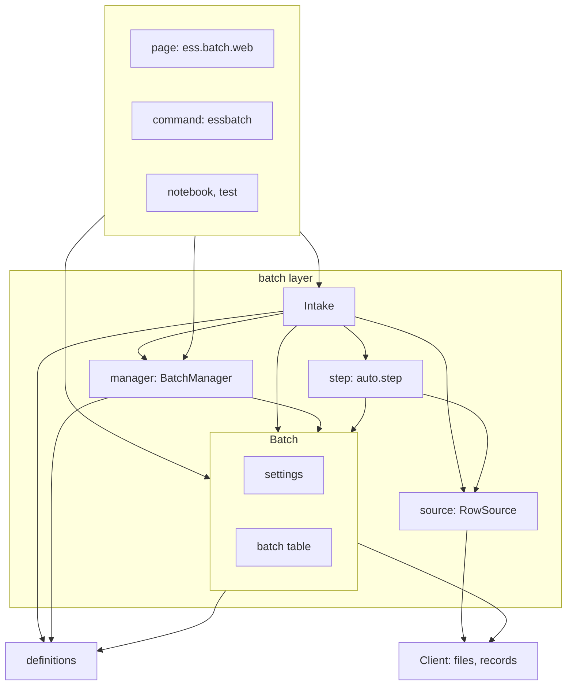
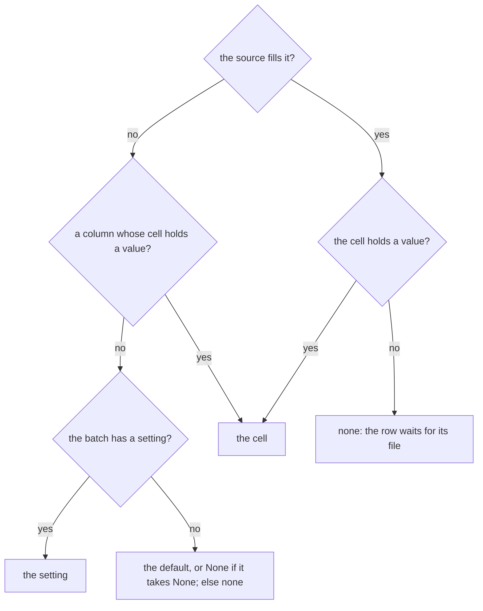
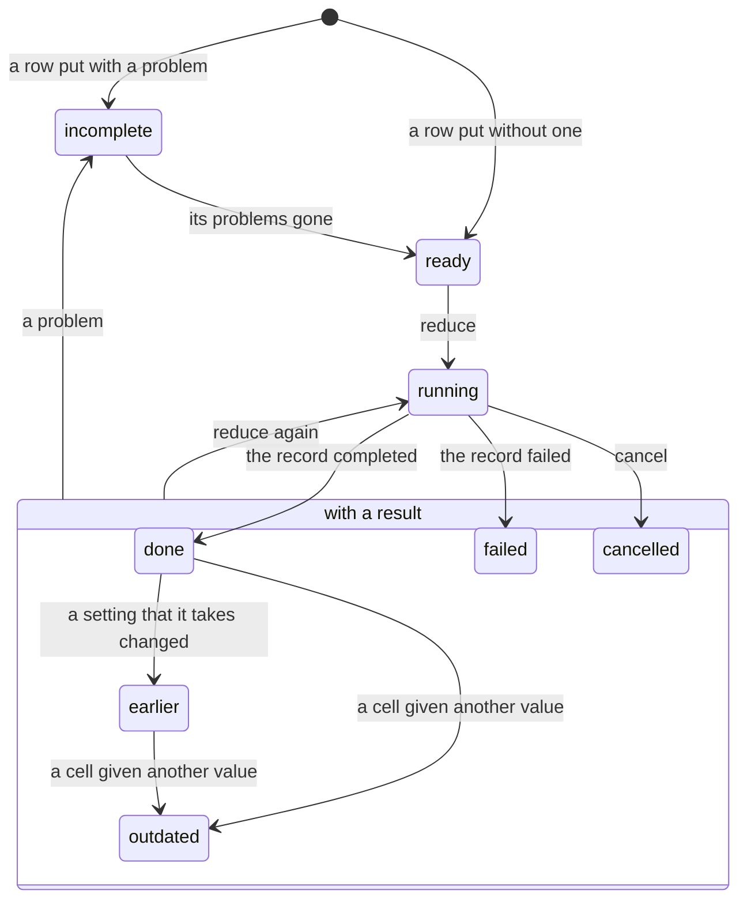
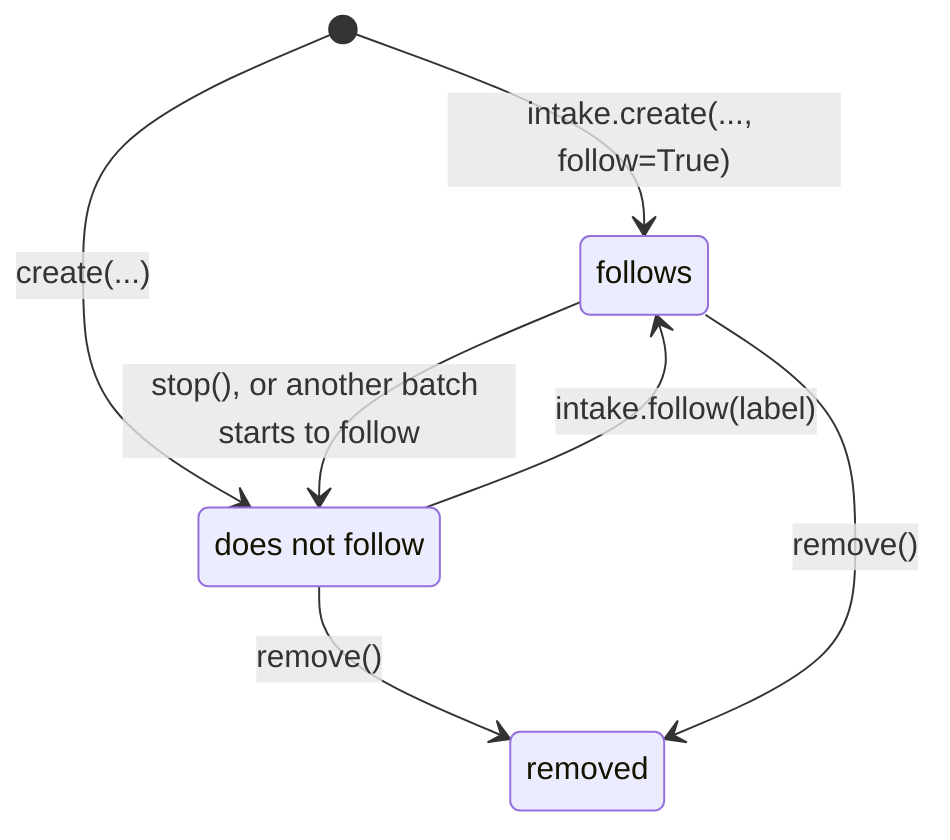
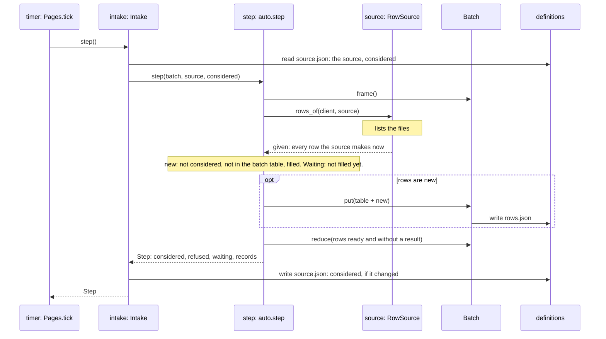

# Batch toolbox for application developers

`ess.batch` reduces one spec for many samples: a table of rows, settings shared by all rows, and the result of each row.
It is built on the client of `ess.apps`; [the client guide](../../../docs/developer/roles/client-authors.ipynb) explains specs, records, labels and stages.
Publishing results to SciCat (`ess.batch.publish`) needs the extra `essbatch[scicat]` (scitacean).
The decisions behind it are [ADR 0012](../../../docs/developer/adr/0012-a-batch-is-a-table.md) (a batch is a template and a table) and [ADR 0013](../../../docs/developer/adr/0013-follow-adds-the-rows-not-considered.md) (Follow adds the rows not considered).

## The system on one page

### Picture

Who calls whom; an arrow points from a caller to what it calls:



Not drawn: the page lists the runs, and the manager finds the specs bound, through the client.
Nothing in the batch layer imports the page or the command.
`table` and `state` are functions on plain data, which any part may use.

| Component | Code | Owns |
|---|---|---|
| table | `table.py` | the form of a batch table: dtypes, cells, cell to request value and back, `rows.json`, table files |
| row source | `source.py`: `RowSource`, `rows_of` | the code of the application that makes rows from the files |
| batch | `reduction.py`: `Batch` | the settings and the batch table of one label: `put`, `state`, `reduce`, `cancel`, and `version`, which moves when the batch table, the settings or a record changes; the only part that submits to the client |
| state | `state.py`: `RowState`, the rules | where each row stands; the rules are functions from the states of rows to keys |
| step | `auto.py`: `step`, `Step` | one step of Follow on one batch: add rows of the source, reduce rows |
| manager | `manager.py`: `BatchManager` | the batches of a workspace: make one from a batch table, list, change, remove; it knows no row source |
| `Intake` | `intake.py`: `Intake` | rows of a row source into a batch: make a batch from a source, offer and take its rows; which batch follows, and its step; `considered` |
| definitions | `definition.py`: `DefinitionStore`, `FolderDefinitions` | what a workspace keeps besides files and records (table below) |
| writing | `writing.py`: `Writing` | how the results of a batch are written: the form of a batch (a format, outputs, and what a person says of them, `ess.apps.writers.About`), and the writers of each spec (`ess.apps.writers.Writer`); the download of the page, `export -l` and publishing write by it |
| publisher | `publish.py`: `Publisher` | the results of a batch into SciCat, one derived dataset per row (`ess.apps.scicat`) with the files that `Writing` writes: which results may be published, and what was published |

### Terms

| Term | Definition |
|---|---|
| workspace | a `Client` (specs bound, files, records) and the definitions; one folder |
| batch | one spec reduced for many samples: a header (title, description), a spec, settings and a batch table. The spec and the settings together have the form of a template (`ess.apps.Template`): they are kept as one (`settings.json`), and the command takes them as one file. So ADR 0012 and the command's help say "a template and a table" |
| label | the name of a batch, unique in a workspace: its folder in the definitions, the label of its records, its address on the page and for the command; `batch.label` |
| `Batch` | the object that holds the settings and the batch table of one label, and changes and reduces them |
| `Intake` | the object that holds the manager and the row sources, by name, and brings rows of a source into a batch; it keeps which batch follows |
| setting | the value of a parameter for the batch: one item of `batch.settings`, by the name of the parameter |
| batch table | the rows of a batch, one per reduction: one `pandas.DataFrame` (below) |
| value of a parameter for a row | what the row is reduced with at that parameter (rule 2) |
| request of a row | the spec with the value of each parameter for the row |
| result of a row | the newest record under the label with the row's key as member |
| state of a row | its result, the status of the result, its problems, and where its request differs from that of its result |
| outdated | a result whose request differs from the row's request now, or that is of another spec |
| earlier | a completed result whose request differs from the row's only at settings: at parameters that have no column, or where the row's cell is empty |
| row source | code of the application that makes rows from the files (a `RowSource`) |
| filled, waits | a row of the source is filled once it has a value in each of `RowSource.fills`; until then it waits |
| considered | the keys of the source that a batch made from it has taken or left out |
| Follow | a step every few seconds on one batch: add the rows of its source that are filled and not considered, then reduce the rows that are ready and have no result; from the making of the batch or `intake.follow(label)`, until it is stopped |

`manager.create` and `intake.create` return the `Batch`, and `manager.batch(label)` gives it again.
Every other method that names a batch takes its label.

The batch table of the example below, as `batch.frame()` gives it:

```python
#        run    name      sample     sample_transmission  thickness
# key
# 60339  60339  water     run:60339  run:60305            <NA>
# 60340  60340  sample A  run:60340  run:60307            2.0
```

| Part | What it is |
|---|---|
| the index, `key` | text that names the row, unique in the batch table; the member of the row's records |
| a parameter column | a column named as a parameter of the spec (`sample`, `sample_transmission`, `thickness`), with the dtype of that parameter: there a row may give its own value. `batch.parameter_columns` names them |
| a note column | any other column (`run`, `name`); shown, never part of a request |
| a cell | plain data, such as `'run:60339'`, `2.0`, `['run:1', 'run:2']`, or empty |

A batch table holds what goes into the reductions only.
The results are records, joined to the rows by key where they are shown or exported.

Other tables are always named with what they are of:

| Table | What it is |
|---|---|
| the files table | `files.csv` of a folder: one line per file with its metadata, such as run, kind, role and sample |
| the rows of a source | a frame of the form of a batch table, which the source makes from the files and a batch takes rows from; it knows no spec, so each of its columns is a note column until a batch takes the row |
| a table file | a batch table as `.csv`, `.tsv` or `.xlsx`, to edit elsewhere and load again |

### Rules that always hold

1. **Only `put` changes a batch table.** A person on the page, the command, `take` and a step each build a frame and call `batch.put(frame)`; so do `batch.make_column` and `batch.make_setting`, which the page's "Make this a column" and "Make this a setting" call. A `put` of an equal frame writes nothing. Which parameters have a column is said by the frame alone: `put` a frame with a column `thickness`, and each row may give its own thickness.
2. **A row is reduced with its cell, else with the setting, else with the default.** For each parameter `p` of the spec:

   ```python
   def value(batch, key, p):                 # the value of parameter p for the row `key`
       table = batch.frame()
       if p in table.columns and not empty(table.loc[key, p]):
           return table.loc[key, p]          # the row gives its own
       if p in batch.fills:
           return MISSING                    # the row waits for its file
       if p in batch.settings:
           return batch.settings[p]          # the setting
       return default(p)                     # of the spec; None if p takes None; else MISSING
   ```

   In the batch table above with `batch.settings == {'thickness': 1.5, ...}`, row 60339 is reduced with thickness 1.5 and row 60340 with 2.0. A row with a `MISSING` value is incomplete and is not reduced.

   `batch.fills` names the parameter columns that the source of the batch fills, here `sample` and `sample_transmission`; it is empty for a batch made without a source. A row taken by hand before its transmission run is listed has an empty cell there. Without the second branch it would be reduced with the transmission run of another sample, from the settings.
3. **The state is computed, never kept.** It is read from the records each time. Each rule (`ready`, `not_reduced`, `left_to_reduce`, `earlier_settings`, `to_reduce`) is a function from the states to keys.
4. **A step never changes a row that the batch table has.** It adds rows, and reduces rows that have no result.
5. **A batch is shown without its source and without the files.** A file that is not found is a problem of its row.
6. **The rules are in the batch layer.** A refusal of what is asked is a `ValueError`, a label that no batch has a `KeyError`, and a write or delete that the definitions cannot do, such as a file the system refuses to write, a `NotKept`. The page and the command show them and copy no rule of the batch layer. The page refuses only a request that no call of the batch layer can express, such as Follow without a row source. The batch layer has no lock and no timer.
7. **At most one batch follows.** It starts with `intake.create(..., follow=True)` or `intake.follow(label)`, and ends with `intake.stop()`, the removal of the batch, or another batch that starts to follow.

### What is kept on disk

| File | Content | Writer |
|---|---|---|
| `definitions/labels/<label>/header.json` | `{"title": ..., "description": ...}` | manager |
| `definitions/labels/<label>/settings.json` | a template: the spec; the settings in `params`, also those of a parameter that has a column; `batch.fills` as its `blanks` | `Batch` |
| `definitions/labels/<label>/rows.json` | the batch table: `{"schema": ..., "data": [{"key": "60339", "sample": "run:60339", ...}]}` | `Batch.put` |
| `definitions/labels/<label>/source.json` | `{"source": "sample-runs", "considered": ["60337", ...], "follows": true}`; only for a batch made from a source | `Intake` |
| `definitions/labels/<label>/form.json` | `{"format": "nxcansas", "outputs": ["iofq"], "name": "{title} {name}", ...}`; only for a batch whose form is set (`ess.batch.writing`) | `Writing` |
| `definitions/labels/<label>/publish.json` | `{"published": [{"key": "60339", "record": ..., "pid": ...}]}`; only for a batch published from (`ess.batch.publish`) | `Publisher` |
| `definitions/corrections.json` | metadata of files set by hand | `CorrectedFiles` |
| `definitions/format.json` | `{"format": 1}`: the format of the files above | `FolderDefinitions`, before its first write |
| `store/`, the log | the records | the workspace |

A label is a batch if and only if `header.json` exists.
`manager.create` writes rows and settings, then the header.
`intake.create` then, if the batch follows, writes `"follows": false` to the `source.json` of the batch that followed, then writes the `source.json` of the batch; if the definitions refuse a write, it removes the batch again.
`intake.follow(label)` writes `"follows": false` to the `source.json` of the batch that followed, then `"follows": true` to that of `label`; a process that stops in between leaves no batch that follows.
So a batch of `intake.create` is not always made as asked or not at all: a process that stops between the header and the batch's `source.json` leaves a batch made without a source, which neither offers rows nor follows, and no batch that follows.
`manager.remove` deletes the header, then every other file of the label, `source.json` too.
So whether a batch follows goes with its label: a batch made again with the label does not follow unless made so.
Each file has one writer.

`FolderDefinitions` refuses, with a `ValueError` that says "make a new folder", a folder with labels and no `format.json`, or another format.
What the files mean changes with the format, such as where the fills of a batch are kept, and a folder read with the wrong meaning would reduce rows with wrong values; no folder is migrated.

`rows.json` has the shape that pandas writes with `to_json(orient='table')`: a schema with the dtype of each column, and one record per row.
The records are written and read as Python values and not by `to_json` and `read_json`, which round floats: `0.1 + 0.2` comes back as `0.3`.
A table file is written and read by pandas (`to_csv`, `read_csv`, `to_excel`, `read_excel`).
`settings.json` has the form of a template file of the client.
Its `blanks` are the parameters that the row source of the batch fills (`batch.fills`): a template gives a blank no value, and each row must fill it.
Which parameters have a column is said by the batch table; they are the blanks of `batch.template()`.
A `source.json` is refused when read unless its fields are `source`, `considered` and `follows`.

## One example followed through

An afternoon at LoKI.
The spec `loki-iofq` has, among others, the parameters `sample` and `sample_transmission` (files) and `thickness: float = 1.0`.
The row source `sample-runs` (`SAMPLE_RUNS` in "Writing a row source") makes one row per sample run and fills `sample` and `sample_transmission`.

**1. A batch is made from the source.** Runs 60337 to 60340 are listed, each with its transmission run.

```python
intake = Intake(manager, sources={'sample-runs': SAMPLE_RUNS})
intake.rows_of('sample-runs')         # what the source makes now
#        run    name      sample     sample_transmission
# key
# 60337  60337  water     run:60337  run:60305
# ...
# 60340  60340  sample A  run:60340  run:60306
batch = intake.create('loki-iofq', title='Afternoon', source='sample-runs',
                      choose=Range(first='60339'), label='afternoon',
                      follow=True)
```

`intake.create` lists the source once and gives `choose` the rows that are filled; a `Range` picks those from 60339 on. In code, `choose` may be any function that picks rows and adds columns.
On disk: `header.json`, `settings.json`, `rows.json` with rows 60339 and 60340, and `source.json` with `considered` = 60337 to 60340 and `"follows": true`.
Rows 60337 and 60338 are considered and not in the batch table: they were left out when the batch was made, so Follow never adds them.
A row that waits when the batch is made, such as a sample run whose transmission run is not listed yet, is neither taken nor considered: Follow adds it once it is filled.

**2. A person edits a cell and reduces.**

```python
table = batch.frame()                 # a copy of the batch table; later: manager.batch('afternoon')
table.loc['60340', 'sample_transmission'] = 'run:60307'
batch.put(table)
batch.reduce(['60339', '60340'])      # {key: Record}
```

`rows.json` is written again. The records are in the store under the label, with members `60339` and `60340`.

**3. A setting becomes a column.**

```python
batch.settings = {**batch.settings, 'thickness': 1.5}
batch.make_column('thickness')        # empty cells; every row takes 1.5, no request changes
table = batch.frame()
table.loc['60340', 'thickness'] = 2.0
batch.put(table)                      # row 60340 is outdated; 60339 still takes 1.5
```

Rows 60339 and 60340, reduced in step 2 with the default 1.0, read `earlier` from the setting on, and `make_column` changes no state. At the `put`, row 60340 reads `outdated`, since its cell 2.0 differs from its result; row 60339 stays `earlier`.
`rows.json` is written with an empty column `thickness`; `settings.json` keeps `thickness: 1.5`.
A row added later, by a step of Follow, by `take` or by hand, takes 1.5 until its cell is set.
`batch.put(table.drop(columns='thickness'))` drops the column, and every row takes 1.5 again.

**4. Follow adds a row once its transmission run is listed.** The page calls `intake.step()` every few seconds.

| | What happens | Batch table | `considered` |
|---|---|---|---|
| a | sample run 60341 is listed; its transmission run is not | unchanged; `done.waiting == ('60341',)` | unchanged |
| b | transmission run 60342 is listed | 60341 is added and reduced | + 60341 |
| c | a person removes row 60340 | 60339, 60341 | unchanged, so 60340 is not added again |
| d | the transmission of sample 60339 is measured again | unchanged: row 60339 keeps its cell | unchanged |

```python
done = intake.step()         # a Step, or None if no batch follows
done.waiting                 # the keys of the rows that wait
done.refused                 # why rows of this step were refused, by key
done.records                 # the records of the rows reduced, by key
```

In step b, `rows.json` is written first, then `source.json`.

**5. A restart.** The process stops; sample run 60343 and its transmission run arrive meanwhile.

```python
manager = BatchManager(client, definitions=definitions)
intake = Intake(manager, sources={'sample-runs': SAMPLE_RUNS})
intake.following             # 'afternoon'
intake.step()                # adds 60343 and reduces it
```

The manager reads the headers; the `Intake` finds the batch that follows in their `source.json`.
`manager.batch('afternoon')` reads `settings.json` and `rows.json` and makes the `Batch`.
The results are read from the records, so no row is reduced twice.

**6. The next batch.** In the evening a person wants the runs from 60400 on in a batch of their own.
They make it from the source, with the settings of the afternoon, and with Follow:

```python
evening = intake.create('loki-iofq', title='Evening', source='sample-runs',
                        choose=Range(first='60400'),
                        settings=manager.batch('afternoon').settings, label='evening',
                        follow=True)  # 'afternoon' stops following
```

No row moves between batches.
`afternoon` keeps its rows, also those from 60400 on that it added before, until a person removes them.
`intake.follow('afternoon')` would let it follow again, in place of `evening`: its next step would add every filled row it has not considered, also those that `evening` took.
A batch that follows has no last row: the rows filled between a last row and the making would never be added.
`intake.create` refuses `follow=True` with a `Range` that has a `last` (see [From a row source](#from-a-row-source)); a function as `choose` may pick any rows, and the filled rows it leaves out are considered.
For a batch of only the rows that arrive from now on, `choose` takes none: `choose=Range(later=True)`.
Every row filled now is then considered, and none is reduced again.

## Writing a row source

A row source is a function from files to rows, and the columns that it fills:

```python
from ess.batch import FileInfo, RowSource

def pair_by_sample(files: Sequence[FileInfo]) -> pd.DataFrame:
    samples = [f for f in files if f.metadata.get('role') == 'sample']
    records = [
        {'key': str(f.metadata['run']), 'run': f.metadata['run'],
         'name': f.metadata.get('name'), 'sample': str(f.ref),
         'sample_transmission': partner(f, files)}   # None if none is listed
        for f in samples
    ]
    columns = ['key', 'run', 'name', 'sample', 'sample_transmission']
    return pd.DataFrame.from_records(records, columns=columns).set_index('key')

SAMPLE_RUNS = RowSource(pair_by_sample, fills=('sample', 'sample_transmission'))
```

- The index is the key, as text. A number as key is refused: write `str(run)`.
- A file is its name, `str(f.ref)`, such as `'run:60339'`.
- `selector` (optional) chooses the files the source is given; raw files if not given.
- `description` (optional) says, for a person, what a row is and how the source pairs the files, such as which transmission run a sample run gets when several fit. `essbatch sources` prints it: a person cannot read the code to check a pairing.
- `rows_of(client, source)` calls the source on the files listed now. It adds an empty column for each of `fills` that its rows lack, so a batch made on an empty folder still has its columns.
- The page names a row by its note column `name` if the batch table has one, else by its key.
- A source knows no spec. `fits(spec, source)` of `ess.batch.intake` checks that each of `fills` is a parameter of the spec; `intake.create` refuses a spec that does not fit.

A source is plain code on plain data: test it on a list of `FileInfo`.

## Cells and their dtypes

`table.dtypes(spec.params)` gives the dtype of each parameter column:

| The parameter takes | dtype | A cell |
|---|---|---|
| a file, an output, a file or an output; text, a `Literal` or an enum of text, a time, a date | `string` | `'run:60339'` |
| a number | `Float64` | `2.0` |
| a whole number | `Int64` | `3` |
| a truth value | `boolean` | `True` |
| a list, a group, a value or an output, anything else | `object` | `['run:1', 'run:2']` |

`| None` does not change the dtype.
A parameter that takes text or an output is refused, since a cell cannot tell the two apart.

Nothing converts a cell: `'2'` and `True` are not numbers.
A cell of another kind than its column is refused where it enters the batch table, with a `ValueError` that names the key and the column.
So is text at a parameter that takes an output, which names no output (`RECORD.OUTPUT`) and no file: the message says how a cell names an output.
One exception: an `Int64` column takes a float that is a whole number, since pandas gives whole numbers with a gap as floats.
A note column gets the dtype of `convert_dtypes()`, which must be one of the five.
In a batch table an empty cell is `pd.NA` (`None` in an `object` column); in `rows.json` and in `to_dict('index')` it is `None`.

`as_request` converts a cell at a parameter that takes:

```python
# a file
'run:60339'      -> FileRef(file='run:60339')
60339            -> FileRef(file='run:60339')        # a whole number is a run
# an output
'r17.centre'     -> OutputRef(record='r17', output='centre')
'r18.slices[2]'  -> OutputRef(record='r18', output='slices', key='2')
# a file or an output: text with a kind ([a-z]+:) is a file, other text an output
# a list of these: each element
# anything else, a file inside a group too: the cell as it is
```

`cell_of` is the inverse: a `FileRef` or an `OutputRef` gives its text, anything else its JSON form.
No other code converts between a cell and a value of a request.

## The request of a row

The value of a parameter for a row:



A parameter without a value is the problem `empty` of the row: it is incomplete.
"The source fills it" is asked of `batch.fills`, kept with the batch (below); each of them is a parameter column.
In code:

```python
template = Template(spec, params=settings, blanks=columns)  # batch.template(): drops the settings at columns
row = rows[columns].loc[[key]].to_dict('index')[key]       # each cell of its type
cells = as_request(model, {c: v for c, v in row.items() if v is not None})
for c in columns - cells.keys():                           # the empty cells
    if c in fills: continue                                # the row waits for its file
    elif c in settings: cells[c] = settings[c]
    elif has_default(c): cells[c] = default(c)
    elif takes_none(c): cells[c] = None
template.fill(params=cells)                                # a blank left: incomplete
```

`batch.empty()` gives what an empty cell gives, by column, `batch.cells(keys=None)` these cells by key, `batch.settings` all settings, and `batch.template()` a copy of the template, which a stage is opened from.
The template is worked out from the settings and the batch table; the batch keeps neither it nor its blanks.

| A column of | An empty cell gives, with no setting |
|---|---|
| `thickness: float = 1.0` | `1.0` |
| `direct_beam: DirectBeamFile \| None` | `None`: no direct beam |
| `sample: SampleFile` | nothing: the row is incomplete (problem `empty`) |
| `sample_transmission`, which the source fills | nothing, whatever the settings and the default: the row waits (problem `empty`) |

A table has no word for `None`: empty is `None`.

```python
batch.settings = {'thickness': 2.0, 'q': {...}}  # one setting per parameter
batch.make_column('thickness')                    # rows may give their own; no cell is filled, the setting stays
frame = batch.frame(); frame.loc['60340', 'thickness'] = 1.5; batch.put(frame)
batch.cells(['60339', '60340'])                   # {'60339': {..., 'thickness': 2.0}, '60340': {..., 'thickness': 1.5}}
batch.values('thickness')                         # {'60339': 2.0, '60340': 1.5}: the value each row takes, by its first row
batch.make_setting('thickness')                   # ValueError: the rows take different values
batch.make_setting('thickness', '60340')          # the column goes; the setting is 1.5
```

`make_setting(name, key)` drops the column; every row then takes the value that the row of `key` took.
If that row's cell holds a value, the setting becomes it; if the cell is empty, the row took the setting (or the default), and the settings stay.
Without `key`, every row must take the same value; a batch whose cells are all empty, or that has no rows, keeps its setting.
It writes `settings.json`, if the setting changes, before `rows.json` without the column; a stop between the two leaves the column, whose empty cells take the value chosen.

A batch made from a row source keeps the parameters that its source fills, `batch.fills`, as the `blanks` of `settings.json`.
The manager gives them to the batch when it makes or reads it; it does not look up the source, so the command without `-s` reads them too.
The batch table keeps a column for each, since a row waits until its cell there is filled.
By the rule above, a setting there is never read; one that the definitions hold is left out when the batch is read, and gone at the next write of the settings.

```python
batch.put(frame.drop(columns='sample_transmission'))   # ValueError: the table keeps the column
batch.make_setting('sample_transmission')              # ValueError, as put
batch.settings = {'sample_transmission': 'run:60305'}  # ValueError: the source of the batch fills sample_transmission
batch.settable(settings)                                # settings without the values at batch.fills
```

Settings taken from elsewhere go through `settable`: those of another batch at `create`, a settings file loaded on the page, those of a row put in the form, and the template of the command.
The settings form of the page has no field for such a column.

## The state of a row and the rules over it

`batch.state(keys=None, *, compare=True)` gives a `RowState` per row:

| Field | Meaning |
|---|---|
| `record`, `status` | the result and its status (`pending`, `completed`, `failed`, `cancelled`), or `None` |
| `problems` | why the row cannot be reduced: an empty cell that gives nothing (table above), a cell the workspace refuses, a referenced record that failed or was cancelled |
| `changed` | the parameters at which the request differs from the request of the result |
| `spec_changed` | the result is of another spec than the one bound |
| `outdated` | `spec_changed`, or `changed` is not empty |
| `earlier` | the row is ready, its result completed, and its request differs from that of the result only at settings: at parameters that are no column, or where the row's cell is empty |
| `text` | what the page, a table file written and the command say: `running`, `incomplete`, `ready`, `done`, `earlier`, `outdated`, `failed` or `cancelled` |

A row with `earlier` reads `earlier`: its result is completed, as that of a row that reads `done`, and is plotted and downloaded as one.
So a reader that wants the rows with a completed result reads `status` (the field), not `text`.
`batch.state` raises `SubmitError` if the settings are refused: then no row can run.
`batch.state(compare=False)` resolves nothing: `changed` is `None`, and so is `outdated` unless the result is of another spec.
`batch.shown(keys=None)` gives the states and the reasons the settings are refused.
While the settings are refused, its states are not compared.
The page shows these states.

What moves a row from one word of `text` to another:



A problem is any of `RowState.problems`: a value missing, such as an empty cell of a column that the row source fills, a cell that the workspace refuses, or a referenced record that failed.
The workspace refuses a cell that names a file that the file source does not know, or cannot read now: it raised `OSError`, as when a mount is gone or a catalogue timed out.
Only the rows that name that file have the problem, and the reason names the file.
A refusal is not kept, so the next state resolves the cell again, and the problem goes once the file is known and can be read.
A row with a result whose cell names the file as its record holds it resolves nothing, so it keeps reading `done`.
A problem goes when a cell is filled or changed, or a setting is applied.
A row with a problem reads `incomplete` whatever its word but `running`, also when it has a result, as a `done` row whose source-filled cell is emptied; the arrow from the box stands for these.
A cell emptied counts as a setting: the row reads `earlier` if the setting or default that it then takes differs from what the cell held.

The rules, in `ess.batch`:

| Rule | Keys |
|---|---|
| `ready(states)` | no problems, and not pending |
| `not_reduced(states)` | ready, and without a result: what a step reduces |
| `earlier_settings(states)` | the rows with `earlier` |
| `left_to_reduce(states)` | ready, and without a result, failed, cancelled or outdated; not those of `earlier_settings` |
| `to_reduce(states, which)` | `left_to_reduce` for `'remaining'`, `earlier_settings` for `'earlier'`, `ready` for `'all'` |

A change of settings applies to the rows not reduced yet, also to a row that takes a setting at a column: it reads `earlier`.
A change of a cell applies to its row: it reads `outdated`.
Which cells are empty is read from the batch table as it is now, so a row whose cell was emptied since it was reduced counts its value as a setting.
A person reduces `left_to_reduce`, or chooses the rows.
The page and the command choose with `to_reduce`.

`batch.reduce(keys)` submits all rows or none, and returns the records by key.
It raises `SubmitError` naming the row and the column.
`batch.settings = {...}` replaces all settings and reduces nothing; a setting at a column is the value of each row whose cell is empty.

## The batches of a workspace

```python
manager = BatchManager(client, definitions=FolderDefinitions(folder),
                       settings={'loki-iofq': {...}},   # the first settings of a batch, by spec
                       staged=('loki-iofq',))           # the specs that run through a stage
batch = manager.create('loki-iofq', title='Water', rows=table)   # the Batch
label = batch.label        # the time of making if not given
manager.headers()          # {label: Header(title, description)}
manager.batch(label)       # the one Batch of the label, made from the definitions at the first call
manager.change(label, title='Water, second try')
manager.remove(label)      # every file of the label goes; the records stay
```

`parameter_columns=` names parameters that are parameter columns of empty cells, besides those of `rows`.

- `create` refuses an empty title, a label that has definitions or records, a spec that the workspace does not bind, and rows that `put` refuses. `manager.check(spec, title=..., label=...)` refuses the first three without rows, and `create` calls it first.
- `fills=` names the parameters that a row source fills (`batch.fills`). `create` keeps them as the `blanks` of `settings.json`, refuses a batch table without one of their columns, and leaves out the settings there (`batch.settable`). Every other setting stays, at a column too. `Intake.create` gives them; code that makes a batch from a batch table of its own, or from a table file, leaves them out.
- `manager.batch(label)` reads `settings.json`, with the fills as its blanks, and `rows.json`, binds the spec by name, and passes the definitions, so the `Batch` writes each change.
- Ask for the batch each time: one handed out before `remove` must not be used after.
- A `Batch` made in code, `Batch(client, spec, label=..., settings=..., rows=...)`, is the same class without definitions: it keeps nothing.

### From a row source

An `Intake` holds the manager and the row sources, by name, and brings rows of a source into a batch:

```python
intake = Intake(manager, sources={'sample-runs': SAMPLE_RUNS})
batch = intake.create('loki-iofq', title='Afternoon', source='sample-runs',
                      choose=Range(first='60339'), parameter_columns=['thickness'])
intake.rows_of('sample-runs')            # what the source makes now
intake.marked('sample-runs', Range(first='60339'))
                                         # rows_of, with columns waits and taken
intake.create(..., choose=Range(later=True), follow=True)
                                         # no row now: Follow adds the rows that arrive later
intake.source(batch.label)               # 'sample-runs'; None for a batch made without a source: it cannot follow
```

`intake.create` takes the rows from the source, in one listing, then makes the batch with the manager:

```python
given = rows_of(client, source)
arrived = given[filled]                  # a value in each of source.fills
table = arrived if choose is None else choose(arrived)
considered = arrived.index               # the rows taken and those left out
batch = manager.create(spec, rows=table, fills=source.fills, ...)
# with follow: "follows": false to the batch that followed
# then source.json: the source, considered, and whether it follows
```

`Range` refuses an end that is not a key of the rows that arrived (a row that waits is not one), a first row after the last, and an end with `later=True`.
`intake.create` refuses a `Range` with a `last` and `follow=True`; a function as `choose` picks any rows, also with `follow=True`, and the filled rows it leaves out are considered.
It refuses a source that is not registered, a source that fills a parameter that the spec lacks (`fits`), and a key from `choose` that is not in `arrived`, and refuses as `manager.create` does.
It checks the label, the title and the spec first, with `manager.check`, then the source and whether the spec fits it, so these refusals come before the source is listed.
If the process stops while a batch that follows is made, the batch may be there and no batch follow (see [What is kept on disk](#what-is-kept-on-disk)).

## Follow

At most one batch follows: the last one made with `follow=True` or given to `intake.follow(label)`, until it is stopped.
The life of a batch made from a source; a batch made without Follow and a batch that stopped are in the same state:



```python
intake.create(..., source='sample-runs', follow=True)    # follows; the batch that followed stops
intake.following            # its label, or None
intake.stop()               # none follows
intake.follow(label)        # this batch follows; the batch that followed stops
done = intake.step()        # a Step, or None if none follows
intake.offered(label)       # the rows of the source that the batch table lacks, with a boolean column `waits`
intake.take(label, keys)    # put these rows as the source gives them now, then consider them
```

A step (`auto.step(batch, source, considered)`), as code:

```python
table = batch.frame()
given = rows_of(batch.client, source)                  # every row the source makes now
new, waiting = added(table, given, batch.fills, considered)
batch.put(pd.concat([table, new]))                     # only the columns of the batch table
considered |= set(new.index) | (set(given.index) & set(table.index))
candidates = not_reduced(batch.state(compare=False))   # ready as given, no result
batch.reduce(not_reduced(batch.state(candidates)))
```

One step of Follow, from the timer to `considered` kept:



- A row is new if its key is neither considered nor in the batch table. A key of the source that the batch table has is considered, so a row added by hand, or by a step cut off before `source.json` is written, stays away once removed.
- A new row is added once each of the batch's `fills` has a value. Until then it waits. The step asks the batch, not the source, which parameters a row waits for, as the state of a row does.
- A row that a person removes stays away: its key is considered. `take` brings it back.
- A row with a result is never reduced by a step, also when it is outdated, failed or cancelled.
- A row whose request is refused does not hold back the others; `done.refused` says why, and the next step tries again.
- A batch of the manager persists what it submits.
- A batch that follows again adds at its next step every row of its source that is filled and not considered: those that arrived while it did not follow, also those that another batch took meanwhile. A row left out when it was made, or removed by a person, stays out. `intake.follow` refuses a batch made without a source, or whose source is not registered.
- `manager.remove(label)` of the batch that follows ends Follow, since `source.json` goes with the label: `intake.following` is then `None`, and `intake.step()` does nothing. A batch made again with the label does not follow unless made so.

A source whose row grows, such as the runs of a sample so far, gives the grown list a new key:

```
after run 2:  si@2      runs=[2]
after run 4:  si@2,4    runs=[2, 4]
after run 3:  si@2,3,4  runs=[2, 3, 4]   # listed after run 4: a new key too
```

Each list is a new row, which a step adds and reduces; the earlier rows keep their results.
The key names the whole list, since a step adds a row only under a key that is not considered.

`offered` and `take` raise `ValueError` "<label> was not made from a row source" for a batch without `source.json`.
`step` takes no label: it steps the batch that follows, whose `source.json` says so.
`auto.step(batch, source, considered)` runs the same step on a `Batch` made in code, with `considered` in memory: give the next step `done.considered`.
Whoever runs the loop owns the timer that calls `intake.step()`: the page's server (`every` of `ess.batch.web.api`), or the command `essbatch follow` (`cli.follow`, see "Table files and the command").

## Table files and the command

A table file (`.csv`, `.tsv`, `.xlsx`) is a batch table as text, with the key as column `key`:

```
key,sample,thickness,binning,name
60339,run:60339,1.5,"{""bins"":4}",water
60340,run:60340,,,NA
```

- `table.write_table(table, path)` is the only writer, and `table.read_table(path, spec.params)` the only reader that gives a batch table. `export TABLE` reads its table file as text (`table.read_text`).
- A list or a group is JSON text. Empty is the only missing marker, so `NA` in a note column is text.
- `read_table` reads columns with their dtypes, and drops `status`, `record`, `failure` and `published`.
- A note column of a `.csv` or `.tsv` file is text, so `0342` stays `'0342'`. A note column of a `.xlsx` file keeps the type of its cells.
- A header that is not exactly a parameter name, such as `Sample`, is read as a note column, and `sample` has no column: every row takes its setting, or the row is incomplete if there is none.

The command `essbatch` (`ess.batch.cli`) works on a workspace folder. Its `--help` is the page for a person who operates batches; this section is for the developer.
The options before the subcommand name the folder (`-w`), the bindings (`-b package.module:BINDINGS`) and the row sources (`-s package.module:SOURCES`, a mapping of names to `RowSource`):

```sh
B="essbatch -w FOLDER -b package.module:BINDINGS -s package.module:SOURCES"
$B files package.module:read -o files.csv      # the files table: a row per file that read knows
$B files package.module:read --with runs.xlsx -o files.csv
                                               # with the role, sample, ... of each run from a run table
$B -c package.module:CATALOGUE --proposal P files -o files.csv
                                               # the raw files of proposal P in SciCat (ess.apps.scicat.scan_catalogue)
$B specs                                       # name, version, title, outputs of each spec bound
$B template loki-iofq -o iofq.yaml             # a template to fill in: each parameter, with what it takes
$B sources                                     # the row sources by name: what each fills, and its description
$B rows sample-runs -o runs.csv                # the rows that the row source makes now
$B reduce iofq.yaml runs.csv -l water          # makes `water`: iofq.yaml its template, runs.csv its batch table
$B reduce iofq.yaml -l water2 --source sample-runs
                                               # a batch of the rows that the source has filled
$B reduce iofq.yaml -l water3 --source sample-runs --first 60339
                                               # of those from 60339 on; --last KEY, --later
$B batches                                     # label, title, spec, rows, reduced, source, follows
$B show -l water -o done.csv                   # the batch table with results; reduces nothing
$B reduce -l water -o done.csv                 # reduces every ready row again; writes the batch table with results
$B reduce iofq.yaml done.csv -l water          # iofq.yaml becomes the settings, done.csv the batch table; reduces
$B template -l water -o now.yaml               # the settings of water, as the page's "settings as a file"
$B form -l water -o form.yaml                  # how the results of water are written, as YAML
$B form -l water form.yaml                     # keep the form edited
$B export -l water results                     # the results of the done rows of water by the form, by key
$B -c package.module:catalogue publish -l water 60339 60340
                                               # publish the results of 60339, 60340 by the form
$B offered -l water2                           # the rows of the row source that the batch table lacks
$B take -l water2 60337 60338                  # put them into the batch table; reduces nothing
$B follow -l water2                            # follow, a step every 5 s until Ctrl-C
$B stop                                        # no batch follows
$B remove -l water2                            # the batch goes, its records stay
```

Each subcommand is a few calls of the batch layer:

| Subcommand | In code |
|---|---|
| `files READ` | `folder.scan_folder(folder, read)`; with `--with TABLE`, then `folder.described(files, table.read_text(TABLE))` |
| `specs` | `client.specs()` |
| `template SPEC` | `templates.template_to_fill(client.spec_named(SPEC), client.specs(), sources)` |
| `template -l LABEL` | `templates.settings_text(batch)`, as the page's settings file |
| `sources` | the names of `-s`, and the `fills` and `description` of each |
| `rows NAME` | `intake.rows_of(NAME)` |
| `batches` | `manager.headers()`, `batch.state(compare=False)`, `intake.source(label)`, `intake.following` |
| `show -l LABEL` | `frames.with_results(batch, batch.shown()[0])` |
| `reduce` | `manager.create` or `intake.create` (with `choose=Range(first, last, later=...)`), or `batch.put` and `batch.settings = ...`; then `frames.reduce_batch` |
| `export TABLE` | `export.export_table(client, table, directory, export.by_writer(client))`, of the table file |
| `export -l LABEL` | `export.export_table(client, table, directory, writing.by_form(label)[0])`, of what `show` gives |
| `form -l LABEL [FILE]` | `writing.set_form(label, writing.load_form(FILE))` if FILE is given, then `writing.form_text(label)`, with `writing = Writing(manager, writers, contact)`, `contact` the principal investigator with `-c` |
| `publish -l LABEL KEY...` | `publish.Publisher(writing, catalogue).publish(label, keys)` |
| `offered -l LABEL` | `intake.offered(label)` |
| `take -l LABEL KEY...` | `intake.take(label, keys)`, then the rows taken as `show` gives them |
| `follow -l LABEL` | `intake.follow(label)`, then `cli.follow(intake, ...)`: `intake.step()` every `--interval` seconds |
| `stop` | `intake.stop()` |
| `remove -l LABEL` | `manager.remove(label)` |

`template_to_fill` reads the type of each parameter with `ess.spec.field_types`, as the fields of the settings form do (`ess.apps.fields`).
Every parameter is commented out, one with a default showing it: the template as written is read by `load_template` and refused by `reduce`, naming each required parameter, and a parameter left commented takes the spec's default, not a copy of today's.
A file in a group is written in its JSON form, `{'@ref': file, file: run:1}`, since `as_request` converts the value of a parameter, not of a field of a group.
`batches` counts the rows whose newest result completed (`reduced`), without comparing requests, which would resolve every row of every batch; `show` gives the status of each row.
The table written has the note columns `status` (the words of `RowState.text`), `record`, `failure` and `published` (the catalogue identifier of the row's result, read from `publish.json` by `Batch.published`, so `show` needs no `-c`).
`--json` writes a table as JSON in place of CSV: a list of objects, one per row, with the key as a field, `null` for an empty cell, and a list of names as a list (a CSV holds the names separated by a space).
For a label that exists, the template becomes the settings and the table file replaces the batch table.
A value of the template at a parameter column of the batch table is the setting that each row with an empty cell takes.
`--remaining` reduces only `left_to_reduce`; `--earlier-settings` adds `earlier_settings` to it.
A row that `--remaining` leaves reads `earlier`, and the command exits with 3.
A label without a batch and with neither a table file nor `--source` gets one row, keyed by the label: every parameter is a setting.
A `reduce` that makes a batch and is then refused removes it again (`manager.remove`), unless a record has the label: nothing was submitted, and the same command line works once the template is right. If the definitions refuse the removal, the first refusal is what is said.
On a label with a batch, a refused `reduce` keeps the template and the table file given.
A wrong `package.module:NAME`, a file given that does not exist, a row source that is not in `-s` (`rows NAME`, `reduce --source NAME`), and a folder without `files.csv` are a message and exit status 2, before the folder is opened, also while another process holds it.
A command is a function of `_Given` and an item of `_COMMANDS` in `cli.py`.
The command opens the folder with `ArrivingFiles`, so `follow` finds the files that arrive while it runs; it reads `files.csv` once at the opening too, so that a files table in error is refused before anything runs.
A table file or a files table that the command or the page writes replaces the file at once (`files.replace_at_once`, also used by `folder.write_files_table`): `files -o files.csv` does not open the folder, so it runs while `follow` holds the folder, and `follow` never reads half a files table.

`-W package.module:NAME` names the writers of the specs, a mapping of spec name to a list of `ess.apps.writers.Writer`, as `-b` and `-s` name bindings and row sources; `Writing` adds scipp HDF5 for every spec.
`form`, `export -l` and `publish` write by the form of the batch, as the page does: the same `Writing`, so the form is one per batch whoever writes. The form file holds the fields of `definition.Form`, read with `Form.model_validate` as the page's body is.
Until a form is kept, its format is the first writer that `-W` gives for the spec, else scipp HDF5.
A kept form of a format that `-W` lacks is refused (exit 2), naming the format; it is never written in another format.
`export TABLE` writes each output that a row's record returned as scipp HDF5: a table file names no batch, so it has no form.
`export` replaces the folder of each key whole: a row is written into a temporary folder in DIRECTORY, then moved in place of the folder of its key, so an earlier export in another format or of other outputs leaves no files behind.
`-c package.module:NAME` makes the catalogue with the function it names, called with `--proposal`, as `fake_catalogue` of `ess.batch.web.demo` is; `publish` needs it.
With `-c`, the owner and contact of a form not set are the principal investigator of the proposal (`scicat.principal_investigator`), for `form` and `publish`; `export -l` does not contact the catalogue.
`publish` refuses (exit 2) what `Publisher.publish` refuses before any upload; an upload that fails exits with 1, and the rows published before it stay published.

`follow` is the second way to run Follow, after the page: whoever runs the loop owns the timer, and one process works on a folder, so the two never run on one folder at once.
`cli.follow(intake, say=..., pause=..., stopped=..., steps=...)` is the loop: a step, `pause()`, a step, ..., until `stopped()` or after `steps`; then it waits for the reductions that run.
The command passes `pause=lambda: event.wait(interval)` and `stopped=event.is_set`, and the first SIGINT, SIGTERM or SIGHUP sets the event (the handler does nothing else, since writing to stderr while the main thread writes raises a reentrant call); a test passes functions that make files arrive and say when to stop.
After a step that did something, `say` gets the keys added and submitted, the status of each row whose reduction ended (`RowState.text`) and why it failed, why rows were refused, the keys that wait, and why the step raised (`error`, `None` if it did not); the command writes it as a line, or as JSON with `--json`.
A step that raises anything is said on stderr as the page says it (`step_failure` of `ess.batch.intake`: "Follow could not step: " and `ess.apps.errors.said`), once while the message stays the same, and the next step tries again; a workspace that stopped (`ess.apps.errors.Stopped`) ends the loop, and the command exits with 1.
Ending the loop does not end Follow: `source.json` still says that the batch follows, so the next `follow`, or a page, goes on; `stop` ends it.
A second signal ends the process with `os._exit`, since the worker threads run the reductions to their end otherwise: the reduction that ran reads failed ("the workspace ended while it ran"), and the next command that opens the folder, `show` too, runs the reductions not started and waits for them.

## Chains

A cell can name an output of another record: `'r17.centre'` at a parameter that takes an output (typed `Referenced[...]` in the spec).
Here `find` is a batch of the spec that finds the beam centre, and `iofq` a batch with the column `beam_centre`:

```python
centres = find.reduce(left_to_reduce(find.state()))   # {key: Record}
table = iofq.frame()
for key, record in centres.items():
    table.loc[key, 'beam_centre'] = str(record.ref('centre'))
iofq.put(table)
```

A cell may name a record that still runs. If that record failed or was cancelled, the row has the problem "the record it reads is failed".

## Where the definitions are kept

`DefinitionStore` is a protocol: `load(key, read)`, `save(key, data)`, `delete(key)`, `labels()`.
A key is a tuple, such as `('labels', label, 'rows')` or `('corrections',)`.
`FolderDefinitions(folder)` keeps each entry of the definitions, by key, as a JSON file under `definitions/`, written whole through a temporary file.
`rows.json` holds `data_of(table)`, and `frame_of(data)` reads it back equal, dtypes and floats included; both are in `ess.batch.table`.
A refused write raises `NotKept`.

## The page

`ess.batch.web` serves the batches of a manager as a page.
`Pages(intake, ...)` takes the `Intake` and reaches the manager as `intake.manager`; it holds one lock over both, and the app calls `Pages.tick`, and so `intake.step()`, on a timer.
`Page` is the presenter of one batch: each action that changes rows builds a batch table and calls `put`.
The actions are described in [`batch/web/README.md`](../src/ess/batch/web/README.md).
Each action of the page is one call of the batch layer:

| On the page | In code |
|---|---|
| an edit of cells, **+ Add row**, **Remove selected**, **Load table** | `batch.put(table)` |
| **Apply** | `batch.settings = settings` |
| **Reduce** and its ways | `batch.reduce(keys)` |
| **+ New batch** | from a source `intake.create(..., choose=Range(first, last, later), parameter_columns=...)`; from a table file or without rows `manager.create(rows=..., parameter_columns=...)` |
| the range's marks | `intake.marked(source, choose)` |
| **+ Add rows from the runs** | `intake.offered(label)`, then `intake.take(label, keys)` |
| "Make this a column" | `batch.make_column(name)` |
| "Make this a setting" | `batch.values(name)`, then `batch.make_setting(name, key)` |
| the grey text of an empty cell | `batch.settings[name]`, else the default of the parameter |
| **Follow** in **+ New batch** | `intake.create(..., follow=True)`; the timer calls `intake.step()` |
| **Stop following** | `intake.stop()` |
| the column **Batches** of the Runs view | `batch.files()` of each batch, joined to the runs by identity |

## Testing an application

- Test the source on a list of `FileInfo`, without a workspace.
- Test the batch on `ess.apps.local()` or a folder workspace with fake workflows (`ess.apps.testing`). They start in milliseconds, and refuse and fail as real ones do.
- Use `FolderDefinitions(tmp_path)`, and make the manager and the `Intake` again to test a restart.
- `packages/essbatch/tests/toys.py` and `conftest.py` show the pattern.

## What it does not do

- A step never changes a cell or removes a row. A transmission run measured again reaches no earlier row; a person sets the cell.
- A correction of a run changes no batch.
- No range of runs is kept: "from run 60339 on" is the choice of rows when the batch is made.
- No row moves between batches: the next batch is made from the source.
- One batch follows at a time. The page offers no action to let a stopped batch follow again; `intake.follow(label)` and `essbatch follow` do.
- The batch layer has no lock and no timer: whoever serves owns both.
