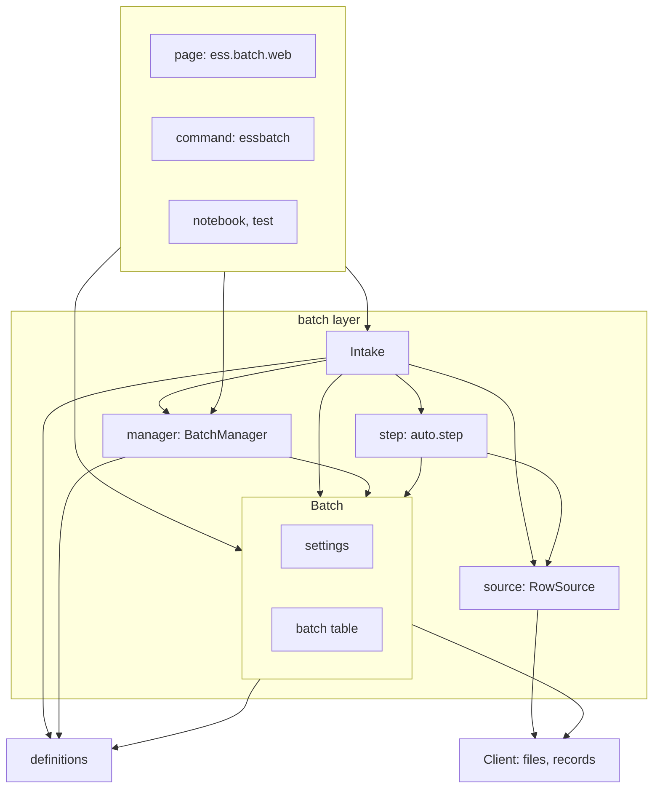
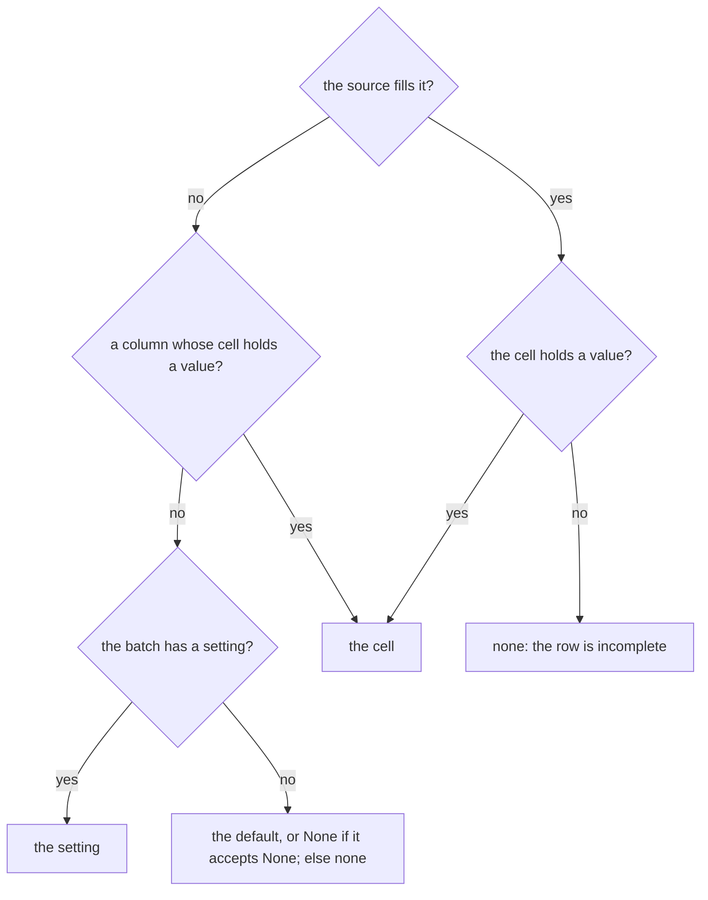
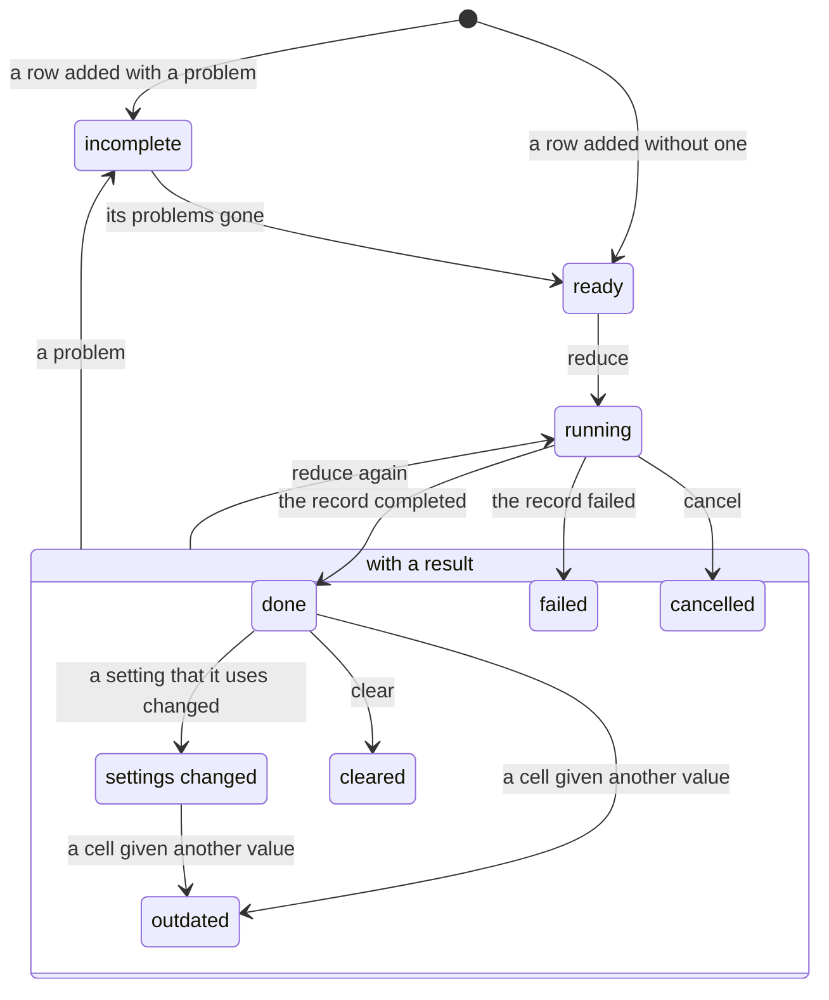
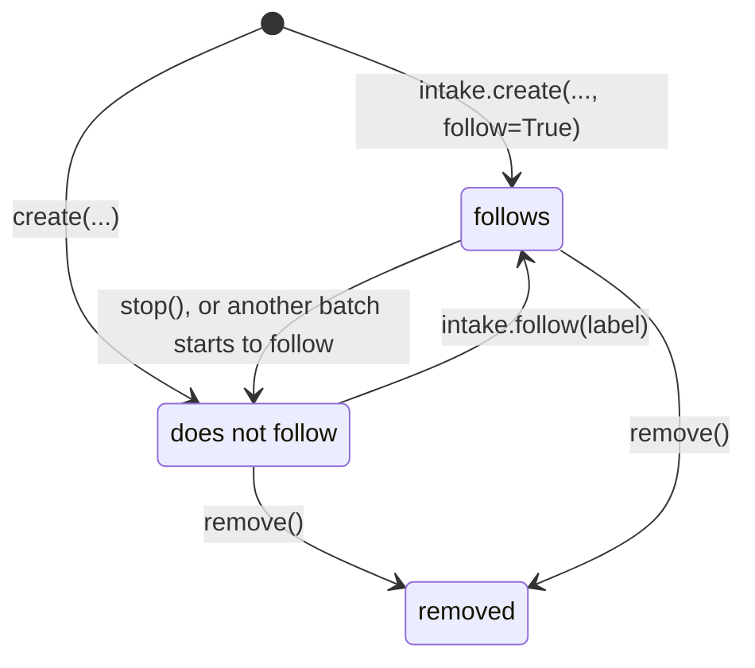
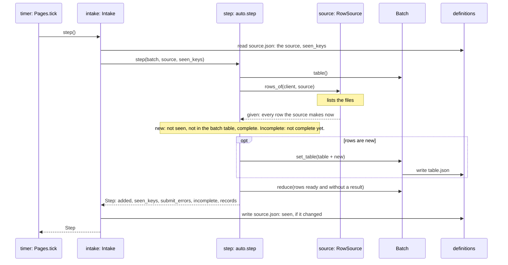

# Batch toolbox for application developers

`ess.batch` reduces one spec for many samples: a table of rows, settings shared by all rows, and the result of each row.
This page is for someone who uses `ess.batch` from Python, or wants to understand how a batch works.
It is built on the client of `ess.apps`; [the client guide](../../../docs/developer/roles/client-authors.ipynb) explains specs, records, labels and stages.
Publishing results to SciCat (`ess.batch.publish`) needs the extra `essbatch[scicat]` (scitacean).
The decisions behind it are [ADR 0012](../../../docs/developer/adr/0012-a-batch-is-a-table.md) (a batch is a template and a table) and [ADR 0013](../../../docs/developer/adr/0013-follow-adds-the-rows-not-considered.md) (Follow adds the rows not seen).
The command `essbatch` (`ess.batch.cli`, see `essbatch --help`) and the page ([`web/README.md`](../src/ess/batch/web/README.md)) are two applications of this layer.

## The system on one page

### Picture

Who calls whom; an arrow points from a caller to what it calls:



Not drawn: the page lists the runs, and the manager finds the specs bound, through the client.
`table` and `state` are functions on plain data, which any part may use.
`writing` and `publish` write the results of a batch to files and to SciCat.

### Terms

| Term | Definition |
|---|---|
| workspace | a [workspace](../../../docs/developer/README.md) with the definitions of its batches, in one folder |
| batch | one spec reduced for many samples: a header, a template and a batch table |
| label | the name of a batch, unique in a workspace; the label of its records |
| setting | the value of a parameter for the whole batch: an item of `batch.settings` |
| result of a row | the newest record under the label with the key of the row as member |
| row source | the application's code that makes rows from the files (a `RowSource`) |
| source columns | the parameters that the row source of a batch fills: `batch.source_columns` |
| complete, incomplete | a row of a source with, or without, a value in each source column |
| seen, `seen_keys` | the keys of its source that a batch has added, left out, or held |
| Follow, the batch that follows | a step every few seconds on one batch: add new rows, reduce them |

The value and the request of a row are defined in [The request of a row](#the-request-of-a-row); its status in [The state of a row](#the-state-of-a-row-and-the-rules-over-it).
The status `incomplete` of a row of the batch table covers any problem, not only an incomplete row of the source.

`manager.create` and `intake.create` return the `Batch`, and `manager.batch(label)` returns it again.
Every other method that refers to a batch accepts its label.

### The batch table

The batch table of the example below, as `batch.table()` returns it:

```python
#        run    name      sample     sample_transmission  thickness
# key
# 60339  60339  water     run:60339  run:60305            <NA>
# 60340  60340  sample A  run:60340  run:60307            2.0
```

| Part | What it is |
|---|---|
| the index, `key` | text, unique in the table; the member of the records of the row |
| a parameter column | named as a parameter of the spec, with its dtype; `batch.parameter_columns` |
| a note column | any other column (`run`, `name`); never part of a request |
| a cell | plain data, such as `'run:60339'`, `2.0`, `['run:1', 'run:2']`, or empty |

A batch table holds no results.
The results are records, joined to the rows by key where they are shown or exported.
Any other table is named with what it is of, such as "the rows of a source".

### Errors

The batch layer raises `ValueError` for a request it rejects, `KeyError` for a label that no batch has or a key that no row has, and `DefinitionWriteError` if the definitions cannot be written.
`Batch.state` and `Batch.reduce` raise `SubmitError` of `ess.apps` when the workspace rejects the settings or a row.

## One example followed through

An afternoon at LoKI.
The spec `loki-iofq` has, among others, the parameters `sample` and `sample_transmission` (files) and `thickness: float = 1.0`.
The row source `sample-runs` (`SAMPLE_RUNS` in [Writing a row source](#writing-a-row-source)) makes one row per sample run and fills `sample` and `sample_transmission`.

**1. A batch is made from the source.** Runs 60337 to 60340 are listed, each with its transmission run.

```python
intake = Intake(manager, sources={'sample-runs': SAMPLE_RUNS})
intake.rows_of('sample-runs')         # what the source makes now
#        run    name      sample     sample_transmission
# key
# 60337  60337  water     run:60337  run:60305
# ...
# 60340  60340  sample A  run:60340  run:60306
batch = intake.create('loki-iofq', title='Afternoon', source='sample-runs',
                      choose=Range(first='60339'), label='afternoon',
                      follow=True)
```

`intake.create` lists the source once and passes the complete rows to `choose`; `Range(first='60339')` picks those from 60339 on.
On disk: `header.json`, `settings.json`, `table.json` with rows 60339 and 60340, and `source.json` with `seen_keys` = 60337 to 60340 and `"follows": true`.
Rows 60337 and 60338 are seen and not in the batch table, so Follow never adds them.
A row that is incomplete when the batch is made, such as a sample run whose transmission run is not listed yet, is not seen: Follow adds it once it is complete.

**2. A person edits a cell and reduces.**

```python
table = batch.table()                 # a copy of the batch table; later: manager.batch('afternoon')
table.loc['60340', 'sample_transmission'] = 'run:60307'
batch.set_table(table)
batch.reduce(['60339', '60340'])      # {key: Record}
```

`table.json` is written again. The records are in the store under the label, with members `60339` and `60340`.

**3. A setting becomes a column.**

```python
batch.settings = {**batch.settings, 'thickness': 1.5}
batch.make_column('thickness')        # empty cells; every row uses 1.5, no request changes
table = batch.table()
table.loc['60340', 'thickness'] = 2.0
batch.set_table(table)                # row 60340 is outdated; 60339 still uses 1.5
```

Rows 60339 and 60340 were reduced in step 2 with the default 1.0, so after the assignment both have status `settings changed`.
`make_column` changes no status.
After `set_table`, row 60340 has status `outdated`, since its cell 2.0 differs from its result. Row 60339 stays `settings changed`.
`settings.json` holds `thickness: 1.5`, and a row added later uses 1.5 until its cell is set.
`batch.set_table(table.drop(columns='thickness'))` drops the column, and every row uses 1.5 again.

**4. Follow adds a row once its transmission run is listed.** The page calls `intake.step()` every few seconds.

| | What happens | Batch table | `seen_keys` |
|---|---|---|---|
| a | sample run 60341 is listed; its transmission run is not | unchanged; `done.incomplete == ('60341',)` | unchanged |
| b | transmission run 60342 is listed | 60341 is added and reduced | + 60341 |
| c | a person removes row 60340 | 60339, 60341 | unchanged, so 60340 is not added again |
| d | the transmission of sample 60339 is measured again | unchanged: row 60339 keeps its cell | unchanged |

```python
done = intake.step()         # a Step, or None if no batch follows
done.incomplete              # the keys of the incomplete rows
done.submit_errors           # why rows of this step were rejected, by key
done.records                 # the records of the rows reduced, by key
```

In step b, `table.json` is written first, then `source.json`.

**5. A restart.** The process stops; sample run 60343 and its transmission run arrive meanwhile.

```python
manager = BatchManager(client, definitions=definitions)
intake = Intake(manager, sources={'sample-runs': SAMPLE_RUNS})
intake.following             # 'afternoon'
intake.step()                # adds 60343 and reduces it
```

The results are read from the records, so no row is reduced twice.

**6. The next batch.** In the evening a person wants the runs from 60400 on in a batch of their own.
They make it from the source, with the settings of the afternoon, and with Follow:

```python
evening = intake.create('loki-iofq', title='Evening', source='sample-runs',
                        choose=Range(first='60400'),
                        settings=manager.batch('afternoon').settings, label='evening',
                        follow=True)  # 'afternoon' stops following
```

No row moves between batches.
`afternoon` keeps its rows, also those from 60400 on that it added before, until a person removes them.
`intake.follow('afternoon')` would let it follow again, in place of `evening`. Its next step would add every complete row that it has not seen, also those that `evening` added.
For a batch of only the rows that arrive from now on, pass `choose=Range(later=True)`.
Every row complete now is then seen, and none is reduced again.

## Writing a row source

A row source is a function from files to rows, and the columns that it fills:

```python
from ess.batch import FileInfo, RowSource

def pair_by_sample(files: Sequence[FileInfo]) -> pd.DataFrame:
    samples = [f for f in files if f.metadata.get('role') == 'sample']
    records = [
        {'key': str(f.metadata['run']), 'run': f.metadata['run'],
         'name': f.metadata.get('name'), 'sample': str(f.ref),
         'sample_transmission': partner(f, files)}   # None if none is listed
        for f in samples
    ]
    columns = ['key', 'run', 'name', 'sample', 'sample_transmission']
    return pd.DataFrame.from_records(records, columns=columns).set_index('key')

SAMPLE_RUNS = RowSource(pair_by_sample, source_columns=('sample', 'sample_transmission'))
```

- The index is the key, as text. A number as key is rejected: write `str(run)`.
- A file is its name, `str(f.ref)`, such as `'run:60339'`.
- The note column `name`, if any, names the row on the page and in a published dataset.
- `description` tells a person what a row is and how the source pairs the files, such as which transmission run a sample run gets when several fit. A person cannot read the code to check a pairing; `essbatch sources` prints it.

## Cells and their dtypes

`table.dtypes(spec.params)` returns the dtype of each parameter column:

| The parameter accepts | dtype | A cell |
|---|---|---|
| a file, an output, a file or an output; text, a `Literal` or an enum of text, a time, a date | `string` | `'run:60339'` |
| a number | `Float64` | `2.0` |
| a whole number | `Int64` | `3` |
| a truth value | `boolean` | `True` |
| a list, a group, a value or an output, anything else | `object` | `['run:1', 'run:2']` |

A spec with a parameter that accepts text or an output makes `dtypes` raise `ValueError`, since a cell cannot tell the two apart.
`set_table` raises `ValueError` for a cell of another kind than its column, naming the key and the column.

`as_request` converts a cell at a parameter that accepts:

```python
# a file
'run:60339'      -> FileRef(file='run:60339')
60339            -> FileRef(file='run:60339')        # a whole number is a run
# an output
'r17.centre'     -> OutputRef(record='r17', output='centre')
'r18.slices[2]'  -> OutputRef(record='r18', output='slices', key='2')
# a file or an output: text with a kind ([a-z]+:) is a file, other text an output
# a list of these: each element
# anything else, a file inside a group too: the cell as it is
```

`cell_of` is the inverse.

## The request of a row

The value of a parameter for a row:



As a function:

```python
def value(batch, key, p):                 # the value of parameter p for the row `key`
    table = batch.table()
    if p in table.columns and not empty(table.loc[key, p]):
        return table.loc[key, p]          # the row's own value
    if p in batch.source_columns:
        return MISSING                    # the row is incomplete
    if p in batch.settings:
        return batch.settings[p]          # the setting
    return default(p)                     # of the spec; None if p accepts None; else MISSING
```

The request of a row is the spec with `value(batch, key, p)` for each parameter `p`.
In [the batch table](#the-batch-table) with `batch.settings == {'thickness': 1.5, ...}`, row 60339 is reduced with thickness 1.5 and row 60340 with 2.0.
A parameter column without a value (`MISSING`) is the problem `empty` of the row: the row is incomplete, and is not reduced.
A required parameter without a column, a setting or a default makes the workspace reject the settings: `batch.state` raises `SubmitError`, and no row can run.
A row added by hand before its transmission run is listed has an empty cell at `sample_transmission`. Without the second branch, it would be reduced with the transmission run of another sample, from the settings.
A table has no word for `None`: an empty cell has the value `None` only by the last branch.

```python
batch.settings = {'thickness': 2.0, 'q': {...}}  # one setting per parameter
batch.make_column('thickness')                    # rows may set their own; no cell is filled, the setting stays
table = batch.table(); table.loc['60340', 'thickness'] = 1.5; batch.set_table(table)
batch.cells(['60339', '60340'])                   # {'60339': {..., 'thickness': 2.0}, '60340': {..., 'thickness': 1.5}}
batch.values('thickness')                         # {'60339': 2.0, '60340': 1.5}: each value, by its first row
batch.make_setting('thickness')                   # ValueError: the rows use different values
batch.make_setting('thickness', '60340')          # the column goes; the setting is 1.5
```

A batch made from a row source stores its source columns as the `blanks` of `settings.json`.
So `manager.batch(label)` reads them without the row source, and the command without `-s` reads them too.
The batch table has a column for each, and a setting there is never read:

```python
batch.set_table(table.drop(columns='sample_transmission'))  # ValueError: the table must have the column
batch.make_setting('sample_transmission')                   # ValueError, as set_table
batch.settings = {'sample_transmission': 'run:60305'}       # ValueError: the source of the batch fills it
batch.settable(settings)                                    # settings without the values at batch.source_columns
```

## The state of a row and the rules over it

`batch.state(keys=None, *, compare=True)` returns a `RowState` per row.
It is read from the records at each call; no state is stored in the definitions.
Its `status` is one of `running`, `incomplete`, `ready`, `done`, `settings changed`, `outdated`, `failed`, `cancelled` or `cleared`, as the page, a written table file and the command show it.
A row with status `settings changed` has a completed result, as a row with status `done`, and is plotted and downloaded as one.
A row with status `cleared` has a completed result whose outputs are cleared (below), so it has nothing to plot or download.
So code that wants the rows with outputs to read checks `record_status` and `cleared`, not `status`.

What moves a row from one status to another:



A problem is any of `RowState.problems`: a value missing, such as an empty cell of a source column, a cell that the workspace rejects, or a record referenced by a cell that failed, was cancelled, or is cleared.
A cleared record is a problem only of a row that would be reduced (below).
A setting outside the columns that refers to such a record is a problem of the settings, not of each row: `batch.shown()` returns it once, without a key, and `batch.reduce` refuses with it.
The workspace rejects a cell that refers to a file that the file source does not know, or cannot read now: it raised `OSError`, as when a mount is gone or a catalogue timed out.
Only the rows that refer to that file have the problem, and the reason names the file.
A row with a result resolves only the cells that differ from its result's request, so a `done` row keeps its status while its file cannot be read.
A rejection is not stored, so the next state resolves the cell again, and the problem goes once the file can be read.
A row with a problem has status `incomplete` unless it is `running`, also when it has a result, as a `done` row whose source-column cell is emptied. The arrow from the box stands for these.

The rules, such as `left_to_reduce` and `not_reduced`, are functions from the states to keys, in `ess.batch.state`.
A change of settings applies to the rows not reduced yet.
A `done` row that uses the setting, also at a column where its cell is empty, gets status `settings changed`.
A change of a cell applies to its row: it gets status `outdated`.
Which cells are empty is read from the batch table now, so a row whose cell was emptied after it was reduced counts the value it then uses as a setting.
A person reduces `left_to_reduce`, or chooses the rows.
The page and the command choose with `to_reduce`.

### Clearing outputs

Clearing frees the disk space of stored outputs, which a reduction computes again from the raw files.
`batch.clear(keys=None)` deletes the outputs of every record of the rows `keys`, or of every member of the batch, also of older records and of members no longer rows (`ess.apps.Client.clear`):

```python
batch.clear(['60339'])     # the row 60339 gets status cleared
batch.reduce(left_to_reduce(batch.state()))  # a new record computes its outputs again
batch.clear(['nope'])      # KeyError: the batch has no row nope
```

A cleared record keeps its request, its status and its provenance.
A failed or cancelled row that is cleared keeps its status `failed` or `cancelled`.

A cell that refers to a cleared record keeps referring to it: nothing points it to a new result.
The problem says what to do, by whether the batch of the record holds a newer result of the row with outputs:

```
mask: its outputs are cleared; reduce the batch masks again, then set mask to the new result
mask: its outputs are cleared; the batch masks has a newer result, set mask to it
```

Loading the template with `{'@latest': masks}` again sets a setting to the newest result.
The problem is one of a row that would be reduced: without a result, or with one that failed, was cancelled, is cleared, or is `outdated`.
A `done` row stays `done`: its outputs were computed and are still there.
So clearing the masks leaves every `done` I(Q) row `done`, and a row that is reduced again has the problem.
A cell edited to refer to a cleared record makes its row `outdated`, so that row has the problem.

The workspace refuses a clear, and clears nothing, while a record is running or something else reads it.
The error names rows by key and batches by title:

```
row 1 of Find is still running
row 1 of Find is read by row 2 of Reduce, which is still running
row 1 of Find is read by the open stage of Reduce
```

A staged batch releases a stage that it opened for a submit the workspace rejected, so that such a stage reads nothing.

## The batches of a workspace

```python
manager = BatchManager(client, definitions=FolderDefinitions(folder),
                       settings={'loki-iofq': {...}},   # the first settings of a batch, by spec
                       staged=('loki-iofq',))           # the specs that run through a stage
batch = manager.create('loki-iofq', title='Water', table=table)   # the Batch
label = batch.label        # the time of making if not given
manager.headers()          # {label: Header(title, description)}
manager.batch(label)       # the one Batch of the label, read from the definitions at the first call
manager.change(label, title='Water, second try')
manager.remove(label)      # every file of the label goes; the records stay
manager.remove(label, clear=True)  # and first the outputs of its records are cleared
manager.clear()            # the outputs of every record of the workspace, of removed batches too
```

`Intake.create` passes `source_columns=` to `manager.create`. Code that makes a batch from a batch table of its own, or from a table file, leaves it out.
A `Batch` made in code, `Batch(client, spec, label=..., settings=..., table=...)`, is the same class without definitions: it stores nothing.

### From a row source

An `Intake` holds the manager and the row sources, by name, and brings rows of a source into a batch:

```python
intake = Intake(manager, sources={'sample-runs': SAMPLE_RUNS})
batch = intake.create('loki-iofq', title='Afternoon', source='sample-runs',
                      choose=Range(first='60339'), parameter_columns=['thickness'])
intake.rows_of('sample-runs')            # what the source makes now
intake.marked('sample-runs', Range(first='60339'))
                                         # rows_of, with columns incomplete and taken
intake.create(..., choose=Range(later=True), follow=True)
                                         # no row now: Follow adds the rows that arrive later
intake.row_source(batch.label)           # 'sample-runs'; None for a batch made without a source: it cannot follow
```

## Follow

The life of a batch made from a source:



```python
intake.create(..., source='sample-runs', follow=True)    # follows; the batch that followed stops
intake.following              # its label, or None
intake.stop()                 # none follows
intake.follow(label)          # this batch follows; the batch that followed stops
done = intake.step()          # a Step, or None if none follows
done.submit_errors            # why rows were rejected, by key; they do not hold back the others
intake.available_rows(label)  # the rows of the source that the batch table lacks, with a boolean column `incomplete`
intake.add_rows(label, keys)  # add these rows as the source makes them now, also seen ones; then mark them seen
```

A step (`auto.step(batch, source, seen_keys)`), as code:

```python
table = batch.table()
given = rows_of(batch.client, source)                  # every row the source makes now
new, incomplete = added(table, given, batch.source_columns, seen_keys)
batch.set_table(pd.concat([table, new]))               # only the columns of the batch table
seen_keys |= set(new.index) | (set(given.index) & set(table.index))
candidates = not_reduced(batch.state(compare=False))   # ready as given, no result
batch.reduce(not_reduced(batch.state(candidates)))
```

One step of Follow, from the timer to `seen_keys` stored:



A removed row stays away: its key is seen, and only `intake.add_rows` brings it back.
A step reduces a row once: a row that has a result, also a failed, cancelled or outdated one, is left to a person.

A source whose row grows, such as the runs of a sample so far, gives the grown list a new key:

```
after run 2:  si@2      runs=[2]
after run 4:  si@2,4    runs=[2, 4]
after run 3:  si@2,3,4  runs=[2, 3, 4]   # listed after run 4: a new key too
```

Each list is a new row, which a step adds and reduces. The earlier rows keep their results.
The key names the whole list, since a step adds a row only under a key that is not seen.

`auto.step(batch, source, seen_keys)` runs the same step on a `Batch` made in code, with `seen_keys` in memory: give the next step `done.seen_keys`.
A batch of the manager persists what it submits. A `Batch` made in code for `auto.step` needs `persist=True`, since nothing releases its records.
The batch layer has no timer: the page's server (`every` of `ess.batch.web.api`) and `essbatch follow` (`cli.follow`) call `intake.step()`.

## Table files

A table file (`.csv`, `.tsv`, `.xlsx`) is a batch table as text, with the key as column `key`:

```
key,sample,thickness,binning,name
60339,run:60339,1.5,"{""bins"":4}",water
60340,run:60340,,,NA
```

- `table.write_table(table, path)` writes a table file, and `table.read_table(path, spec.params)` reads it as a batch table. `table.read_text(path)` reads a table file as text, without a spec.
- A list or a group is JSON text. Empty is the only missing marker, so `NA` in a note column is text.
- `read_table` reads columns with their dtypes, and drops `status`, `record`, `failure` and `published`, which `frames.with_results` adds.
- A note column of a `.csv` or `.tsv` file is text, so `0342` stays `'0342'`. A note column of a `.xlsx` file keeps the type of its cells if that is text, a number, a whole number or true/false; else it is text.
- A header that is not exactly a parameter name, such as `Sample`, is read as a note column, and `sample` has no column: every row uses its setting, or the settings are rejected if there is none.

## Chains

A cell can refer to an output of another record: `'r17.centre'` at a parameter that accepts an output (typed `Referenced[...]` in the spec).
Here `find` is a batch of the spec that finds the beam centre, and `iofq` a batch with the column `beam_centre`:

```python
centres = find.reduce(left_to_reduce(find.state()))   # {key: Record}
table = iofq.table()
for key, record in centres.items():
    table.loc[key, 'beam_centre'] = str(record.ref('centre'))
iofq.set_table(table)
```

A cell may refer to a record that still runs. If that record failed or was cancelled, the row has the problem "the record it reads is failed". If its outputs are cleared, the problem says how to point the cell to a new result ("Clearing outputs").

## Workspaces of a root folder

A workspace folder states in `workspace.json` the proposal and the file source it is opened with.
A root folder holds workspaces:

```
ROOT/
  336349/
    workspace.json   {"proposal": "336349", "files": "scicat:staging.ess",
                      "title": "LoKI commissioning", "description": "..."}
    log.jsonl  store/  definitions/
  local-test/
    workspace.json   {"proposal": "local", "files": "local", ...}
    files.csv  log.jsonl  store/  definitions/
```

| `files` | The file source |
|---|---|
| `local` | `files.csv` of the folder, as `essbatch files` writes it; no file without one |
| `scicat:PROFILE` | the raw datasets of the proposal in the SciCat of the scitacean profile `PROFILE` |

A folder without `workspace.json` is a local workspace of the proposal `local`.
The proposal and the file source belong to the workspace, not to a batch.
Cells such as `run:385`, `seen_keys` and the corrections refer to files by names that only this file source resolves.
So another proposal is another workspace.
Several workspaces may share a proposal: the name of the folder identifies a workspace.

```python
header = WorkspaceHeader(Header('LoKI commissioning'), proposal='336349',
                         files='scicat:staging.ess')
create_workspace(root, '336349', header)     # ROOT/336349/workspace.json
workspaces(root)                             # {'336349': header, ...}
allowed = file_sources(['local', 'scicat:staging.ess'])   # logs in to staging.ess now
client, files, definitions = open_workspace(root / '336349', BINDINGS, allowed=allowed)
remove_workspace(root, '336349')             # deletes the folder
```

An application states the file sources it allows, and `open_workspace` raises `ValueError` for a workspace of another one.
`essbatch` allows the file source of the folder it opens.
A test passes its own `FileSources`, such as a fake of SciCat, and needs no network.
The name of a workspace follows the rule of a label of a batch (`definition.check_label`).
The launch page of [`web/README.md`](../src/ess/batch/web/README.md) lists the workspaces of a root folder, makes and removes them, and opens each at its own URL.

## What is stored on disk

| File | Content | Writer |
|---|---|---|
| `definitions/labels/<label>/header.json` | `{"title": ..., "description": ...}` | manager |
| `definitions/labels/<label>/settings.json` | a template: the spec, the settings, the source columns as `blanks` | `Batch` |
| `definitions/labels/<label>/table.json` | `{"schema": ..., "data": [{"key": "60339", "sample": "run:60339", ...}]}` | `Batch.set_table` |
| `definitions/labels/<label>/source.json` | `{"row_source": "sample-runs", "seen_keys": ["60337", ...], "follows": true}` | `Intake` |
| `definitions/labels/<label>/output_options.json` | `{"format": "nxcansas", "outputs": ["iofq"], "name": "{title} {name}", ...}` | `Writing` |
| `definitions/labels/<label>/publish.json` | `{"published": [{"key": "60339", "record": ..., "pid": ...}]}` | `Publisher` |
| `definitions/corrections.json` | metadata of files set by hand | `CorrectedFiles` |
| `definitions/format.json` | `{"format": 2}`: the format of the files above | `FolderDefinitions`, before its first write |
| `store/`, the log | the records | the workspace |
| `workspace.json` | `{"proposal": ..., "files": ..., "title": ..., "description": ...}` | `create_workspace`, `essbatch files --proposal` |

`source.json` exists only for a batch made from a row source, `output_options.json` once output options are set, and `publish.json` once a result is published.
Each file has one writer, and `FolderDefinitions` writes it whole through a temporary file.
`settings.json` has the shape of a template file of the client, and `table.json` that of pandas' `to_json(orient='table')`.

A label is a batch if and only if `header.json` exists.
`manager.create` writes the batch table and the settings, then the header.
`manager.remove` deletes the header, then every other file of the label, `source.json` too.
So whether a batch follows goes with its label: a batch made again with the label does not follow unless made so.
`intake.create` makes the batch with the manager. With `follow=True`, it then writes `"follows": false` to the `source.json` of the batch that followed. Then it writes the `source.json` of the batch. If the definitions reject a write, it removes the batch again.
`intake.follow(label)` writes `"follows": false` to the `source.json` of the batch that followed, then `"follows": true` to that of `label`.
A process that stops between these writes leaves no batch that follows.
A process that stops between the header and the `source.json` of `intake.create` leaves a batch made without a source, which has no available rows and does not follow.

`FolderDefinitions` rejects a folder with labels and no `format.json`, or of another format, with a `ValueError` that ends "make a new folder".
A folder read with the wrong meaning would reduce rows with wrong values, and no folder is migrated.

## Testing an application

- Test the source on a list of `FileInfo`, without a workspace.
- Test the batch on `ess.apps.local()` or a folder workspace with fake workflows (`ess.apps.testing`). They start in milliseconds, and reject and fail as real ones do.
- Use `FolderDefinitions(tmp_path)`, and make the manager and the `Intake` again to test a restart.
- `packages/essbatch/tests/toys.py` and `conftest.py` show the pattern.

## What it does not do

- A step never changes a cell or removes a row.
- A correction of a run changes no batch.
- No range of runs is stored: "from run 60339 on" is the choice of rows when the batch is made.
- One batch follows at a time. The page offers no action to let a stopped batch follow again; `intake.follow(label)` and `essbatch follow` do.
- The batch layer has no lock: whoever serves holds one.
