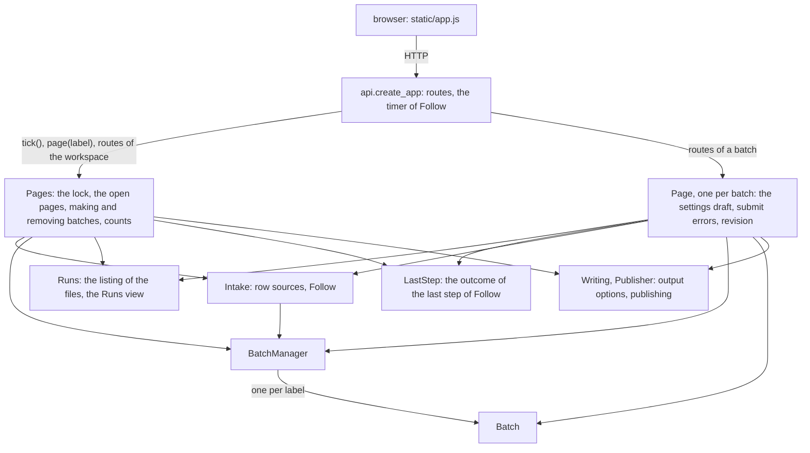
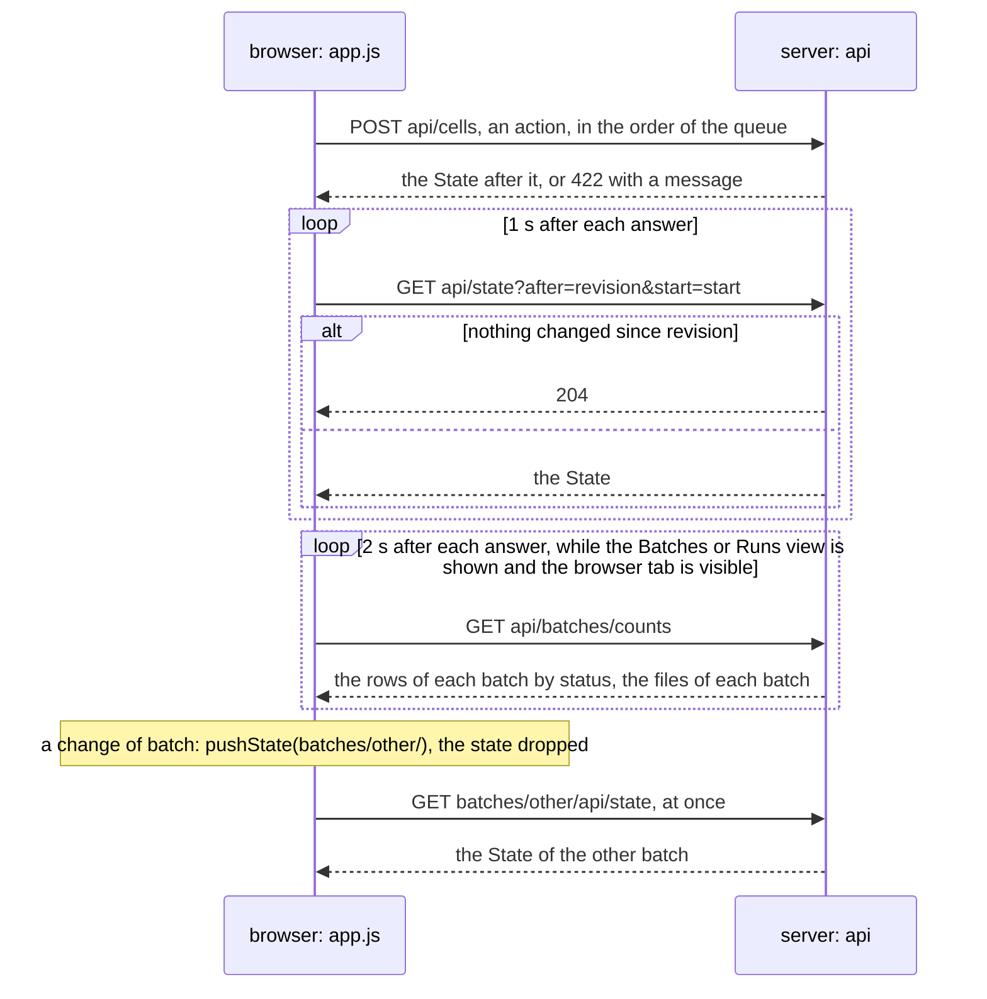

# The batch page

For a maintainer of `ess.batch.web`.
After reading you know which object holds which state, how a request reaches the batch layer, how the browser learns of changes, and what to keep in mind when you change the page.

`ess.batch.web` serves each batch of a workspace (`ess.batch.BatchManager`) as a web page at `/batches/<label>/`.
One Python process holds the workspace, the batches and the server.
The browser holds only what it shows.
How to work with batches in code: [the batch guide](../../../../docs/batch.md).

## Running it

```sh
sh packages/essbatch/src/ess/batch/web/static/vendor.sh   # once: the page's libraries into static/vendor/ (needs npm)

python -m ess.batch.web.demo [FOLDER] --port 8000              # fake runs, fake I(Q); needs essbatch[web]
python -m ess.instruments.loki.web FOLDER --port 8000           # LoKI's I(Q); needs essinstruments[loki-app]
python -m ess.instruments.loki.arrivals [FOLDER] --arrive 15    # LoKI's I(Q), runs arriving in a new folder
```

Each command lists its options with `--help`.
Open `http://localhost:8000/`.
`FOLDER` is a workspace folder (`ess.apps.folder`); without it, the demos create a temporary folder and print its path.
The LoKI page reads the masks from a record. Reduce the detector and the masks first, with the two `essbatch` commands in [the docstring of `ess.instruments.loki.web`](../../../../../essinstruments/src/ess/instruments/loki/web.py). `loki.arrivals` does this itself.

## The objects and their state

An arrow points from a caller to what it calls:



Each piece of state has one owner, and only the owner writes it:

| Owner | State | Lost when the server stops |
|---|---|---|
| the batch layer | batch tables, settings, headers, the batch that follows, output options, what was published | no: in the definitions |
| `Runs` | the listing of the files; corrections of runs (through `CorrectedFiles`) | the listing only |
| `LastStep` | the outcome of the last step of Follow | yes |
| `Page` | the settings draft (`Draft`), the submit errors of the last reduction, the revision | yes |
| the browser | view, tab, selection, filter, sort, plot axes, the draft of the output options | yes |

The browser holds the draft of the output options, but the server holds the settings draft.
A partly filled field of the settings form cannot be sent to the browser and back (see `draft.py`).
A draft of the output options is lost at a reload or a change of batch.

## How a request reaches the batch layer

`Page` is the presenter of one batch: it has no HTTP, and `api.py` only maps routes to its methods.
The batch layer decides every rule of rows, settings, sources, reduction and Follow.
The web layer translates what the batch layer raises into a message for a person, and copies no rule.
Each action is one call of the batch layer:

```python
# api.py
@batch.post('/api/cells')
def edit(page: PageOfLabel, body: CellEdit) -> State:
    return page.edit(body)

# page.py: Page.edit, wrapped by @_action
with pages.lock:
    try:
        pages.check(label)          # NotFound (404) if the batch was removed
        page._fit()                 # rebuild the forms if the parameter columns changed
        table = batch.table()       # a copy
        table.loc[keys, column] = value
        batch.set_table(table)      # the batch validates and writes to disk
    finally:
        page.revision += 1          # also when the action raises
    return page.state(notice)
```

A request returns what the page needs next:

| Request | Returns |
|---|---|
| an action on a batch | the `State` after it |
| an action on the workspace (`api/batches`, `api/runs/cells`, `api/batch/remove`, `api/outputs/clear`) | `Made` or `Notice`, since the page without a batch has no `State` |
| a read (`api/plot`, `api/row`, `api/results.zip`, ...) | what it reads, also when it is a POST because the body is long |
| any request that fails | 422 `{message}` (`errors.Rejected`), or 404 for a label without a batch (`errors.NotFound`) |

How an exception becomes a message is in `errors.py`.
Code of the application, such as a row source, the file source or a drawing, may raise anything: the page shows the message and keeps working.

## Threads and the lock

FastAPI runs each route in a thread of its pool.
The app's lifespan runs one more thread, which calls `Pages.tick`, one step of Follow, every `Pages.interval` seconds.
One reentrant lock, `Pages.lock`, serializes every request, every step of Follow and every count of rows.
Each public method of `Pages`, `Page` and `Runs` takes it.
`LastStep` is used only under it.

A step of Follow runs whether a page is open or not.
`Pages.tick` catches every exception, so that the timer never ends; the page of the batch that follows shows the error, and the next step tries again.

## How the browser learns of changes

There are no websockets.
Each action returns the new `State`, and the browser polls for changes that happen without an action, such as a reduction that finishes or a step of Follow.
URLs are relative to the page's own, `batches/<label>/`:



`Page.poll` compares a tuple of counters and values, `Page._live()`, with the tuple at the last revision:

```python
(batch.revision,              # the batch table and the template
 listing.cursor,              # the position in the workspace's records
 listing.revision,            # the files listed, and why they cannot be listed
 manager.revision,            # the headers of the batches
 intake.following,            # the batch that follows
 last_step.token(label))      # what the page shows of the last step of Follow
```

It also reads the workspace's records changed since `listing.cursor`.
If anything changed, it lists the files again and increments `Page.revision`.
No signal reports that a file arrived, so the listing is only refreshed at a poll, an action or a step of Follow.
`start` is new at each start of the server; a page that sees another `start` reloads.

The Runs view gets the batches of each run from `api/batches/counts`, not from `api/runs`, since Follow adds rows that refer to runs without a change of the runs.
The page without a batch polls no state; it reloads the list of batches with each count.

## The browser

`static/` holds the page as ES modules, with no build step: `app.js`, `tables.js` (Tabulator grids), `form.js`, `dom.js`.
`vendor.sh` fetches Tabulator and Plotly into `static/vendor/`.

The document loads once.
A change of batch (a click in the list, a new batch, a removal, Back and Forward) runs `show` in `app.js`: it records the URL with `history.pushState` (after a removal `replaceState`; at Back and Forward the browser changed it), drops the state, and polls the new batch at once.
The grids stay and receive the rows and columns of the new batch.
Two counters drop answers that arrive late: `changes` counts the changes of batch, and `sent[kind]` counts the requests of each kind, such as `api/plot`.

Every request that depends on the actions before it waits in one queue (`queued` in `app.js`), so that the server receives them in the order a person made them:

| In the queue | Why |
|---|---|
| each action of a batch (`act`), corrections of runs, the removal of a batch, **Clear all outputs** | each changes what the next one reads |
| a file download (the batch table, the settings, the results) | it must include an edit that the click sent at the blur of its input |
| **Make** of a new batch | it may start with the settings that an **Apply** before it set |

The poll, the counts and the other reads (`api/runs`, `api/sources`, `api/plot`, ...) are sent at once.
An action is sent to the batch that was shown when the person made it, also if another batch is shown when its turn comes.
Its answer is then dropped, and an error appears as the page's message with the title of its batch.

The browser stores in `sessionStorage`, so that a reload or a return to a batch shows the same: per workspace the view, the tab and the plot axes (`WORKSPACE` in `app.js`), per batch the filter, the selection and the sort (`BATCH`).

## Mounting under a prefix

The page requests `api/...` relative to its own URL, and `/` redirects by a relative URL, so a parent app can mount it under a prefix.
Starlette does not run the lifespan of a mounted app, and the lifespan owns the timer of Follow, so the parent runs it:

```python
batch = create_app(pages)
parent = FastAPI(lifespan=lambda _: batch.router.lifespan_context(batch))
parent.mount('/batch', batch)
```

## Limits

- One process holds the folder. `essbatch` opens it only while the server is stopped. What its commands write, such as the rows that `essbatch add` adds, the page shows at its next start.
- One `Batch` object per label. Another `Batch` of the page's label writes its whole batch table at each change, over that of the page.
- One user. Two open pages of one batch show and edit the same state.
- One lock for all pages. A request waits while a step of Follow runs on another batch, and while results are published, uploads included.
- A batch that cannot be shown, such as one whose table cannot be read, has no tab **Batch**, so the page cannot remove it. `essbatch remove` can, while the server is stopped.
- The confirmations are the browser's dialogs (`confirm`).

## Browser tests

```sh
cd packages/essbatch
python -m pytest tests/web_browser_test.py   # in Chromium
python -m pytest tests/web_test.py           # the API, without a browser
```

The browser tests need Playwright, a Chromium (`playwright install chromium`, or `chromium` on the `PATH`), and the libraries of `vendor.sh`.
Without one of the three they skip; with the environment variable `CI` set they fail.
