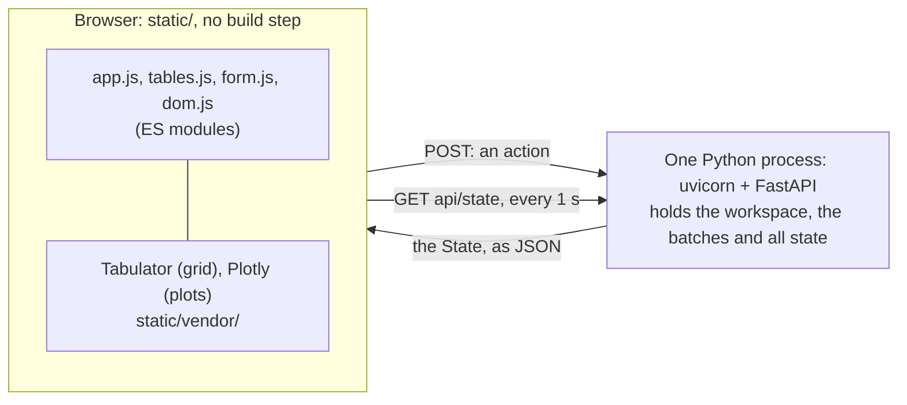
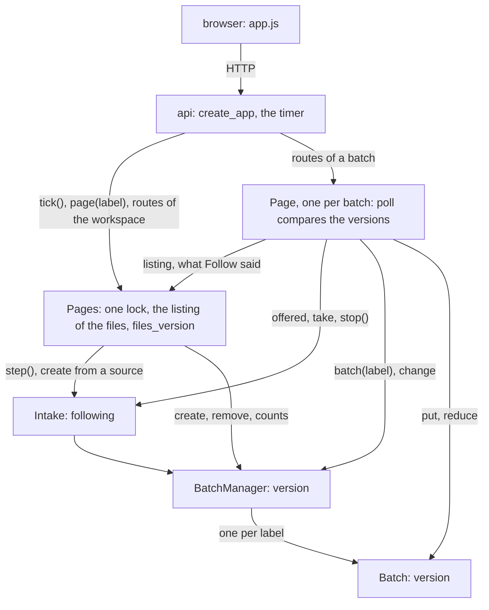
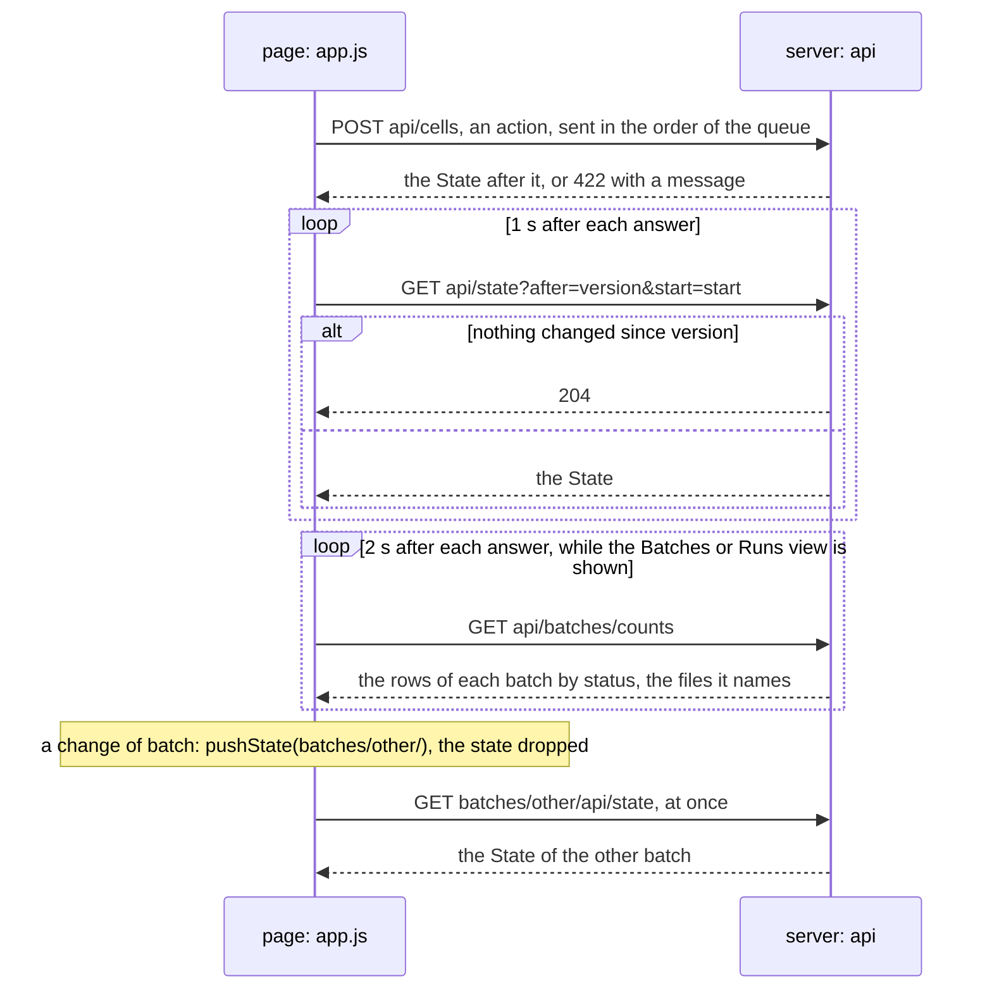

# The batch page

`ess.batch.web` shows each batch of a workspace (`ess.batch.BatchManager`) as a web page: the rows with their status, the settings, the runs, and the results as a plot.
One Python process holds the workspace, the batches and the server; the browser holds only what it shows.
The page of a batch is at `/batches/<label>/`.

## Running it

```sh
sh packages/essbatch/src/ess/batch/web/static/vendor.sh   # once: the page's libraries into static/vendor/ (needs npm)

python -m ess.batch.web.demo [FOLDER] --port 8000                  # fake runs, fake I(Q)
python -m ess.batch.web.demo --fake-catalogue                      # the same, publishing to a SciCat in memory
python -m ess.batch.web.demo --arrive 10 [--start M]               # fake runs, a sample arriving every 10 s
python -m ess.batch.web.demo --samples 150 --arrive 2 --start 100  # 150 samples: 100 at the start, one more every 2 s
python -m ess.instruments.loki.web FOLDER --port 8000                   # LoKI's I(Q) on a workspace folder
python -m ess.instruments.loki.arrivals [FOLDER] --arrive 15 [--count N] [--start M] # LoKI's I(Q), runs arriving in a new folder
python -m ess.instruments.loki.arrivals --follow 2                      # the same, the first batch following the files, a step every 2 s
```

Open `http://localhost:8000/`: it redirects to the page of the batch that follows, else to that of the only batch; otherwise it shows the list of batches, to show one or make one (see [Making a batch](#making-a-batch)).
Each `FOLDER` is a workspace folder (`ess.apps.folder`); the demos make a temporary one if none is given, and say which.
At a start, the demo and the LoKI page make a batch of the rows their row source gives if no batch is listed, so also at a start after a person removed the last one; the batches and the batch that follows are kept in the folder.
The demo needs the extra `essbatch[web]`, the LoKI modules `essinstruments[loki-app]`.
The LoKI page reads the masks from a record, so reduce the detector and the masks on the folder first, with two `essbatch` commands that [the docstring of `ess.instruments.loki.web`](../../../../../essinstruments/src/ess/instruments/loki/web.py) gives; the LoKI arrivals do this themselves.
The two commands make the batches `detector` and `masks`, so the LoKI page then makes no batch of I(Q): make it with **+ New batch**.
With `--arrive`, the runs of one sample (fake demo) or one run (LoKI) arrive every `SECONDS`, until all have arrived.
`--samples N` (fake demo, 24) and `--count N` (LoKI, 12 runs) say how many there are in all; beyond the samples that the module names, the same are measured again as `<name> #2`, `#3`...
`--start M` says how many of them are there at the start, in the first batch (fake demo: 3 samples; LoKI: 0 runs). The first batch does not follow; make a batch with **Follow** in **+ New batch** to add the rows that the runs fill and reduce them. **List runs again** lists them in the Runs view and in the choices of a cell, and changes no row.
Each page reads `files.csv` again when it is replaced (`ess.apps.folder.ArrivingFiles`), so a run registered by hand, with `ess.apps.folder.write_files_table`, shows too.
The demo and the LoKI page take `--interval SECONDS`, the time between two steps of Follow (5).
The LoKI arrivals take `--follow [SECONDS]`, which makes their first batch with Follow, with a step every `SECONDS` (5).
`--fake-catalogue` needs the extra `essbatch[scicat]`; the catalogue forgets its datasets at a restart, while the batch keeps which records it published (see [Output](#output)).

## The batch table

The rows of the page are the batch table (`Batch.frame()`): one row per key, a parameter column per parameter that each row sets, and the note columns, shown as text.
A row is shown by its note `name`, else by its key; **+ Add row** takes its key.
Each change of rows on the page, an edit of cells, **+ Add row**, **Remove selected** and **Load table**, makes the new batch table and puts it to the batch (`Batch.put`); what the batch refuses is said, and nothing changes.
A run chosen in a cell is kept as the text of its file (`table.cell_of`).
**Load table** replaces the whole batch table, its columns too; the page then shows the cells and the settings form of the parameter columns loaded.
It is refused while the settings form holds a change, which the new form would drop, as "Make this a column" and "Make this a setting" are.
**+ Add rows from the runs**, on the page of a batch made from a row source, lists the rows of the source that the batch table lacks (`Intake.offered`): those left out when the batch was made, those removed, those that wait for a run, marked, and, in a batch that does not follow, those filled after it was made or after it stopped.
The rows a person picks are added as the source makes them now (`Intake.take`), and Follow does not add them again once removed; so a removed row comes back this way.

"Make this a column", at a setting in the Settings tab, makes the parameter a column with an empty cell in each row (`Batch.make_column`); it is offered only for a parameter that has no column and whose cell the page edits.
The setting stays: a row whose cell is empty takes it, also a row added later, by Follow or by a person, until its cell is set.
The grid shows such a cell in grey as the value it takes: the setting, or the default of the parameter if the batch has none.
The field of a parameter column in the Settings tab has **Default**, which sets it back to the default of the parameter, for every kind of field; once applied, that default is the setting, and a parameter without a default has no setting, so a row whose cell is empty is incomplete.
A parameter column that the row source of the batch fills has no field in the Settings tab and no "Make this a setting": its empty cell means that the row waits for a run (`Batch.fills`), and the batch table keeps the column, so a table file loaded without it is refused.
"Make this a setting", in the menu of the header of a column, drops the column (`Batch.make_setting`): the setting becomes the value that every row takes, or, where the rows differ, the value a person chooses in a dialog, which lists the values that the rows take (`GET api/columns/values?name=...`).
Both are refused while the settings form holds a change, since the page then builds the form and the cell editors again.
**Download as CSV** and **Download as XLSX** give the batch table with the results of its rows (`frames.with_results`).
If the file source raises, the page shows the batch table, the results and the plots all the same; the pickers offer no file, the Runs view is empty, and both say why.
A row whose cell names a file that the file source cannot read reads `incomplete`, with the reason at the cell, until the file source reads the file again ([the state of a row](../../../../docs/batch.md#the-state-of-a-row-and-the-rules-over-it)).

## Settings and Follow

The settings form has a field per parameter.
The field of a parameter column is marked "A column: a row may give its own": its value is the setting that each row with an empty cell takes, and it may be left unset, as for a column of files.
The settings form holds a change until **Apply** writes it to the batch; **Discard** shows the batch's settings again.
While a person has changed the form and not applied the change, the bar above it reads "Changed, not applied yet", and the rows still read as with the batch's settings.
Apply is refused while the form misses something, and the bar says what; it also names the settings kept that the form cannot show, which Apply replaces.
While the form holds a change, **Reduce**, the ways of its menu, **Reduce them again** and **Download settings** are refused, so that nothing is reduced or saved with settings other than those shown.
**Load settings** and "Put these settings in the form" in the row tab fill the form, after a confirmation if it holds a change; a file that cannot be read whole leaves the form as it was. A value at a parameter column that the row source fills is left out (`Batch.settable`).
"Put these settings in the form" puts the value that the row was reduced with at each column where its cell is empty, and leaves the batch's setting where the row gives its own value, which is no setting of the batch.
**Download settings** writes every setting, those at the parameter columns too, as a template without blanks.
A change of the settings applies to the rows not reduced yet.
A row reduced before that takes the setting changed reads `earlier`, reduced with earlier settings, and **Reduce** leaves it (`ess.batch.left_to_reduce`); a row that gives its own value in the column of the setting stays `done`.
Its pill is teal, neither the green of `done` nor the amber of `outdated`, and the text beside it names the settings that changed, such as "Binning changed".
Its result counts as one of a `done` row: the plot, **Download all** and the count of results take it.
The label of the Settings tab shows how many rows read `earlier`, and the tab a bar above the form, "N rows reduced with earlier settings", with **Reduce them again**.
That button, and **Reduce rows of earlier settings** in the menu ▾ next to **Reduce**, reduce those rows (`earlier_settings`), after a confirmation that names how many.
**Reduce** never reduces them: with only such rows left, it reads "Nothing left to reduce".
To try settings on one row, change them, **Apply**, select the row, and choose **Reduce selected** in the menu ▾ next to **Reduce**.
The row tab then shows what the row was reduced with: the value of each parameter that the row took, from its cells and the settings, and marks those that differ from what the row takes now.
To keep the settings, press **Reduce them again**; to drop them, change them back and **Apply**, and the row tried reads `earlier`.
In a batch that follows, the settings applied for the trial are also those of the rows that Follow reduces meanwhile, such as the rows of runs that arrive. To try settings on a few rows first, make a batch without Follow, then the batch that follows with "Start with the settings of" the first.
The page sends its actions in the order a person did them, so a value typed and Apply clicked at once are applied with one click.
Each state replaces the form, but not while the focused input holds a value typed and not sent; Escape puts back the value sent last.

A batch follows from the time it is made, if **Follow** is ticked in **+ New batch** (see [Making a batch](#making-a-batch)), until it is stopped.
At most one batch follows: making one with Follow stops the batch that followed before, and the list of batches marks the one that follows.
The page of the batch that follows has **Stop following** next to **List runs again** (`POST api/follow/stop`, `Intake.stop`). It asks once, since the page offers no action to let the batch follow again; rows that arrive later are then added with **+ Add rows from the runs**, or go to a new batch.
The page of a batch that does not follow has no Follow control.
While a batch follows, a timer in the server runs a step every `interval` seconds (5 by default; `Pages(intake, interval=...)`, or `--interval SECONDS`), under the lock of every request, with or without a page open.
A step is `Intake.step`:

```python
done = intake.step()   # a Step, None if no batch follows
done.refused           # why a row could not be submitted, by key
done.waiting           # the keys of the rows of the source not filled yet
```

It adds the rows of the source that the batch has not considered and that are filled, and reduces the rows that are ready and have no result (`ess.batch.not_reduced`).
A row that waits for a run is added at the first step after the run arrives; the page of the batch that follows says how many rows wait.
A row that a person removed is not added again.
A step changes no row that the batch table has: a run that arrives later, or a correction in the Runs view, leaves the cells as they are.
Follow reduces with the batch's settings, whatever the form holds.
A row with a result waits for **Reduce**, also one that is outdated or failed.
A row that a person adds, or edits before it has a result, is reduced by the next step once it is complete.
A correction is an action of the workspace, made in the Runs view of any page, also of the page without a batch (`POST api/runs/cells`).
An action submits only what a person asks to reduce; the next step reduces what the rule gives after it. Apply submits nothing, and the next step reduces the rows without a result with the settings applied.
Apply forgets why Follow could not reduce a row, since the next step tries again.
The page of the batch that follows shows "Following, every N s", how many rows wait, why the last step failed if it did, and, at the row, why a row could not be submitted; the row keeps its status, such as `ready`.
Whatever a step raises, from the files, the workflow or the workspace, is the step's failure, said on the page of the batch that follows; the next step tries again.

## The runs

The view **Runs** lists the runs of the workspace (`Pages.runs`), with the fields of a run that a person corrects, and the column **Batches**.
The column **Batches** names each batch that uses the run, by its title, in the order of the list of batches, and its tooltip adds the label of each, since two batches may share a title; it is empty for a run in no batch.
A batch uses a run if a cell of its batch table names it, such as a sample run or an element of a list of runs, or one of its settings does, such as the run of the can (`Batch.files`).
A reference to a file not listed is ignored alone, also in a list of runs; only in a group of fields, such as a setting of several fields, does it hide the other files of the group.
A run is matched by its identity, as the workspace resolves a name: a cell that names `run:70003` names the run that the view lists as `path:raw/70003.nxs`.
A name resolved is kept until the next change of the batch table, as the state of the rows keeps it; so a run that gains a catalogue identifier is matched by it after that change.
A title is a link that shows its batch as a click on its title in the list of batches does: in place, in the Rows view; a click with a modifier key is left to the browser.
A click on the header of the column sorts the runs by it, the runs in no batch first, so that a run left out of every batch is found.
The column also shows which batches a correction of a run does not reach, since a row that a batch table has keeps its cells.

## The list of batches

The view **Batches**, next to the rows and **Runs**, lists every batch of the workspace: its title, label and description, and which batch follows; the batch shown is marked.
A click on a row of the list shows its batch, and the view stays Batches: the right pane then shows that batch. A click on the title shows its batch in the Rows view.
The page shows one batch, so the list has no checkboxes.
The title is a link to the page of its batch, so a click with a modifier key, or with the middle button, opens it in another tab.
The label and the description are text to select and copy: a click on them, or one that selects text, shows no batch.
The description keeps its line breaks, here and in the forms "New batch" and of the tab Batch, where it is a field of several lines.
While the view Batches or the view Runs is shown, the page counts the rows of each batch by status (`Pages.counts`), the next count 2 s after the answer of the one before; nothing counts while the view Rows is shown, or while the tab of the browser is hidden.
The answer of a count also gives the files that each batch names, which the Runs view joins to its runs.
A count updates the cells of the rows; the rows are made again only when the list changes, so the keyboard focus on a title and a text selected stay.
The Runs view so updates only the runs whose batches changed, and not while a person types a correction in a cell.
The statuses are those of the chips of each batch's page (`RowState.text`).
A count reads the state of every batch under the lock of all pages, so the pages and Follow wait until it ends.
One count of a batch of 1,000 toy rows, half of them reduced, takes 46 ms; the first count after a change of its batch table takes 225 ms, since each value that names a file is resolved again.
A batch that cannot be counted, such as one whose batch table cannot be read, shows why in its row.
The counts shown stay until the next answer replaces them; a count that fails shows none, and the Runs view keeps the batches of each run of the last answer.
The list and the Runs view are the same on every page.
The page without a batch, which polls no state, loads the list again with each count.

## A change of batch

The document is loaded once.
A click on a batch in the list, **Make** of a new batch, the removal of a batch, and Back and Forward of the browser show another batch in place (`show` in `app.js`): the URL changes to the page of the batch (`history.pushState`), the page drops the state, and the next poll, sent at once, draws the state of the batch.
The grids stay, and get the rows and the columns of the batch.
An action goes to the batch it was made for, also a value typed that the change sends as it takes the focus, or an action that waits in the queue; a file asked for is saved.
Nothing of the batch before stays: its rows, selection, filter and plot, the row tab, the forms, the dialogs and menus, a message or a refusal, and the state that an action of the batch before answers after the change.
A refusal of such an action is the page's message, which names the batch by its title, such as "Samples: The batch was not changed: …", not a message at a field or a form of the batch shown.
Until the first state is drawn the page takes no click, and it fades if that takes longer than 0.3 s.
If the server does not answer then, the page says so, and shows the Batches and Runs views, without the batch before, until the first state comes; then it shows the view chosen.

The page remembers in the session of the browser, so that a reload or a return to a batch shows the same:

| For the workspace | For each batch |
|---|---|
| the view (Batches, Rows, Runs), the tab of the right pane, the axes of the plot | the filter, the selection, the sort |

## Making a batch

**+ New batch** in the Batches view opens a form above the list:

| Field | What it is |
|---|---|
| Title, Description | the header of the batch; the title is required |
| Rows | from a row source that the application registers (`Intake(sources=...)`), from a table file, or "none: no rows" |
| Range | with a row source: the first and the last row to take, each open if not chosen, among the rows that the source has filled now (`Range`); or, as the last choice of "From", no row now (`later`): the batch gets only the rows added later, by Follow if ticked, else with **+ Add rows from the runs**; below it, the rows of the source, each marked by the server as taken, left out, or waiting (`GET api/sources/rows?name=...&first=...&last=...&later=...`) |
| Table file | from a table file: a `.csv`, `.tsv` or `.xlsx` file with a column `key` (`table.read_table`) |
| Workflow | a spec that the workspace binds and that has a parameter for each column that the row source fills; any spec without a row source |
| Settings | on the page of a batch: start with the settings of that batch, else with those that the application gives; a setting at a parameter column ticked stays, and each row whose cell is empty takes it, also a row that Follow adds; a parameter column that the row source fills gets no setting |
| Follow | with a row source: add the rows that arrive later, and reduce them; off unless ticked. While ticked, the end of the range is open and cannot be chosen, since a last row would leave out the rows filled between it and the making for good; the `Intake` refuses a last row with Follow (`Intake.create`). Beside it, how many rows taken are reduced at once, and the batch that follows now, which stops following if ticked |
| Columns | the parameter columns that the row source fills, fixed; the other parameters of the spec whose cell the page edits, to tick (a group of fields, such as a Q binning, stays a setting); none for a table file, whose columns are those of the file |

**Make** sends the form to `POST api/batches`, or the file to `POST api/batches/table`, and the page shows the new batch in the Rows view.
With a row source, the batch holds the rows of the range that the source has filled now, with an empty parameter column for each column ticked that the source does not fill; a row that waits cannot be taken; if the batch follows, Follow adds it once filled, as it adds those that arrive later.
A table file refused, or empty, is named as the person chose it.
From a table file, the batch has no row source; a column of the file named as no parameter is a note column, so a misspelt column is a note, and the parameter it meant is a setting that the settings form asks for.
Without a row source, the batch holds no rows and the parameter columns ticked; rows are added on its page or by **Load table**.
In code:

```python
settings = manager.batch(other).settings                        # thickness among them
batch = intake.create(spec, title=title, source=source,
                      choose=Range(first, last, later),
                      parameter_columns=['thickness'],          # ticked: an empty column
                      settings=settings,                        # less those at the fills of the row source
                      follow=follow)                            # Follow ticked
batch = manager.create(spec, title=title, rows=table,           # from a table file, or rows=None
                       parameter_columns=['thickness'], settings=settings)
```

The batch is made in one call: a call that is refused leaves no batch, and a batch that follows replaces the one before only if it is made. A process that stops while a batch that follows is made may leave the batch made and no batch that follows ([What is kept on disk](../../../../docs/batch.md#what-is-kept-on-disk)).

Opened on the page of a batch, the form starts at that batch's row source, workflow, parameter columns and settings, so the next batch is this form with a range that starts later, and Follow ticked by the person.
"From" starts at the first row, so a batch with Follow reduces every row taken again; "no row now" with Follow makes a batch of only the rows that arrive from now on.
A batch that follows and has no row yet says so where its rows would be.
Follow is off unless ticked, since it stops the batch that follows, which the page cannot make follow again, and reduces the rows taken within seconds, with the settings chosen.

The choices come from `GET api/sources`; what can be made is decided by `Intake.create` and `BatchManager.create`, and what they refuse, such as an empty title, shows at the form, with nothing made.
**Make** is disabled while it is sent, so a double click makes one batch.
The form offers each row source with the specs that fit it (`fits`), and a row source that no spec fits not at all; this is an offer, not a rule: `Intake.create` refuses a spec that does not fit.

The form is closed until **+ New batch** is pressed.
`/` serves the page without a batch if no batch follows and there are none or several: the Batches view, with the form open if there is no batch, and the Runs view.
It polls no state; the list of batches is loaded again with each count, and the runs once.
`/` answers with `Cache-Control: no-store`, so that a `/` opened again asks the server, which redirects once one batch follows or there is one batch.
The page asks `/` so too when it shows the root in place, after a batch is removed or at Back.
The page of a batch that cannot be shown, such as one whose table cannot be read, says why, and shows the Batches and Runs views; the form is open only if there is no batch.
So does an open page of a batch removed meanwhile, at its next poll, which the server answers 404 ("There is no batch X.").

## Changing and removing a batch

The tab **Batch**, next to **Result**, **Settings** and the row tab, shows the header of the batch of the page.
Its workflow, columns and label are shown as text.
Its title and description are a form, which **Save** sends to `POST api/batch` (`BatchManager.change`).
What the manager refuses, such as an empty title, shows at the form, and nothing changes.

**Remove this batch**, after a confirmation, removes the header and every other file of the batch: its settings, its batch table, its `source.json`, its `form.json` and its `publish.json` (`POST api/batch/remove`, `BatchManager.remove`); its results stay in the workspace, and its datasets in the catalogue.
If the batch follows, none follows from then on.
The page then shows `/` in place of the batch in the history of the browser: the batch that `/` redirects to, the one that follows or the only one left, else the page without a batch.

## Output

The tab **Output** holds the form of the batch, kept per batch by `ess.batch.writing.Writing`, which **Apply** sends to `POST api/output/form` (`Writing.set_form`).
It says how the result of each row is written, and what is said of it:

| Field | Meaning |
|---|---|
| Format | one of the writers that the application gives for the spec of the batch (`Pages(..., writers=writers)`), first the default, then `scipp HDF5`, which every spec has; the select shows each writer's title, with its description under it, and the form keeps its name |
| Outputs | the outputs to write, for a format that writes those chosen (`Writer.outputs is None`); hidden for a format that reads outputs of its own, such as NXcanSAS |
| Name | the pattern of the name of each result: `{title}` the batch's title, `{name}` the row's name, `{key}` its key |
| Description, keywords, owner, contact email | what is said of each result (`ess.apps.writers.About`) |

Until a person applies the form, its format is the first of the formats, it names every output, its description is the batch's, and its owner and contact email are none, or, for an application given a catalogue, the principal investigator of the proposal, as the catalogue says (`ess.apps.scicat.principal_investigator`), asked once at the start: the ESS ingestor makes the same person owner and contact of each raw dataset.
A kept form whose format the application lacks, such as one kept by `essbatch form` with other writers, writes nothing: the format shows none picked, the bar says why (`OutputShown.problem`), and the downloads and **Publish** wait until a person picks a format and applies it.

The form holds a change until **Apply**, under the bar of the Settings tab ("Changed, not applied yet"), and **Discard** shows the form in force again.
Unlike the draft of the settings, which the `Page` holds, the browser holds this one: it is lost at a reload or a change of batch, and a form in force that changed elsewhere refills the inputs only while they hold no change.

**Download selected** and **Download all**, in the Files menu, give a zip with a folder per row that has a result, named by its key, written by the form in force (`POST api/results.zip`, `Writing.by_form`): the files of the format and the record of the result, `_record.json`; beside them `results.csv`, the rows with their status and record.
Both are refused while the form holds a change, so that the zip is what the form shows, as **Download settings** is while the settings form holds one.

An application given a catalogue (`Pages(..., catalogue=Catalogue(...))`, `ess.apps.scicat`) has, under the form, the button **Publish**, and the grid a column **Published**; without one, neither shows, and `POST api/publish` is refused.
The result of a row is published as one derived dataset of SciCat (`ess.batch.publish.Publisher`, `ess.apps.scicat.publish`), with the files that the download writes.
The rest is read from the result: the files it read with a catalogue identifier are its inputs, the proposal is the workspace's, and the software is that of the server now.
**Publish N selected** publishes the selected rows that read `done` or `earlier` and are not published, with the form in force (`POST api/publish`, `Publisher.publish`); the column **Published** then shows the identifier of each dataset.
The publisher decides which results may be published (`PUBLISHABLE`); the button only mirrors it, and waits, with a hint, while the form holds a change, names no owner or contact email, or a publication runs.
A result is published once; a row reduced again may be published again, as a new dataset.
What the publisher refuses, such as a row whose result is outdated, publishes nothing; an upload that fails keeps those before it, which its message names.
Which SciCat, and whether files are copied on a shared file system or sent over SFTP, is the `scitacean.Client` and its file transfer that the application gives (`ess.apps.scicat.Catalogue`); the transfer must have no `source_folder` of its own, so that each dataset has the folder of its record.
There is no login yet.

## The rules of the design

The web layer follows eight rules. Each says where a reader finds a kind of thing, so a change that breaks one needs a reason.

1. **The batch layer decides.** Every rule of rows, settings, sources, reduction and Follow is in `ess.batch`. The web layer says what the batch layer refuses in words for a person and copies no rule of the batch layer. It refuses only a request that no call of the batch layer can express, such as Follow without a row source (`NewBatch`). The form in the browser may know a rule to be helpful, such as that a batch that follows has no last row, but the server does not decide it here.
2. **One lock.** `Pages.lock` is around every request, every step of Follow and every count. Each public method of `Pages` takes it, and a caller may hold it already; a property of `Pages` (`listing`, `files_version`, `runs_version`, `corrects_runs`) reads one value without it.
3. **Each piece of state has one owner, which alone writes it.**

   | Owner | State |
   |---|---|
   | the batch layer | the batches: batch table, settings, header, which batch follows, the output form and what was published |
   | `Pages` | the listing of the files and its version, the corrections of runs, what the last step of Follow said |
   | `Page` | the draft of the settings form, the refusals of the last reduction, its version |
   | the browser | what is shown: selection, filter, view, tab, sort, axes; the draft of the output form ([Output](#output)) |

   A `Page` changes its batch through the batch layer, and asks `Pages` for the listing and for what to show of Follow.
4. **A request answers what the page needs next.** An action that changes a batch answers the `State` after it. A request that reads answers what it reads, also when it is a POST because its body is long (`api/plot`, `api/results.zip`). An action of the workspace answers what the page shows next, since the page without a batch has no state: a `Notice` for correcting a run or removing a batch, `Made` for a new batch. Any request may answer 422 with a message, or 404 for a label that is no batch.
5. **A change is noticed by counters.** At each poll the server compares versions and answers 204 until one moved ([How the page learns of changes](#how-the-page-learns-of-changes)). No signal says that a file arrived, so nothing read from the files is kept by the version of a batch; the listing has a version of its own.
6. **A refusal is a `Problem` (422) or a `Missing` (404); how an exception reads as a message is in `refusals.py` and `ess.apps.errors.said`.** Code of the application, such as a row source, the file source or a drawing, may raise anything: the page says it and keeps working (`refused`, `said`): a pydantic `ValidationError` as each reason at its field, another refusal (`ValueError`, `OSError`) as its text, and a defect with its type. Elsewhere an action catches only the refusals it expects of the batch layer, or of a file or a value that a person gave, and says them with `why` after what it was doing, such as "Cannot load rows.csv: ...".
7. **The browser draws from the state and sends its actions in one queue** ([How the page asks](#how-the-page-asks)).
8. **The settings form is a draft.** Only **Apply** and **Make this a setting** write settings. While the form holds a change, the page refuses to reduce, to change which parameters are columns, and to give the settings as a file.

## Server and browser



The server holds all state.
The browser draws the `State` that the server sends and sends what a person does; it keeps only what it shows (selection, filter, view, sort).
There are no websockets: each action answers with the new `State`, and the page polls to see results arrive ([How the page learns of changes](#how-the-page-learns-of-changes)).

## Layers

The objects of the server; an arrow points from a caller to what it calls, and `Page.poll` compares the numbers named `version` and `files_version`, and which batch follows (see [How the page learns of changes](#how-the-page-learns-of-changes)):



| Module | What it holds |
|---|---|
| `static/` | the page: `index.html`, `app.js`, `tables.js`, `form.js`; what is shown: selection, filter, view, tab, sort, axes |
| `api.py` | HTTP: `create_app(pages)`; each action is a POST that answers with the new `State` (`models.py`), 422 `{message}`, or 404 for a label that is no batch |
| `pages.py` | `Pages`: what the pages share, without HTTP: the `Intake` and its manager, one lock around every request and step, the list of batches and its counts, making and removing a batch. It alone writes the listing of the files and its version, the corrections of runs, and the step of Follow (`tick`) and what it said |
| `page.py` | `Page`: what the page of one batch does, without HTTP. It alone writes the settings form (a `Draft` until Apply), the refusals and its version. Through the manager and the `Intake` it writes its batch: the rows (each change a frame put to the batch), the settings at Apply, its header, the rows taken, Follow's stop. It asks `Pages` for the listing and for what to show of Follow |
| `draft.py` | `Draft`: the settings form of a `Page`, a draft until Apply: what it holds, what it showed of the batch's settings, and the settings it could not show |
| `refusals.py` | how `Pages` and `Page` refuse a request: `Problem` (422) or `Missing` (404); how an exception of the batch layer reads as a message (`why`, `kept`), and how a request says what code of the application raised (`refused`, with `ess.apps.errors.said`: a pydantic `ValidationError` as each reason at its field, `ValueError` and `OSError` as their text; anything else is a defect, said with its type) |
| `ess.batch` | the logic: `BatchManager`, `Intake`, `step`, `Batch`, `table`, states, `CorrectedFiles`; shared with the command `essbatch` |

`/docs` on a running server lists the API.

## How the page learns of changes

How the page and the server talk, with the URLs relative to the page's own, `batches/<label>/`:



`version` counts each action, each step of Follow that changes what the page shows (the rows, the runs, the records, the refusals, or its failure), each change of the batch that follows, and each change of the workspace's records, such as a reduction that finished.
At each poll the server compares what the page saw at its last version with: `Batch.version` (the batch table and the template), the position of the listing in the workspace's records, `Pages.files_version` (the files listed and why they cannot be), `BatchManager.version` (the headers), `Intake.following` (the batch that follows), and what the page shows of the last step of Follow (`Pages.follow_token`). A record that changed since the listing's position is in the workspace's changes, which the poll reads too.
`start` is new at each start of the server; a page that sees another one loads again.
`State.runs` is `Pages.files_version`, the changes of the runs, which all pages share, and `null` if the application corrects no runs; the Runs view asks for `api/runs` when it moves.
The batches of each run come with the counts (`api/batches/counts`), every 2 s while the Runs view is shown, and not with `api/runs`: Follow adds rows that name runs without a change of the runs.
`State.batches` lists the batches, so the version moves when the headers of the batches or the batch that follows change, whoever changed them; only a page that polls no state asks for `api/batches`.
`api/batches`, `api/batches/counts`, `api/sources`, `api/runs` and the corrections of runs (`api/runs/cells`, `api/runs/cells/revert`) belong to the workspace: they answer the same under any label, and at `/api/...`.

## How the page asks

One function of `app.js` makes every request of the page, other than the poll.
It answers the body, or shows the message of the failure (the server's `message` for a 422, "The server answered 500.", or that the server does not answer) and answers nothing.
It also drops an answer when a newer request of the same kind was sent (`/api/row`, `/api/runs`, `/api/plot`), or when what it was for changed, such as a row that is no longer the only one selected.
An older answer of the poll is dropped by its `version`.
An action is sent to the API of the batch shown when it was made, also if another batch is shown when its turn in the queue comes; the state it answers is then dropped, as is a state of the poll of the batch before. A change of batch also drops the answers on their way of each kind, such as `api/plot`, so that nothing of the batch before is drawn.
Every request that depends on the actions before it waits in one queue (`queued` in `app.js`), so that the server gets them in the order a person did them and each acts on what the ones before left:

| In the queue | Why |
|---|---|
| each action of a batch (`act`), the corrections of runs, the removal of a batch | each changes what the next one reads |
| a file asked for (the table file of the batch table, the settings, the results) | it holds an edit that the click sent at the blur of its input |
| **Make** of a new batch | it starts with the settings that an **Apply** sent before put in force |

The poll, the counts, and the other reads (`api/runs`, `api/sources`, `api/sources/rows`, `api/rows/offered`, `api/columns/values`, `api/plot`, `api/row`) go at once: they change nothing, and what they draw follows the next state; a dialog filled by one leaves the check to the server at its action, which waits in the queue.
The keys of many rows (a plot, the results as a zip) go in the body of a POST, since a URL has a limit.
The page asks for `api/...`, relative to its own URL, and `/` redirects by a relative URL, so a parent app can mount it under a prefix, and the answers are gzipped for a client that accepts it.
Starlette does not run the lifespan of a mounted app, which owns the timer of Follow, so the parent runs it:

```python
batch = create_app(pages)
parent = FastAPI(lifespan=lambda _: batch.router.lifespan_context(batch))
parent.mount('/batch', batch)
```

## Where the definition is kept

The headers, the batch tables, the settings, the batch that follows, and the corrections of runs are the definitions of the workspace. A folder whose definitions are of another format is refused when the page starts (`FolderDefinitions`).
The demo and the LoKI page give the manager, and so the `Intake`, and the file source the folder's definitions, `FOLDER/definitions/` (`ess.batch.FolderDefinitions`), so a restart shows the batches, their definitions and the batch that follows again.
The settings form is a draft of the batch's settings: **Apply** writes it to the batch, and so to the definitions. A draft not applied is lost when the server stops.
Results are records of the workspace, in `FOLDER/store/`.
See [Where the definitions are kept](../../../../docs/batch.md#where-the-definitions-are-kept).

## Limits

- One process holds the folder. `essbatch` opens it only while the server is stopped; what its commands write to the definitions, such as a batch that `reduce` makes or the rows that `take` adds, the page shows at its next start.
- One `Batch` per label. Another one on the page's label writes its whole batch table at each change, over that of the page ([Where the definitions are kept](../../../../docs/batch.md#where-the-definitions-are-kept)).
- One user. Two open pages of one batch show and edit the same state.
- One lock for all pages: a request waits while a step of Follow runs on another batch, and while results are published, uploads included.
- A batch that cannot be shown, such as one whose table cannot be read, has no tab **Batch**, so it is removed only in code.
- The confirmations are the browser's dialogs (`confirm`).

## Browser tests

```sh
cd packages/essbatch
python -m pytest tests/web_browser_test.py   # in Chromium
python -m pytest tests/web_test.py           # the API, without a browser
```

The browser tests need Playwright, a Chromium (`playwright install chromium`, or `chromium` on the `PATH`), and the libraries of `vendor.sh`.
Without one of the three they skip, and with the environment variable `CI` set they fail.
They do not cover loading an XLSX table, an edit of several rows in the Runs view, or the messages for a wrong settings file.
